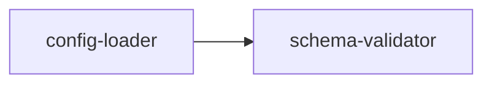

# Level 1 — Modules

> This folder is the reference implementations of MAM Level 1: self-contained,
> production-grade capability units. Everything here follows the complete
> component set defined in
> [full-mam.md](https://github.com/tcp-ecosystems/MAM/blob/main/plan-doc/full-mam.md)
> — every section is real: real inputs, real logic, real tests, no placeholders,
> no toy pipelines, no commented-out demo code.

A Level 1 module answers one question and answers it completely:

> **What does this unit do, what are the exact rules it follows, and how do you
> know it works?**

---

## 1. What belongs at this level

| In scope (Level 1) | Not at this level |
|--------------------|-------------------|
| Pure capability units — validation, policy decisions, rate limiting, log emission, config resolution | Long-running processes (→ [Level 4 — Services](../04-services/README.md)) |
| Stateless or ephemeral state passed through the call | Persistent state across restarts (→ [Level 2 — Components](../02-components/README.md)) |
| One `run()` entry point returning a structured envelope | Multi-step orchestration (→ [Level 3 — Workflows](../03-workflows/README.md)) |
| Phase composition inside a single process | Whole-repository composition (→ [Level 5 — Systems](../05-systems/README.md)) |

---

## 2. The structural contract (from full-mam.md)

Every `.mam.md` in this folder carries **all** of the following components, and
each one is load-bearing — if a section could be deleted without losing
information, the module does not belong here:

| Component | Requirement at Level 1 |
|-----------|------------------------|
| **Metadata** (§3) | Complete identity: `id`, `name`, `version`, `type`, `author`, `description`, `license`, `runtime`, `tags`, `capabilities`, `permissions`, `dependencies`. Frontmatter ≤ 50 lines. |
| **Purpose** (§5) | What responsibility this unit owns, and explicitly what it does *not* do. |
| **Inputs / Outputs** (§6–7) | Markdown tables with name, type, required flag, and semantics. No "any" types without justification. |
| **Capabilities** (§8) | One `### <name>` subsection per capability; must match the frontmatter `capabilities` list exactly. |
| **Rules** (§9) | Declared behavioral constraints — ordering guarantees, failure behavior, envelopes. Implementation must be checkable against these. |
| **Permissions** (§10) | Concrete, minimal, declared in frontmatter. A Level 1 module that needs internet to validate a string is wrong. |
| **Dependencies** (§11) | Only real cross-module dependencies, with version constraints. Stdlib does not need declaring. |
| **Workflow** (§12–13) | Mermaid `flowchart` that mirrors the code — the diagram and the Python must tell the same story. |
| **Python** (§14) | A real `run()` entry point returning a **structured envelope**: `status`/`valid`, `code`, payload, `duration_ms`. Pure-stdlib so any host executes it. |
| **Tests** (§15) | A `### Input` YAML fixture, a `### Expected` YAML fixture, and pytest-style functions covering the envelope contract, every error code, and the edge cases in the Rules section. |
| **Examples** (§16) | Real invocations with real output — not `print("hello")`. |
| **References** (§17) | Spec links and the modules this one composes from. |

Conformance level: **`standard`** per [SPEC §9](https://github.com/tcp-ecosystems/MAM/blob/main/spec/SPEC.md)
\- every standard section present, validation passes with zero errors.

---

## 3. The reference modules

| Module | Capability | Composes |
|--------|------------|----------|
| [`schema-validator`](schema-validator.mam.md) | Structural validation of values against a schema, with stable error codes and paths | — |
| [`retry-policy`](retry-policy.mam.md) | Retry/abort decisions: attempt budget, deadline, backoff with seeded jitter | — |
| [`rate-limiter`](rate-limiter.mam.md) | Token-bucket admission with injectable clock and wait math | — |
| [`structured-logging`](structured-logging.mam.md) | JSON-line event records with recursive secret redaction | — |
| [`config-loader`](config-loader.mam.md) | Layered config resolution (defaults < file < env) validated by schema | `schema-validator` |

Dependency graph — all five are leaf-level except `config-loader`:



Why these five first: they are the cross-cutting primitives every Level 2+ unit
in this library reuses (components need config + logging; workflows need retry
+ rate limiting; services need all five). They are defined once here so every
higher level composes instead of re-inventing.

---

## 4. Using these modules

```bash
# Validate every file in this folder (and every folder in this repo)
mam validate .

# Structural test run against one module
mam test 01-modules/schema-validator.mam.md

# Execute a module natively through the MAM runtime
mam run 01-modules/retry-policy.mam.md --inputs '{"attempt": 2, "category": "timeout"}'

# Inspect what the parser actually sees (the machine layer of full-mam.md §2)
mam ast 01-modules/config-loader.mam.md
```

Notes on the envelope: every module returns the same discipline —

```text
{ ..., "status"|"valid"|"allowed" : <verdict>, "code": <stable error code or "">, "duration_ms": <timing> }
```

Callers branch on `status`/`code`, never on prose. Every error code is declared
in the module's Rules or Inputs tables and covered by at least one test.

---

## 5. Acceptance gate (what `mam validate` + review enforce before a module is listed)

- [ ] Frontmatter has every identity field; `capabilities` match `### Capability` headings 1:1
- [ ] `## Inputs` and `## Outputs` are tables — every parameter of `run()` documented
- [ ] Mermaid workflow and the Python control flow agree (step names correspond)
- [ ] Python is stdlib-only at Level 1, or depends only on modules listed in `dependencies`
- [ ] `run()` never raises to the caller — failures come back in the envelope with a stable `code`
- [ ] Every declared error code appears in the `## Tests` section at least once
- [ ] `### Input` / `### Expected` YAML fixtures reflect a scenario, not `x: 1`
- [ ] `mam validate <file>` → 0 errors; `mam test <file>` → all cases pass
- [ ] Twins shipped: `module.mam.md` + `module.mam` (identical content)
- [ ] No placeholder text: no `TODO`, no `pass  # implement`, no `"..."`

---

## 6. Writing a new Level 1 module

1. Scaffold the skeleton (then replace *everything* with real content):
   `mam new module <name>`
2. Fill the contract from §2 top to bottom — write the envelope discipline and
   error taxonomy *first*; the Python is the last section you finish.
3. Prove it: `mam validate`, `mam test`, and execute the Tests Python outside
   the doc if you want the strongest guarantee (the CI harness in MAM's repo
   does exactly that).
4. Ship it: `mam publish --targets <id>` to the Hub, then open the awesome-mam
   PR with the module row (see the [root README](../README.md#contribute)).
