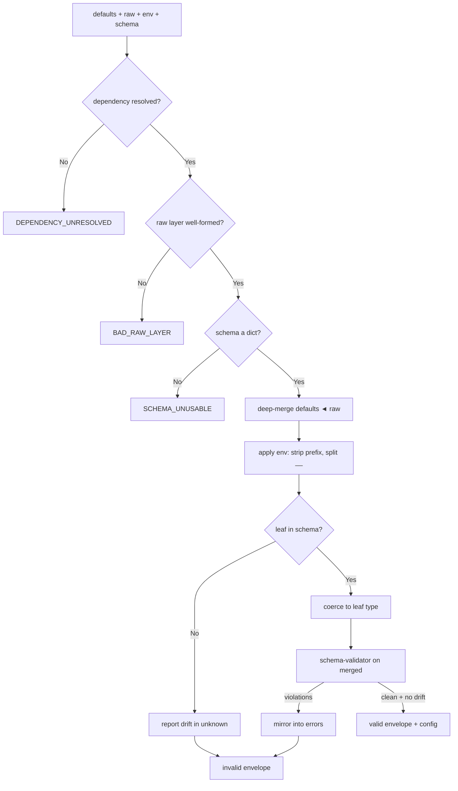

---
# MAM Metadata
id: config-loader
name: Config Loader
version: 1.0.0
type: module

author: TCP Ecosystems
description: >
  Layered runtime configuration: deep-merges defaults, a file layer and
  environment overrides, coerces environment strings to the schema's types,
  surfaces config drift (unknown keys) separately from violations, and hands
  the merged result to schema-validator for the final structural check.
  The composing example of Level 1's cross-module dependency rule.

license: MIT

runtime:
  language: python
  version: ">=3.12"

tags:
  - configuration
  - composition
  - validation
  - environment
  - bootstrap

dependencies:
  - name: schema-validator
    version: ">=1.0.0"
  - name: mam-runtime
    version: ">=1.0.0"

capabilities:
  - resolve
  - coerce
  - gate

permissions:
  filesystem: read
  network: none
  environment: read
---

# Config Loader

## Purpose

Produces one validated configuration object from the three layers every
production process needs — packaged defaults, a checked-in file layer, and
environment overrides — and refuses to hand the caller a configuration that
has not passed the schema check. Environment strings are coerced to the exact
type the schema declares at that path (`CFG_POOL__SIZE=16` becomes integer
`16`), so a config that looks like a number but is typed as text cannot slip
through.

It is also this library's standing example of the Level 1 dependency rule:
it does not re-implement validation — `schema-validator` does that, and the
`DEPENDENCY_UNRESOLVED` envelope proves the wiring is explicit, never silent.

It does **not** read the filesystem or `os.environ` itself; the caller passes
both layers in. That keeps the module hermetic: tests inject dictionaries,
hosts inject `json.load()` and `dict(os.environ)`.

## Inputs

| Name | Type | Required | Description |
|------|------|----------|-------------|
| raw | object or None | Yes | File-layer mapping (a JSON/YAML document as dict); `None` means no file layer |
| schema | object | Yes | Config schema in schema-validator grammar |
| defaults | object | No | Lowest-priority layer. Defaults to `{}` |
| env | object | No | Environment mapping. Defaults to `{}` |
| prefix | string | No | Env key prefix. Defaults to `CFG_` |

### Env-key grammar

```text
CFG_<NAME>            → top-level key  `name`   (lower-cased)
CFG_<A>__<B>          → nested path    a.b
CFG_<A>__<B>__<C>     → nested path    a.b.c
```

Values are coerced by the declared leaf type: `boolean` accepts
`true/false/1/0/yes/no`; `integer` and `number` parse digits; `string` passes
through; keys whose path resolves to an object or maps to nothing in the
schema are reported as drift in `unknown`, never applied.

## Outputs

| Name | Type | Description |
|------|------|-------------|
| valid | boolean | `true` when the merged config passed schema validation with zero drift |
| config | object or None | The merged configuration; `None` while unresolved or invalid |
| errors | array | Structural violations mirrored from schema-validator (`path`, `code`, `expected`, `actual`) |
| unknown | array | Drift report: keys present in raw/env but absent from the schema |
| code | string | `""` on a completed run; `DEPENDENCY_UNRESOLVED`, `BAD_RAW_LAYER`, `SCHEMA_UNUSABLE` otherwise |
| duration_ms | number | Wall-clock time including the schema-validator pass |

### Error codes

| Code | Meaning |
|------|---------|
| `DEPENDENCY_UNRESOLVED` | `schema-validator` was not provided by the runtime's dependency resolution |
| `BAD_RAW_LAYER` | `raw` is neither `None` nor a dict |
| `SCHEMA_UNUSABLE` | `schema` is not a dict |
| `INVALID_ENV_VALUE` | An env value failed coercion to the declared leaf type (mirrored into `errors`) |

## Capabilities

### resolve

Deep-merge `defaults ◄ raw ◄ env` — nested mappings union, scalars from the
higher layer win, lists replace whole.

### coerce

Translate environment strings into the schema-declared leaf type, per path.

### gate

Run the merged object through `schema-validator` and refuse to return a
configuration that has any violation or any drift key.

## Rules

- The module never mutates `defaults`, `raw`, or `env`.
- Precedence is strictly `defaults < raw < env`; lower layers can never override a present higher layer.
- Drift (unknown keys) never crashes the run and never modifies the merge — it is reported in `unknown` with the source layer it came from.
- `config` is returned only in the `valid` envelope; callers cannot receive a partially validated object.
- Validator violations mirrored with `path` and `code` untouched; drift reported only in `unknown`.
- The schema is trusted to be a dict and its `properties` consulted per path; a malformed schema surfaces as `SCHEMA_UNUSABLE` — never a raise.
- The dependency on `schema-validator` is honored through runtime resolution; if it is absent the caller gets `DEPENDENCY_UNRESOLVED`, never a NameError.

## Workflow



## Python

```python
import time
from typing import Any, Dict, List, Optional, Tuple

try:
    from schema_validator import run as validate_value  # runtime dependency resolution
except ImportError:
    validate_value = None

_TRUTHY = frozenset({"1", "true", "yes", "on"})
_FALSY = frozenset({"0", "false", "no", "off"})


def _merge(base: Any, override: Any) -> Dict[str, Any]:
    out = dict(base) if isinstance(base, dict) else {}
    if isinstance(override, dict):
        for key, value in override.items():
            if isinstance(value, dict) and isinstance(out.get(key), dict):
                out[key] = _merge(out[key], value)
            elif isinstance(value, dict):
                out[key] = _merge(value, {})      # deep copy: callers keep their layers
            elif isinstance(value, list):
                out[key] = list(value)
            else:
                out[key] = value
    return out


def _leaf(schema: Any, segments: List[str]) -> Optional[Tuple[str, Dict[str, Any]]]:
    """Resolve the schema node at segments; ('object-trail', node) when the
    path stops on an object, ('scalar', node) for a coercable leaf."""
    node = schema
    for index, segment in enumerate(segments):
        if not isinstance(node, dict):
            return None
        if node.get("type") == "object":
            node = node.get("properties", {}).get(segment)
            if node is None:
                return None
            continue
        if node.get("type") == "array":
            return None
        return ("scalar", node) if index == len(segments) - 1 else None
    if isinstance(node, dict) and node.get("type") == "object":
        return ("object-trail", node)
    return ("scalar", node) if node is not None else None


def _coerce(text: str, leaf: Dict[str, Any]) -> Tuple[bool, Any]:
    token = leaf.get("type")
    if token == "boolean":
        lowered = text.strip().lower()
        if lowered in _TRUTHY:
            return True, True
        if lowered in _FALSY:
            return True, False
        return False, text
    if token == "integer":
        try:
            return True, int(text.strip())
        except ValueError:
            return False, text
    if token == "number":
        try:
            return True, float(text.strip())
        except ValueError:
            return False, text
    if token == "string":
        return True, text
    return False, text


def run(raw: Any, schema: Any, defaults: Optional[Dict[str, Any]] = None,
        env: Optional[Dict[str, Any]] = None, prefix: str = "CFG_") -> Dict[str, Any]:
    started = time.perf_counter()

    def envelope(valid: bool, config: Optional[Dict[str, Any]], errors: List[Dict[str, Any]],
                 unknown: List[Dict[str, Any]], code: str = "") -> Dict[str, Any]:
        return {"valid": valid, "config": config, "errors": errors, "unknown": unknown,
                "code": code, "duration_ms": round((time.perf_counter() - started) * 1000, 3)}

    if validate_value is None:
        return envelope(False, None, [], [], code="DEPENDENCY_UNRESOLVED")
    if raw is not None and not isinstance(raw, dict):
        return envelope(False, None, [], [], code="BAD_RAW_LAYER")
    if not isinstance(schema, dict):
        return envelope(False, None, [], [], code="SCHEMA_UNUSABLE")

    defaults = defaults or {}
    env = env or {}
    errors: List[Dict[str, Any]] = []
    unknown: List[Dict[str, Any]] = []

    merged = _merge(defaults, raw)

    for key, value in (raw or {}).items():
        if isinstance(value, dict):
            for sub in value:
                if _leaf(schema, [str(key).lower(), str(sub)]) is None:
                    unknown.append({"path": f"{key}.{sub}", "layer": "raw"})
        elif _leaf(schema, [str(key).lower()]) is None:
            unknown.append({"path": str(key), "layer": "raw"})

    for key, text in env.items():
        if not key.startswith(prefix):
            continue
        segments = key[len(prefix):].lower().split("__")
        resolved = _leaf(schema, segments)
        if resolved is None or resolved[0] != "scalar":
            unknown.append({"path": ".".join(segments).lower(), "layer": "env"})
            continue
        target = resolved[1]
        ok, coerced = _coerce(str(text), target)
        if not ok:
            errors.append({"path": ".".join(segments), "code": "INVALID_ENV_VALUE",
                           "expected": target.get("type"), "actual": str(text)[:60]})
            continue
        cursor = merged
        for segment in segments[:-1]:
            node = cursor.setdefault(segment, {})
            if not isinstance(node, dict):
                node = cursor[segment] = {}
            cursor = node
        cursor[segments[-1]] = coerced

    drifted = {entry["path"] for entry in unknown}
    verdict = validate_value(merged, schema)
    for error in verdict["errors"]:
        if error["code"] == "UNEXPECTED_PROPERTY":
            if error["path"] not in drifted:      # one drift report, not two
                unknown.append({"path": error["path"], "layer": "merged"})
        else:
            errors.append(dict(error))

    if errors or unknown:
        return envelope(False, None, errors, unknown)
    return envelope(True, merged, [], [])
```

## Tests

### Input

```yaml
defaults:
  retries: 3
  debug: false
  pool:
    size: 8
raw:
  dsn: postgres://db.prod.internal:5432/orders
env:
  CFG_POOL__SIZE: "16"
```

### Expected

```yaml
valid: true
```

```python
CONFIG_SCHEMA = {
    "type": "object",
    "required": ["dsn", "pool"],
    "properties": {
        "dsn": {"type": "string", "pattern": r"postgres://[a-z0-9.:\-]+/\w+"},
        "retries": {"type": "integer", "minimum": 0, "maximum": 20},
        "debug": {"type": "boolean"},
        "batch_url": {"type": "string", "pattern": r"https://[a-z0-9.\-]+(?:/\w+)+"},
        "pool": {"type": "object", "required": ["size"],
                 "properties": {"size": {"type": "integer", "minimum": 1, "maximum": 512}}},
    },
}
DEFAULTS = {"retries": 3, "debug": False, "pool": {"size": 8}}
RAW = {"dsn": "postgres://db.prod.internal:5432/orders",
       "batch_url": "https://api.internal.example.com/v1/batch", "pool": {"size": 4}}
ENV = {"CFG_RETRIES": "10", "CFG_POOL__SIZE": "16", "CFG_DEBUG": "1"}


def test_layers_merge_strictly_low_to_high():
    out = run(RAW, CONFIG_SCHEMA, DEFAULTS)
    assert out["valid"] is True and out["code"] == ""
    assert out["config"]["retries"] == 3          # defaults survive
    assert out["config"]["pool"]["size"] == 4     # raw overrides defaults
    assert out["config"]["batch_url"].endswith("/v1/batch")


def test_env_layer_wins_and_coerces_by_leaf_type():
    out = run(RAW, CONFIG_SCHEMA, DEFAULTS, env=ENV)
    assert out["valid"] is True
    c = out["config"]
    assert c["retries"] == 10 and isinstance(c["retries"], int)   # "10" -> int
    assert c["pool"]["size"] == 16                                # env beats raw
    assert c["debug"] is True                                     # "1" -> True


def test_boolean_coercion_is_exact():
    for text, expected in ("yes", True), ("no", False), ("0", False), ("off", False):
        out = run(RAW, CONFIG_SCHEMA, DEFAULTS, env={"CFG_DEBUG": text})
        assert out["config"]["debug"] is expected, text


def test_env_creates_nested_paths_when_absent():
    raw = dict(RAW, pool={"size": 4})
    del raw["pool"]
    out = run(raw, CONFIG_SCHEMA, DEFAULTS, env={"CFG_POOL__SIZE": "32"})
    assert out["valid"] is True and out["config"]["pool"]["size"] == 32


def test_drift_is_reported_not_crashed():
    out = run(dict(RAW, stale_region="eu"), CONFIG_SCHEMA, DEFAULTS)
    assert out["valid"] is False
    assert out["config"] is None
    assert out["unknown"] == [{"path": "stale_region", "layer": "raw"}]


def test_unknown_env_key_is_drift():
    out = run(RAW, CONFIG_SCHEMA, DEFAULTS, env={"CFG_GHOST_MODE": "true"})
    assert out["unknown"] == [{"path": "ghost_mode", "layer": "env"}]


def test_missing_required_mirrors_from_validator():
    out = run({}, CONFIG_SCHEMA, DEFAULTS)
    codes = [e["code"] for e in out["errors"]]
    assert "MISSING_REQUIRED" in codes
    assert any(e["path"] == "dsn" for e in out["errors"])


def test_violations_mirror_validator_codes():
    bare = {"retries": 3, "debug": False}   # no pool: forces MISSING_REQUIRED too
    out = run({"dsn": "not-a-postgres-url"}, CONFIG_SCHEMA, bare, env={"CFG_RETRIES": "many"})
    codes = sorted(e["code"] for e in out["errors"])
    assert codes == ["INVALID_ENV_VALUE", "MISSING_REQUIRED", "PATTERN_MISMATCH"]


def test_missing_dependency_is_a_clean_envelope():
    saved = validate_value
    try:
        globals()["validate_value"] = None
        out = run(RAW, CONFIG_SCHEMA, DEFAULTS)
        assert out["code"] == "DEPENDENCY_UNRESOLVED" and out["config"] is None
    finally:
        globals()["validate_value"] = saved


def test_bad_layers_are_coded_never_raised():
    assert run("yaml-from-1998", CONFIG_SCHEMA)["code"] == "BAD_RAW_LAYER"
    assert run(RAW, "no-schema")["code"] == "SCHEMA_UNUSABLE"


def test_inputs_never_mutated():
    raw_snapshot = {"dsn": "postgres://db.prod.internal:5432/orders", "pool": {"size": 4}}
    run(raw_snapshot, CONFIG_SCHEMA, DEFAULTS, env=ENV)
    assert raw_snapshot == {"dsn": "postgres://db.prod.internal:5432/orders", "pool": {"size": 4}}
```

## Examples

```python
import json, os

layered = run(
    raw=json.load(open("config/production.json")),
    schema=CONFIG_SCHEMA,
    defaults={"retries": 3, "pool": {"size": 8}},
    env={k: v for k, v in os.environ.items() if k.startswith("CFG_")},
)
if not layered["valid"]:
    raise SystemExit(f"config rejected: {layered['errors']} drift={layered['unknown']}")
merge_into_deployment(layered["config"])
```

### Expected Flow

```text
dependency check -> layer merge -> env coercion -> drift scan -> schema gate
```

## References

- [MAM source format, full component set](https://github.com/tcp-ecosystems/MAM/blob/main/plan-doc/full-mam.md) §3–§17 (this module exercises §11 cross-module dependencies end to end)
- Depends on: [`schema-validator`](schema-validator.mam.md) — the structural gate
