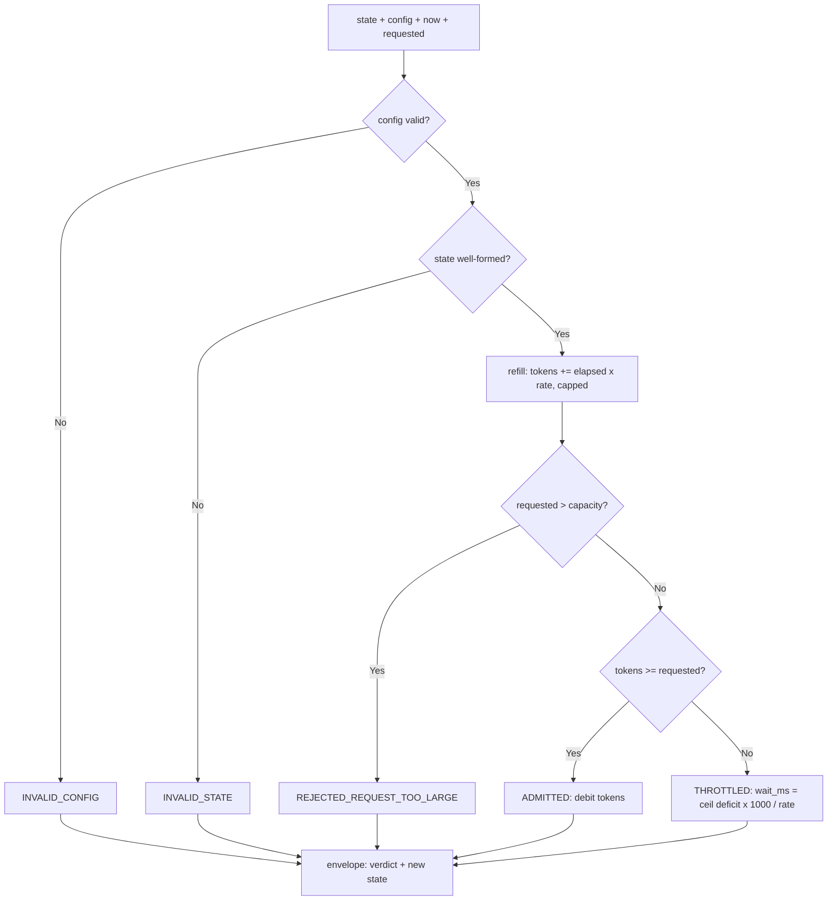

---
# MAM Metadata
id: rate-limiter
name: Rate Limiter
version: 1.0.0
type: module

author: TCP Ecosystems
description: >
  Token-bucket admission control as a pure state-transition function. Given
  bucket state, a capacity/refill policy, a clock reading, and a requested
  amount, it returns an admit-or-throttle verdict, the precise wait in
  milliseconds, and the bucket state to pass through on the next call.

license: MIT

runtime:
  language: python
  version: ">=3.12"

tags:
  - pacing
  - throughput
  - admission
  - resilience
  - fairness

dependencies:
  - name: mam-runtime
    version: ">=1.0.0"

capabilities:
  - admit
  - refill
  - bound

permissions:
  filesystem: none
  network: none
---

# Rate Limiter

## Purpose

Implements the token-bucket algorithm with the timer removed: instead of a
background thread, the bucket is refilled arithmetically from an injectable
clock reading on every call. Any host — a service, a workflow step, a test —
drives it with `now_ms` and keeps full control of time, which makes the
limiter's behavior exactly reproducible under test and free of hidden threads.

It does **not** hold state between calls and does **not** perform I/O. The
caller persists the returned `state` and passes it back on the next call;
requests that share one bucket must serialize access to that state.

## Inputs

| Name | Type | Required | Description |
|------|------|----------|-------------|
| state | object | Yes | Bucket state — see contract below |
| config | object | Yes | Bucket policy: `capacity`, `refill_per_second` |
| now_ms | number | Yes | Caller's clock reading in milliseconds (monotonic within one bucket) |
| requested | number | No | Tokens this call wants. Defaults to `1` |

### State contract

```text
state = { "tokens": number, "last_refill_ms": number }
```

The caller copies the value returned from the previous `run` — the module is
stateless by design; the envelope's `state` field is its persistence handle.

### Config contract

```text
config = { "capacity": number >= 1, "refill_per_second": number >= 0.001 }
```

Refill is continuous up to `capacity`; anything above `capacity` is discarded,
so a caller that waits forever never accumulates more burst than promised.

## Outputs

| Name | Type | Description |
|------|------|-------------|
| allowed | boolean | Whether the call is admitted now |
| code | string | Decision code, `""` never occurs — every verdict is coded |
| tokens_before / tokens_after | number | Bucket level after refill, before the debit decision / level persisted after the decision |
| wait_ms | integer | Milliseconds until `requested` tokens are available; `0` when admitted |
| state | object | New bucket state to persist (`{"tokens", "last_refill_ms"}`) |
| duration_ms | number | Wall-clock time spent in `run` |

### Decision codes

| Code | Meaning |
|------|---------|
| `ADMITTED` | Tokens taken; `wait_ms` is 0 |
| `THROTTLED` | Not enough tokens; wait `wait_ms` and the request becomes grantable |
| `REJECTED_REQUEST_TOO_LARGE` | `requested` exceeds `capacity` — ungrantable at any wait |
| `INVALID_CONFIG` | Missing/out-of-domain `capacity` or `refill_per_second` |
| `INVALID_STATE` | Malformed bucket state (missing keys, negative tokens) |
| `INVALID_INPUT` | Out-of-domain `now_ms` or `requested` (e.g. `requested <= 0`) |

## Capabilities

### admit

Grant a request only if the continuous refill has restored enough tokens.

### refill

Reconstruct the bucket level arithmetically from `(now_ms - last_refill_ms)` —
no timers, no background threads.

### bound

Enforce the burst ceiling (`capacity`) on refills and reject requests that are
physically ungrantable instead of admitting fractional approximations.

## Rules

- The module is stateless: bucket state crosses the call boundary through the `state` field.
- Clock readings never rewind the bucket: `now_ms` earlier than `last_refill_ms` refills nothing.
- Refill grants at most `capacity` tokens; excess time is never banked.
- A request above `capacity` is rejected outright — it can never be granted, so no wait is promised.
- The admitted atomically decrements under a single serialization discipline: one bucket, one caller thread.
- On error codes the returned `state` echoes the input unchanged, so a caller can retry the call.
- The returned `state` keeps full precision (`tokens` may be fractional); `wait_ms` rounds up to keep promises conservative.

## Workflow



## Python

```python
import math
import time
from typing import Any, Dict, Tuple

MIN_REFILL = 0.001  # tokens per second; below this a deny is also expected


def _check(config: Any, state: Any) -> Tuple[bool, str]:
    if not isinstance(config, dict):
        return False, "config"
    capacity = config.get("capacity")
    refill = config.get("refill_per_second")
    if isinstance(capacity, bool) or not isinstance(capacity, (int, float)) or capacity < 1:
        return False, "config.capacity"
    if isinstance(refill, bool) or not isinstance(refill, (int, float)) or refill < MIN_REFILL:
        return False, "config.refill_per_second"
    if not isinstance(state, dict):
        return False, "state"
    tokens, last = state.get("tokens"), state.get("last_refill_ms")
    if isinstance(tokens, bool) or not isinstance(tokens, (int, float)) or tokens < 0:
        return False, "state.tokens"
    if isinstance(last, bool) or not isinstance(last, (int, float)) or last < 0:
        return False, "state.last_refill_ms"
    return True, ""


def run(state: Any, config: Any, now_ms: Any, requested: Any = 1) -> Dict[str, Any]:
    started = time.perf_counter()
    ok, field = _check(config, state)
    if not ok:
        return {"allowed": False, "code": "INVALID_" + field.upper().split('.')[0],
                "detail": f"{field} is outside its declared domain",
                "tokens_before": None, "tokens_after": None, "wait_ms": 0,
                "state": state if isinstance(state, dict) else None,
                "duration_ms": round((time.perf_counter() - started) * 1000, 3)}

    capacity = float(config["capacity"])
    refill = float(config["refill_per_second"])
    if isinstance(now_ms, bool) or not isinstance(now_ms, (int, float)) or now_ms < 0:
        return {"allowed": False, "code": "INVALID_INPUT",
                "detail": "now_ms must be a non-negative number",
                "tokens_before": None, "tokens_after": None, "wait_ms": 0,
                "state": state,
                "duration_ms": round((time.perf_counter() - started) * 1000, 3)}
    if isinstance(requested, bool) or not isinstance(requested, (int, float)) or requested <= 0:
        return {"allowed": False, "code": "INVALID_INPUT",
                "detail": "requested must be a positive number",
                "tokens_before": None, "tokens_after": None, "wait_ms": 0,
                "state": state,
                "duration_ms": round((time.perf_counter() - started) * 1000, 3)}

    tokens_before = float(state["tokens"])
    elapsed_seconds = max(0, (now_ms - state["last_refill_ms"])) / 1000
    tokens = min(capacity, tokens_before + elapsed_seconds * refill)
    tokens_before = tokens  # refill first: the caller sees the post-refill level
    tokens_after = tokens

    if requested > capacity:
        return {"allowed": False, "code": "REJECTED_REQUEST_TOO_LARGE",
                "detail": f"{requested} tokens can never be granted by a bucket of {capacity}",
                "tokens_before": tokens_before, "tokens_after": tokens_after,
                "wait_ms": 0, "state": {"tokens": tokens, "last_refill_ms": now_ms},
                "duration_ms": round((time.perf_counter() - started) * 1000, 3)}

    if tokens >= requested:
        tokens_after = tokens - requested
        return {"allowed": True, "code": "ADMITTED",
                "detail": f"{requested} of {tokens} tokens granted",
                "tokens_before": tokens_before, "tokens_after": tokens_after,
                "wait_ms": 0, "state": {"tokens": tokens_after, "last_refill_ms": now_ms},
                "duration_ms": round((time.perf_counter() - started) * 1000, 3)}

    deficit = requested - tokens
    wait_ms = int(math.ceil(deficit * 1000 / refill))
    wait_ms = min(wait_ms, 2_147_483_647)  # keep the promise inside a 32-bit int
    return {"allowed": False, "code": "THROTTLED",
            "detail": f"deficit of {round(deficit, 4)} tokens clears in {wait_ms} ms",
            "tokens_before": tokens_before, "tokens_after": tokens_after,
            "wait_ms": wait_ms, "state": {"tokens": tokens, "last_refill_ms": now_ms},
            "duration_ms": round((time.perf_counter() - started) * 1000, 3)}
```

## Tests

### Input

```yaml
state:
  tokens: 10
  last_refill_ms: 0
config:
  capacity: 10
  refill_per_second: 2
now_ms: 0
requested: 3
```

### Expected

```yaml
allowed: true
code: ADMITTED
tokens_after: 7
```

```python
FULL = {"tokens": 10.0, "last_refill_ms": 0}
CONF = {"capacity": 10, "refill_per_second": 2}


def test_fresh_full_bucket_admits_a_burst():
    out = run(FULL, CONF, 0, 3)
    assert out["allowed"] is True and out["code"] == "ADMITTED"
    assert abs(out["tokens_after"] - 7.0) < 1e-9
    assert out["wait_ms"] == 0


def test_drained_bucket_throttles_with_exact_wait():
    out = run({"tokens": 0.0, "last_refill_ms": 0}, CONF, 0, 1)
    assert out["allowed"] is False and out["code"] == "THROTTLED"
    assert out["wait_ms"] == 500  # one token at 2 tokens/second


def test_refill_restores_continuously_from_state():
    drained = run({"tokens": 0.0, "last_refill_ms": 0}, CONF, 0, 1)
    later = run(drained["state"], CONF, 500, 1)  # 500 ms -> exactly one token
    assert later["allowed"] is True and later["code"] == "ADMITTED"


def test_refill_never_exceeds_capacity():
    out = run({"tokens": 0.0, "last_refill_ms": 0}, CONF, 60_000, 1)
    assert out["allowed"] is True
    assert abs(out["tokens_after"] - 9.0) < 1e-9  # full bucket minus the debit


def test_request_above_capacity_is_rejected_not_waitlisted():
    out = run(FULL, CONF, 0, 11)
    assert out["allowed"] is False
    assert out["code"] == "REJECTED_REQUEST_TOO_LARGE"
    assert out["wait_ms"] == 0


def test_clock_never_rewinds_the_bucket():
    out = run({"tokens": 0.5, "last_refill_ms": 1_000}, CONF, 999, 1)
    assert out["allowed"] is False and out["code"] == "THROTTLED"
    assert out["tokens_before"] == 0.5      # elapsed clamped to zero: no refill, no rewind


def test_state_is_the_persistence_handle():
    a = run(FULL, CONF, 0, 3)
    b = run(a["state"], CONF, 0, 3)
    assert abs(b["tokens_after"] - 4.0) < 1e-9


def test_error_codes_return_untouched_state():
    broken_state = {"last_refill_ms": 0}
    out = run(broken_state, CONF, 0, 1)
    assert out["code"] == "INVALID_STATE" and out["state"] is broken_state
    assert run(FULL, {"capacity": 0, "refill_per_second": 2}, 0)["code"] == "INVALID_CONFIG"
    assert run(FULL, {"capacity": 10, "refill_per_second": 0}, 0)["code"] == "INVALID_CONFIG"


def test_fractional_requests_are_granted():
    out = run(FULL, CONF, 0, 0.5)
    assert out["allowed"] is True and abs(out["tokens_after"] - 9.5) < 1e-9


def test_throttle_wait_is_never_underpromised():
    out = run({"tokens": 0.25, "last_refill_ms": 0}, CONF, 0, 1)
    # deficit 0.75 at 2 tokens/second = 375 ms exactly
    assert out["wait_ms"] == 375
```

## Examples

```python
# A caller paces a scraper at 5 requests/second with a burst ceiling of 3
bucket, policy = {"tokens": 3.0, "last_refill_ms": 0}, {"capacity": 3, "refill_per_second": 5}

run(bucket, policy, 0, 1)      # ADMITTED, state -> {"tokens": 2.0, "last_refill_ms": 0}
run(bucket, policy, 0, 1)      # ADMITTED
run(bucket, policy, 0, 1)      # ADMITTED -> tokens 0.0
run(bucket, policy, 0, 1)      # THROTTLED, wait_ms 200 → retry at now_ms=200
```

### Expected Flow

```text
validate -> continuous refill -> ceiling/budget check -> debit or promise wait
```

## References

- [MAM source format, full component set](https://github.com/tcp-ecosystems/MAM/blob/main/plan-doc/full-mam.md) §6–§15
- Pairs with [`retry-policy`](retry-policy.mam.md) — throttled calls feed `RATE_LIMITED` into the retry decision
