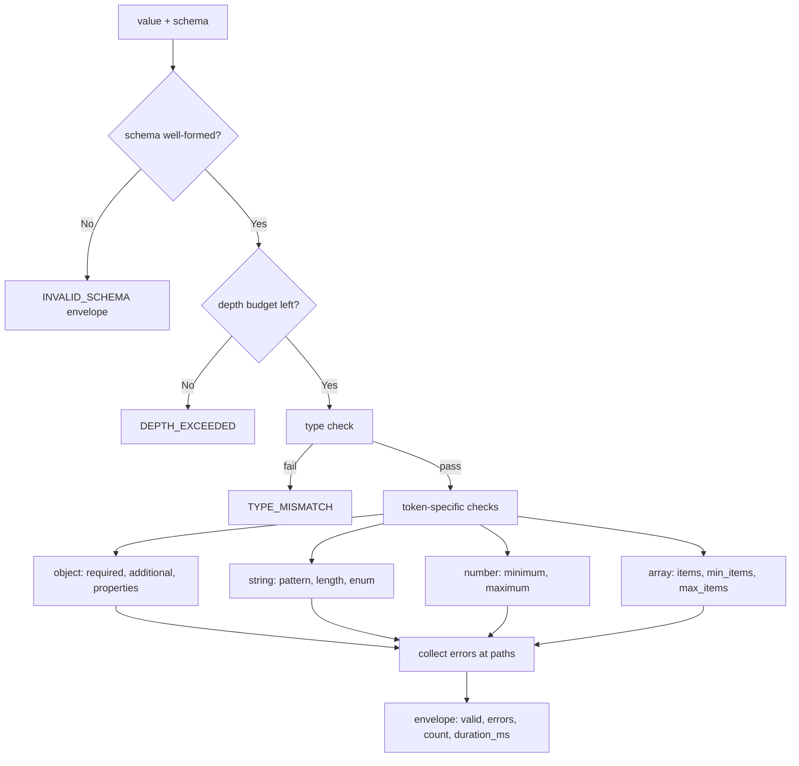

---
# MAM Metadata
id: schema-validator
name: Schema Validator
version: 1.0.0
type: module

author: TCP Ecosystems
description: >
  Structural validation of any value against a declarative schema, with stable
  error codes, dotted paths to the exact violation, and a bounded recursion
  depth. The validation primitive every other module in this library builds on.

license: MIT

runtime:
  language: python
  version: ">=3.12"

tags:
  - validation
  - schema
  - integrity
  - errors

dependencies:
  - name: mam-runtime
    version: ">=1.0.0"

capabilities:
  - validate
  - classify
  - bound

permissions:
  filesystem: none
  network: none
---

# Schema Validator

## Purpose

Checks a runtime value against a declarative schema and returns every violation
at once — not just the first one — each with a stable machine-readable code and
a dotted path (`billing.amount_cents`, `tags[2]`) pointing at the exact
offender. This is the validation primitive used by `config-loader` and, at
higher levels, by every component boundary and workflow step in this library.

It does **not** coerce types, apply defaults, or mutate the input. Deciding what
to do about a violation belongs to the caller.

## Inputs

| Name | Type | Required | Description |
|------|------|----------|-------------|
| value | any | Yes | The runtime value to check (dict, list, str, number, boolean, None, …) |
| schema | object | Yes | Schema spec, see grammar below |
| path | string | No | Base path for error paths. Defaults to `""` |
| max_depth | integer | No | Schema-recursion budget. Defaults to `32` |

### Schema grammar

```text
type token: object | string | integer | number | boolean | array | null

object:  {type: object, properties: {<key>: schema}, required?: [keys],
          additional?: bool (default true)}
string:  {type: string, pattern?: regex, min_length?: int, max_length?: int, enum?: [..]}
integer: {type: integer, minimum?: num, maximum?: num}
number:  {type: number, minimum?: num, maximum?: num}
boolean: {type: boolean}
array:   {type: array, items?: schema, min_items?: int, max_items?: int}
null:    {type: null}
```

Boolean values are **not** integers (a classic Python foot-gun this module
refuses to inherit).

## Outputs

| Name | Type | Description |
|------|------|-------------|
| valid | boolean | `true` when zero violations were collected |
| errors | array | All violations; each has `path`, `code`, `expected`, `actual`, `detail` |
| count | integer | Number of violations (`len(errors)`) |
| duration_ms | number | Wall-clock time spent in `run` |

### Error codes

| Code | Meaning |
|------|---------|
| `INVALID_SCHEMA` | The schema itself is not a dict or uses an unknown type token |
| `TYPE_MISMATCH` | Value's Python type does not match the declared type token |
| `MISSING_REQUIRED` | A required object key is absent |
| `UNEXPECTED_PROPERTY` | Key present under `additional: false` but not declared in `properties` |
| `PATTERN_MISMATCH` | String fails `re.fullmatch` against the declared pattern |
| `TOO_SHORT` / `TOO_LONG` | String length outside declared bounds |
| `OUT_OF_RANGE` | Number outside `minimum`/`maximum` (inclusive bounds) |
| `ENUM_VIOLATION` | Value not among the declared alternatives |
| `DEPTH_EXCEEDED` | Validation recursion exceeded `max_depth` |

Array-element violations are not a separate code: the element is validated
recursively, so it carries its own code (`TYPE_MISMATCH`, `OUT_OF_RANGE`, …)
at its indexed path (`tags[2].amount_cents`, `tags[0]`).

## Capabilities

### validate

Check a value against the schema recursively, collecting every violation, never
stopping at the first.

### classify

Attach a stable code to each violation so callers branch on data, not prose.

### bound

Refuse schemas deeper than `max_depth` instead of risking unbounded recursion
on adversarial input.

## Rules

- Validation never mutates `value` or `schema`.
- All violations are collected — an object with three bad fields yields three errors.
- The module never raises to the caller; a broken schema is an `INVALID_SCHEMA` envelope.
- Error paths are dotted for object keys and bracketed for array indices (`tags[2]`).
- Bounds are inclusive: `minimum: 0` accepts `0`.
- `enum` is checked only after the type check passes.
- Timing is the cost of validation alone, no fixture construction.

## Workflow



## Python

```python
import re
import time
from typing import Any, Dict, List

_TYPE_TOKENS = ("object", "string", "integer", "number", "boolean", "array", "null")


def _error(path: str, code: str, expected: str, actual: Any, detail: str = "") -> Dict[str, Any]:
    rendered = actual if isinstance(actual, str) else (
        "" if actual is None else repr(actual)[:120])
    return {
        "path": path or "(root)",
        "code": code,
        "expected": expected,
        "actual": rendered,
        "detail": detail,
    }


def _type_matches(value: Any, token: str) -> bool:
    if token == "object":
        return isinstance(value, dict)
    if token == "string":
        return isinstance(value, str)
    if token == "integer":
        return isinstance(value, int) and not isinstance(value, bool)
    if token == "number":
        return isinstance(value, (int, float)) and not isinstance(value, bool)
    if token == "boolean":
        return isinstance(value, bool)
    if token == "array":
        return isinstance(value, list)
    if token == "null":
        return value is None
    return False


def _check(value: Any, schema: Any, path: str, depth: int,
           max_depth: int, out: List[Dict[str, Any]]) -> None:
    if depth > max_depth:
        out.append(_error(path, "DEPTH_EXCEEDED", f"< {max_depth} levels", depth))
        return
    if not isinstance(schema, dict):
        out.append(_error(path or "(root)", "INVALID_SCHEMA", "dict schema", type(schema).__name__))
        return
    token = schema.get("type")
    if token not in _TYPE_TOKENS:
        out.append(_error(path, "INVALID_SCHEMA", f"type in {', '.join(_TYPE_TOKENS)}", token))
        return
    if not _type_matches(value, token):
        out.append(_error(path, "TYPE_MISMATCH", token, type(value).__name__))
        return
    if schema.get("enum") is not None and value not in schema["enum"]:
        out.append(_error(path, "ENUM_VIOLATION", repr(schema["enum"]), repr(value)[:60]))
        return

    if token == "object":
        props = schema.get("properties", {})
        for key in schema.get("required", []):
            if key not in value:
                out.append(_error(f"{path}.{key}" if path else key,
                                  "MISSING_REQUIRED", "required key present", "absent"))
        if schema.get("additional") is False:
            for key in value:
                if key not in props:
                    out.append(_error(f"{path}.{key}" if path else key,
                                      "UNEXPECTED_PROPERTY", "declared or additional=false", key))
        for key, sub in props.items():
            if key in value:
                inner = f"{path}.{key}" if path else key
                _check(value[key], sub, inner, depth + 1, max_depth, out)

    elif token == "string":
        pattern = schema.get("pattern")
        if pattern is not None and not re.fullmatch(pattern, value):
            out.append(_error(path, "PATTERN_MISMATCH", pattern, value[:60]))
        min_length, max_length = schema.get("min_length"), schema.get("max_length")
        if min_length is not None and len(value) < min_length:
            out.append(_error(path, "TOO_SHORT", f">= {min_length} chars", len(value)))
        if max_length is not None and len(value) > max_length:
            out.append(_error(path, "TOO_LONG", f"<= {max_length} chars", len(value)))

    elif token in ("integer", "number"):
        minimum, maximum = schema.get("minimum"), schema.get("maximum")
        if minimum is not None and value < minimum:
            out.append(_error(path, "OUT_OF_RANGE", f">= {minimum}", value))
        if maximum is not None and value > maximum:
            out.append(_error(path, "OUT_OF_RANGE", f"<= {maximum}", value))

    elif token == "array":
        min_items, max_items = schema.get("min_items"), schema.get("max_items")
        if min_items is not None and len(value) < min_items:
            out.append(_error(path, "TOO_SHORT", f">= {min_items} items", len(value)))
        if max_items is not None and len(value) > max_items:
            out.append(_error(path, "TOO_LONG", f"<= {max_items} items", len(value)))
        items = schema.get("items")
        if items is not None:
            for index, element in enumerate(value):
                _check(element, items, f"{path}[{index}]" if path else f"[{index}]",
                       depth + 1, max_depth, out)


def run(value: Any, schema: Any, path: str = "", max_depth: int = 32) -> Dict[str, Any]:
    started = time.perf_counter()
    collected: List[Dict[str, Any]] = []
    _check(value, schema, path, 0, max_depth, collected)
    return {
        "valid": not collected,
        "errors": collected,
        "count": len(collected),
        "duration_ms": round((time.perf_counter() - started) * 1000, 3),
    }
```

## Tests

### Input

```yaml
order:
  name: invoice-2026-10
  amount_cents: 12500
  currency: USD
```

### Expected

```yaml
valid: true
count: 0
```

```python
ORDER_SCHEMA = {
    "type": "object",
    "required": ["name", "amount_cents", "currency"],
    "additional": False,
    "properties": {
        "name": {"type": "string", "min_length": 3, "max_length": 64},
        "amount_cents": {"type": "integer", "minimum": 0, "maximum": 10_000_000},
        "currency": {"type": "string", "pattern": r"[A-Z]{3}"},
        "tags": {"type": "array", "items": {"type": "string"}, "max_items": 10},
    },
}


def test_valid_order_passes():
    out = run({"name": "invoice-2026-10", "amount_cents": 12500, "currency": "USD",
               "tags": ["bulk", "q4"]}, ORDER_SCHEMA)
    assert out["valid"] is True
    assert out["count"] == 0
    assert out["duration_ms"] >= 0


def test_all_violations_collected_not_just_first():
    out = run({"name": "", "amount_cents": "not-a-number", "currency": "usdx",
               "extra": 1}, ORDER_SCHEMA)
    codes = sorted(e["code"] for e in out["errors"])
    assert codes == ["PATTERN_MISMATCH", "TOO_SHORT", "TYPE_MISMATCH", "UNEXPECTED_PROPERTY"]
    assert out["valid"] is False


def test_missing_required_reports_path():
    out = run({"name": "invoice-2026-11"}, ORDER_SCHEMA)
    paths = [e["path"] for e in out["errors"] if e["code"] == "MISSING_REQUIRED"]
    assert sorted(paths) == ["amount_cents", "currency"]


def test_type_mismatch_reports_python_type():
    out = run({"name": "inv", "amount_cents": "not-a-number", "currency": "USD"},
              ORDER_SCHEMA)
    assert out["errors"][0]["code"] == "TYPE_MISMATCH"
    assert out["errors"][0]["actual"] == "str"


def test_booleans_are_not_integers():
    out = run({"name": "inv", "amount_cents": True, "currency": "USD"}, ORDER_SCHEMA)
    assert out["errors"][0]["code"] == "TYPE_MISMATCH"


def test_out_of_range_is_inclusive_bounds():
    schema = {"type": "integer", "minimum": 0, "maximum": 100}
    assert run(0, schema)["valid"] is True
    assert run(100, schema)["valid"] is True
    out = run(101, schema)
    assert out["errors"][0]["code"] == "OUT_OF_RANGE"


def test_array_items_use_indexed_paths():
    out = run(["ok", 7], {"type": "array", "items": {"type": "string"}})
    assert out["errors"][0]["path"] == "[1]"
    assert out["errors"][0]["code"] == "TYPE_MISMATCH"


def test_pattern_is_fullmatch():
    out = run("abx", {"type": "string", "pattern": r"ab"})
    assert out["errors"][0]["code"] == "PATTERN_MISMATCH"


def test_broken_schema_yields_invalid_schema_envelope():
    out = run("anything", "not-a-schema")
    assert out["valid"] is False
    assert out["errors"][0]["code"] == "INVALID_SCHEMA"


def test_unknown_type_token_rejected():
    out = run("x", {"type": "float32"})
    assert out["errors"][0]["code"] == "INVALID_SCHEMA"


def test_depth_budget_enforced():
    deep_value, deep_schema = 1, {"type": "null"}
    for _ in range(40):
        deep_value = [deep_value]
        deep_schema = {"type": "array", "items": deep_schema}
    out = run(deep_value, deep_schema, max_depth=5)
    assert any(e["code"] == "DEPTH_EXCEEDED" for e in out["errors"])


def test_clone_never_mutates_input():
    payload = {"name": "inv", "amount_cents": 5, "currency": "USD"}
    run(payload, ORDER_SCHEMA)
    assert payload == {"name": "inv", "amount_cents": 5, "currency": "USD"}
```

## Examples

```python
result = run(
    {"name": "invoice-2026-10", "amount_cents": -5, "currency": "usd"},
    ORDER_SCHEMA,
)
# {'valid': False, 'count': 2,
#  'errors': [
#    {'path': 'amount_cents', 'code': 'OUT_OF_RANGE', 'expected': '>= 0',
#     'actual': '-5', 'detail': ''},
#    {'path': 'currency', 'code': 'PATTERN_MISMATCH', 'expected': '[A-Z]{3}',
#     'actual': 'usd', 'detail': ''}],
#  'duration_ms': 0.04}
```

### Expected Flow

```text
schema check -> depth budget -> type check -> token-specific checks -> envelope
```

## References

- [MAM source format, full component set](https://github.com/tcp-ecosystems/MAM/blob/main/plan-doc/full-mam.md) §3–§17
- [MAM Specification](https://github.com/tcp-ecosystems/MAM/blob/main/spec/SPEC.md) §6 (validation levels)
- Consumed by: [`config-loader`](config-loader.mam.md) — the dependency that makes this module the library's validation floor
