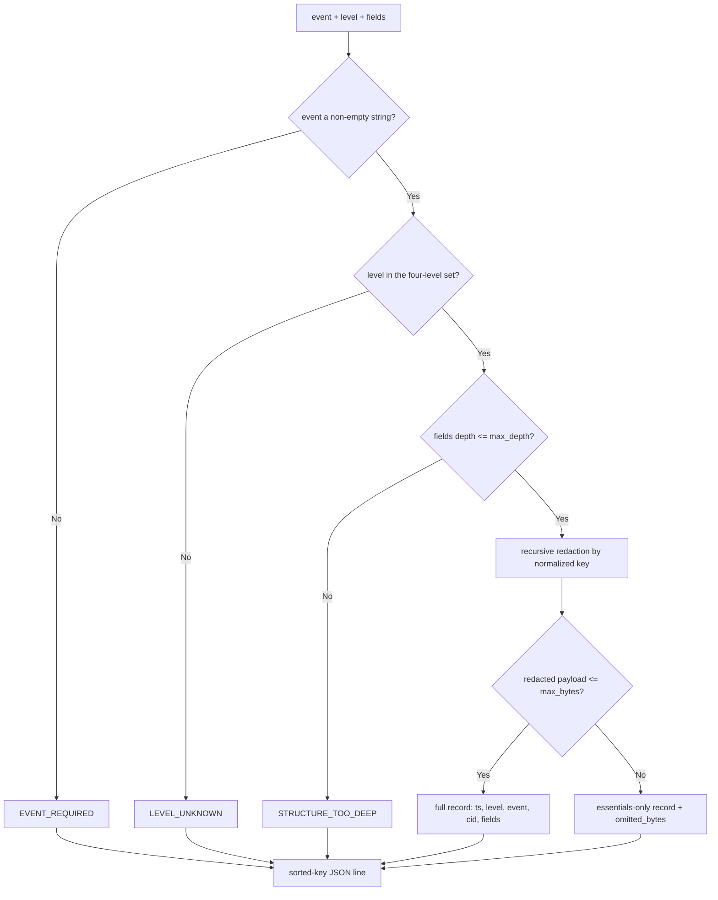

---
# MAM Metadata
id: structured-logging
name: Structured Logging
version: 1.0.0
type: module

author: TCP Ecosystems
description: >
  Emits one JSON-line log record per event with a fixed schema, recursive
  secret redaction over a normalized key list, a payload-size containment
  guard for the log sink, and deterministic key ordering for byte-stable
  output. The logging primitive for every module, component and service in
  this library.

license: MIT

runtime:
  language: python
  version: ">=3.12"

tags:
  - logging
  - observability
  - redaction
  - integrity
  - json

dependencies:
  - name: mam-runtime
    version: ">=1.0.0"

capabilities:
  - emit
  - redact
  - contain

permissions:
  filesystem: none
  network: none
---

# Structured Logging

## Purpose

Builds one detonation-safe log record per event: a fixed schema (`ts`, `level`,
`event`, `correlation_id`, `fields`), secrets recursively redacted before
anything leaves the module, and a payload-size containment so a runaway blob
cannot take down a log sink or blow a budget. Output is deterministic JSON with
sorted keys — identical events produce identical bytes.

It does **not** write to disk, stdout, or a network. The caller decides where
the returned `line` goes; the module only decides what the record says and
makes sure it is safe to send.

## Inputs

| Name | Type | Required | Description |
|------|------|----------|-------------|
| event | string | Yes | Dotted event name (`order.rejected`, `auth.token.refreshed`) |
| level | string | Yes | One of `debug`, `info`, `warn`, `error` |
| fields | object | No | Structured payload attached to the event |
| correlation_id | string | No | Request/session correlation identifier |
| now | integer | No | Caller's clock reading (ms) for the `ts` stamp |
| max_depth | integer | No | Nesting budget over `fields`. Defaults to `16` |
| max_bytes | integer | No | Serialized-anything budget per `line`. Defaults to `8192` |

## Outputs

| Name | Type | Description |
|------|------|-------------|
| valid | boolean | `true` when a `line` was produced |
| code | string | `""` on success; one of the codes below on a guard trip |
| record | object | The schema-fixed record (may be the essentials-only variant), `None` on error envelopes |
| line | string | The JSON-line string to hand to the log sink; `""` on error envelopes |
| duration_ms | number | Wall-clock time spent in `run` |

### Error codes

| Code | Meaning |
|------|---------|
| `EVENT_REQUIRED` | `event` is not a non-empty string |
| `LEVEL_UNKNOWN` | `level` outside the four-level set |
| `STRUCTURE_TOO_DEEP` | `fields` nests deeper than `max_depth` |
| `PAYLOAD_OMITTED` | Redacted payload exceeds `max_bytes`; essentials-only record is returned instead, with the original payload size recorded |

## Capabilities

### emit

Assemble the fixed-schema record and serialize it as a deterministic JSON line.

### redact

Walk `fields` recursively and replace the value of any key in the redaction
list with `***` — key names are normalized (`api_key`, `api-key`, `ApiKey` all
match), values are never searched, only keyed paths.

### contain

Cap the payload at `max_bytes`; refuse records that could drown the sink,
reporting exactly what was dropped and how big it was.

## Rules

- Redaction runs **before** serialization — a secret never reaches even the
  intermediate record, so string truncations of leaks are impossible.
- Redact by key identity, not by value sniffing: values are never inspected,
  so false positives on innocent strings are impossible and the redaction set
  is explicit.
- Normalization: keys are lowercased with separators (`-`, `_`, `.`, space)
  removed before matching.
- Errors never raise to the caller; every bad input becomes a coded envelope.
- The error envelope contains the offending key/shape, never the offending value.
- On `PAYLOAD_OMITTED` the essentials-only record is complete and self-describing
  (`omitted_bytes` included) so downstream tools never see corrupt JSON.
- Key order in `line` is sorted; the same record always serializes to the same bytes.
- Values longer than 120 characters are abbreviated with the original length preserved.

## Workflow



## Python

```python
import json
import time
from typing import Any, Dict, Optional

LEVELS = ("debug", "info", "warn", "error")
NORMALIZATION = str.maketrans({"-": "", "_": "", ".": "", " ": ""})
MAX_VALUE_CHARS = 120

REDACTION_KEYS = frozenset({
    "password", "passwordhash", "passwd", "secret", "clientsecret", "token",
    "accesstoken", "refreshtoken", "idtoken", "authorization", "cookie",
    "apikey", "privatekey", "sessioncookie", "signingkey",
})


def _normalize(key: Any) -> str:
    return str(key).lower().translate(NORMALIZATION)


def _abbreviate(value: Any) -> Any:
    if isinstance(value, str) and len(value) > MAX_VALUE_CHARS:
        return {"type": "string", "prefix": value[:MAX_VALUE_CHARS],
                "length": len(value)}
    if isinstance(value, str):
        return value
    if isinstance(value, (bool, int, float, str, type(None))):
        return value
    if isinstance(value, list):
        return [_abbreviate(item) for item in value]
    if isinstance(value, dict):
        return {str(key): _abbreviate(val) for key, val in value.items()}
    return repr(value)


def _depth(value: Any, depth: int) -> int:
    if isinstance(value, dict):
        return max((_depth(item, depth + 1) for item in value.values()), default=depth)
    if isinstance(value, list):
        return max((_depth(item, depth + 1) for item in value), default=depth)
    return depth


def _redact(value: Any, depth: int) -> Any:
    if depth > 64:
        return {"type": "truncated", "reason": "redact depth limit"}
    if isinstance(value, dict):
        out: Dict[str, Any] = {}
        for key, item in value.items():
            if _normalize(key) in REDACTION_KEYS:
                out[str(key)] = "***"
            else:
                out[str(key)] = _redact(item, depth + 1)
        return out
    if isinstance(value, list):
        return [_redact(item, depth + 1) for item in value]
    return _abbreviate(value)


def _essentials(event: str, level: str, correlation_id: Optional[str],
                now: Optional[int]) -> Dict[str, Any]:
    record: Dict[str, Any] = {"event": event, "level": level}
    if correlation_id is not None:
        record["correlation_id"] = correlation_id
    if now is not None:
        record["ts"] = now
    return record


def run(event: Any, level: Any, fields: Optional[Dict[str, Any]] = None,
        correlation_id: Optional[str] = None, now: Optional[int] = None,
        max_depth: int = 16, max_bytes: int = 8192) -> Dict[str, Any]:
    started = time.perf_counter()

    def envelope(valid: bool, code: str, record: Optional[Dict[str, Any]]) -> Dict[str, Any]:
        line = json.dumps(record, sort_keys=True, separators=(",", ":")) if record else ""
        return {"valid": valid, "code": code, "record": record, "line": line,
                "duration_ms": round((time.perf_counter() - started) * 1000, 3)}

    if not isinstance(event, str) or not event:
        return envelope(False, "EVENT_REQUIRED", None)
    if level not in LEVELS:
        return envelope(False, "LEVEL_UNKNOWN", None)
    if fields is None:
        fields = {}
    if not isinstance(fields, dict):
        return envelope(False, "STRUCTURE_TOO_DEEP", None)
    if _depth(fields, 1) > max_depth:
        return envelope(False, "STRUCTURE_TOO_DEEP", None)

    clean = _redact(fields, 0)
    record = _essentials(event, level, correlation_id, now)
    payload = _abbreviate(clean)
    record["fields"] = payload

    line = json.dumps(record, sort_keys=True, separators=(",", ":"))
    if len(line.encode()) > max_bytes:
        safe = _essentials(event, level, correlation_id, now)
        safe["fields"] = {}
        safe["omitted_bytes"] = len(line.encode())
        safe["note"] = "payload omitted: exceeded containment budget"
        return envelope(True, "PAYLOAD_OMITTED", safe)

    return envelope(True, "", record)
```

## Tests

### Input

```yaml
event: order.rejected
level: error
correlation_id: c-31
fields:
  order_id: o-771
  reason: insufficient_funds
```

### Expected

```yaml
valid: true
code: ""
```

```python
import json


def test_record_follows_the_fixed_schema():
    out = run("order.rejected", "error",
              fields={"order_id": "o-771", "reason": "insufficient_funds"},
              correlation_id="c-31", now=1_772_000_000_000)
    assert out["valid"] is True and out["code"] == ""
    record = json.loads(out["line"])
    assert record["level"] == "error" and record["event"] == "order.rejected"
    assert record["correlation_id"] == "c-31" and record["ts"] == 1_772_000_000_000
    assert record["fields"]["order_id"] == "o-771"


def test_redaction_by_default_key_set():
    out = run("auth.attempt", "warn", fields={
        "user": "ada",
        "password": "hunter2",
        "Authorization": "Bearer abc",
        "api_key": "k-123",
        "nested": {"refresh_token": "t-9", "note": "kept"},
    })
    f = json.loads(out["line"])["fields"]
    assert f["user"] == "ada" and f["nested"]["note"] == "kept"
    assert f["password"] == f["api_key"] == "***"
    assert f["Authorization"] == "***"
    assert f["nested"]["refresh_token"] == "***"


def test_key_normalization_catches_variant_spellings():
    out = run("auth.attempt", "info", fields={"Api-Key": "v", "PRIVATE_KEY": "w"})
    assert json.loads(out["line"])["fields"] == {"Api-Key": "***", "PRIVATE_KEY": "***"}


def test_deep_nesting_is_redacted_contextually():
    out = run("jobs.scan", "info", fields={
        "batch": [{"password": "x"}, "clean", {"meta": {"token": "t"}}]})
    f = json.loads(out["line"])["fields"]
    assert f["batch"][0]["password"] == "***"
    assert f["batch"][1] == "clean"
    assert f["batch"][2]["meta"]["token"] == "***"


def test_invalid_level_is_a_coded_envelope():
    out = run("x", "verbose")
    assert out["valid"] is False and out["code"] == "LEVEL_UNKNOWN"
    assert out["line"] == "" and out["record"] is None


def test_empty_event_is_rejected():
    out = run("", "info")
    assert out["code"] == "EVENT_REQUIRED"


def test_depth_budget_rejects_hostile_nesting():
    hostile = current = {"n": {}}
    for _ in range(30):
        current["n"] = {"n": {}}
        current = current["n"]
    out = run("x", "info", fields=hostile, max_depth=16)
    assert out["code"] == "STRUCTURE_TOO_DEEP"


def test_oversize_payload_is_contained_not_dropped():
    # 200 columns of 500-char cells: abbreviation keeps prefixes but the
    # aggregate stays far above the 1 KiB budget, so containment trips.
    big = {f"col_{i:02d}": "x" * 500 for i in range(200)}
    out = run("ingest.scan", "warn", fields=big, max_bytes=1024)
    assert out["valid"] is True and out["code"] == "PAYLOAD_OMITTED"
    record = json.loads(out["line"])
    assert record["fields"] == {} and record["omitted_bytes"] > 1024
    assert record["event"] == "ingest.scan"


def test_single_long_string_is_abbreviated_not_omitted():
    out = run("ingest.scan", "warn", fields={"blob": "x" * 20_000}, max_bytes=4096)
    assert out["code"] == ""  # abbreviation brought it inside the budget
    assert json.loads(out["line"])["fields"]["blob"]["length"] == 20_000


def test_long_string_values_are_abbreviated_with_length():
    out = run("docs.preview", "info", fields={"body": "y" * 300})
    f = json.loads(out["line"])["fields"]["body"]
    assert f["length"] == 300 and len(f["prefix"]) == 120


def test_identical_records_byte_identical():
    args = ("evt.name", "info", {"a": 1, "b": [1, 2], "c": {"d": True}})
    assert run(*args, now=5)["line"] == run(*args, now=5)["line"]


def test_optional_members_omitted_when_absent():
    out = run("simple.tick", "debug")
    assert json.loads(out["line"]).keys() == {"event", "level", "fields"}
```

## Examples

```python
record = run(
    "auth.login.failed", "warn",
    fields={"user_id": "u-42", "password": "s3cret", "attempts": 2},
    correlation_id="req-9f2", now=1_772_000_000_000,
)
print(record["line"])
# {"correlation_id":"req-9f2","event":"auth.login.failed","fields":{"attempts":2,
#  "password":"***","user_id":"u-42"},"level":"warn","ts":1772000000000}
#  — the secret is "...***" before anything leaves the process.
```

### Expected Flow

```text
validate -> depth budget -> recursive redaction -> containment gate -> JSON line
```

## References

- [MAM source format, full component set](https://github.com/tcp-ecosystems/MAM/blob/main/plan-doc/full-mam.md) §5–§17
- Consumed by components and services in [Level 2](../02-components/README.md) and [Level 4](../04-services/README.md) for structured telemetry
