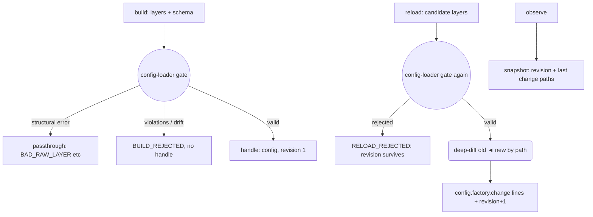

---
# MAM Metadata
id: config-factory
name: Config Factory
version: 1.0.0
type: component

author: TCP Ecosystems
description: >
  Holds the one immutable-in-spirit configuration object a running process
  needs, turns layered reloads into a controlled revision change, and reports
  every structural change by path — never by value — through the
  structured-logging channel. Composes config-loader for the layering gate
  and structured-logging for telemetry.

license: MIT

runtime:
  language: python
  version: ">=3.12"

tags:
  - configuration
  - hot-reload
  - drift
  - telemetry
  - process

dependencies:
  - name: config-loader
    version: ">=1.0.0"
  - name: structured-logging
    version: ">=1.0.0"
  - name: mam-runtime
    version: ">=1.0.0"

capabilities:
  - build
  - reload
  - report

permissions:
  filesystem: none
  network: none
  environment: read
---

# Config Factory

## Purpose

A running process must answer exactly one question about its configuration:
*what revision am I on, and can I move to the next one safely?* This factory
owns that question. `config-loader` already validates, merges and coerces the
layers — the factory adds the stateful side: the approved revision, its
controlled replacement, and the **path-diff audit trail** so every reload is
reproducible in the logs without ever replaying values (secrets are redacted
by the logging layer anyway; the factory never puts values in logs at all).

## Memory

```text
handle = {
  "config":   <the approved merged configuration>,   # caller owns; factory never mutates it
  "revision": n,                                     # starts at 1 on build
  "schema":   <the schema every revision validated against>
}
```

- **Persistence:** caller-owned handle, same rule as every component here.
- **On corrupt (non-dict, key-missing) handles:** every export returns a coded `INVALID_HANDLE` envelope and refuses to act — a rejected reload never leaves the process without working config.

## Exports

| Export | Inputs | Returns | Contract |
|--------|--------|---------|----------|
| `build(raw, schema, defaults?, env?)` | the three layers + schema | `{valid, handle, code, errors, unknown, lines, duration_ms}` | One config-loader gate; a valid merge becomes revision 1; an invalid one never produces a handle |
| `reload(handle, raw, env?, now_ms?)` | replacement file + env layers | `{code, revision, changes, lines, config?, duration_ms}` | Controlled change: invalid candidate → revision and config untouched (`RELOAD_REJECTED`); valid → deep-diff by path, `config.factory.change` lines, revision+1 |
| `observe(handle)` | — | `{revision, keys, changed_paths?}` snapshot | Read-only picture for health probes and dashboards |

## Inputs

Everything structural is described by schema-validator grammar — the factory
takes no schema of its own apart from config-loader's:

| Export | Name | Type | Required | Description |
|--------|------|------|----------|-------------|
| build / reload | raw | object | Yes | File-layer mapping (`None` during reload means "keep env-only change") |
| build | schema | object | Yes | Config schema; every revision validates against the same schema |
| build / reload | defaults | object | No | Lowest layer |
| build / reload | env | object | No | Environment layer (`CFG_` keys per config-loader's grammar) |
| reload | handle | object | Yes | The factory's own handle |
| reload / observe | now_ms | number | No | Clock for the emitted lines' `ts` |

## Outputs

| Name | Type | Description |
|------|------|-------------|
| code | string | `""`, or `DEPENDENCY_UNRESOLVED`, `BAD_RAW_LAYER`, `SCHEMA_UNUSABLE`, `BUILD_REJECTED`, `RELOAD_REJECTED`, `RELOADED`, `INVALID_HANDLE` |
| config | object or None | The approved configuration — never a partially validated one |
| revision | integer | Monotonic revision counter, `1` after build |
| changes | object | `{added: [paths], removed: [paths], changed: [paths]}` from the last accepted reload |
| lines | array | JSON log lines emitted this step (path-level detail only) |

## Capabilities

### build

Run the layer gate once and stamp the result as revision 1 — or report the rejection with the loader's own reasons.

### reload

Turn a layered change into a validated revision change: same gate, same deep-merge, plus a path diff against the live revision.

### report

Answer "what revision is this process on and what changed last" without re-reading any layer.

## Rules

- A rejected candidate **never** replaces the live config: `config` and `revision` survive unchanged, and the rejection is logged with violation paths only.
- Values never enter logs — paths only. Secrets are redacted by the logging layer as a second net, but the factory's discipline is simply to not report values.
- The diff is bidirectional: additions, removals and value changes each get their own path list; a dict replacing a scalar is one `changed` path, not a forest.
- `build` always starts at revision 1; `reload` only ever moves forward.
- The schema is frozen in the handle at build time; `reload` re-validates the candidate against the original schema, not against a newer one.
- Rejected reloads are not failures of the process — `RELOAD_REJECTED` is a healthy no-op for a bad candidate.
- Env keys outside the schema are drift, straight from config-loader's scanner; the factory adds a second class of no — an invalid candidate is a no-op reload, not a process failure.

## Workflow



## Python

```python
import time
from typing import Any, Dict, Optional, Tuple

try:
    from config_loader import run as load_layers
    from structured_logging import run as log_event
except ImportError:
    load_layers = log_event = None


def _gate(handle: Any) -> Tuple[bool, str]:
    if not isinstance(handle, dict):
        return False, "handle"
    for key in ("config", "revision", "schema"):
        if key not in handle:
            return False, f"handle.{key}"
    if not isinstance(handle["revision"], int) or handle["revision"] < 1:
        return False, "handle.revision"
    return True, ""


def _diff(old: Any, new: Any, path: str = "") -> Dict[str, Any]:
    added = []
    removed = []
    changed = []
    if isinstance(old, dict) and isinstance(new, dict):
        for key in sorted(set(old) | set(new)):
            child = f"{path}.{key}" if path else key
            if key not in old:
                added.append(child)
            elif key not in new:
                removed.append(child)
            elif isinstance(old[key], dict) or isinstance(new[key], dict):
                sub = _diff(old[key], new[key], child)
                added.extend(sub["added"])
                removed.extend(sub["removed"])
                changed.extend(sub["changed"])
            elif old[key] != new[key]:
                changed.append(child)
    elif old != new:
        changed.append(path or "(root)")
    return {"added": added, "removed": removed, "changed": changed}


def _line(event: str, level: str, fields: Dict[str, Any], now_ms: Any) -> str:
    verdict = log_event(event, level, fields=fields, now=now_ms)
    return verdict["line"]


def build(raw: Any, schema: Any, defaults: Optional[Dict[str, Any]] = None,
          env: Optional[Dict[str, Any]] = None) -> Dict[str, Any]:
    started = time.perf_counter()

    def envelope(valid: bool, code: str, **extra: Any) -> Dict[str, Any]:
        out = {"valid": valid, "handle": None, "code": code, "errors": [],
               "unknown": [], "lines": [], "config": None,
               "duration_ms": round((time.perf_counter() - started) * 1000, 3)}
        out.update(extra)
        return out

    if load_layers is None or log_event is None:
        return envelope(False, "DEPENDENCY_UNRESOLVED")

    verdict = load_layers(raw, schema, defaults=defaults, env=env)
    if verdict["code"]:
        return envelope(False, verdict["code"], errors=verdict["errors"], unknown=verdict["unknown"])
    if not verdict["valid"]:
        return envelope(False, "BUILD_REJECTED", errors=verdict["errors"], unknown=verdict["unknown"])

    handle = {"config": verdict["config"], "revision": 1, "schema": schema}
    out = envelope(True, "")
    out["config"] = verdict["config"]
    line = _line("config.factory.build", "info", {"revision": 1}, 0)
    out["lines"].append(line)
    out["handle"] = handle
    return out


def reload(handle: Any, raw: Any, env: Optional[Dict[str, Any]] = None,
           now_ms: Any = 0) -> Dict[str, Any]:
    started = time.perf_counter()

    def envelope(code: str, **extra: Any) -> Dict[str, Any]:
        out = {"code": code, "revision": None, "changes": None, "lines": [],
               "config": None, "valid": True,
               "duration_ms": round((time.perf_counter() - started) * 1000, 3)}
        out.update(extra)
        return out

    ok, where = _gate(handle)
    if not ok:
        return envelope("INVALID_HANDLE", valid=False, config=None)
    if load_layers is None or log_event is None:
        return envelope("DEPENDENCY_UNRESOLVED", valid=False)

    verdict = load_layers(raw if raw is not None else {}, handle["schema"],
                          defaults=handle["config"], env=env)
    if verdict["code"] and verdict["code"] != "BUILD_REJECTED":
        out = envelope(verdict["code"], valid=False)
        line = _line("config.factory.reload.rejected", "warn",
                     {"stage": "structure", "code": verdict["code"]}, now_ms)
        out["lines"].append(line)
        return out
    if not verdict["valid"] or verdict["code"] == "BUILD_REJECTED":
        out = envelope("RELOAD_REJECTED", valid=False)
        line = _line("config.factory.reload.rejected", "warn",
                     {"stage": "schema", "violations": len(verdict["errors"]),
                      "drift": [u["path"] for u in verdict["unknown"]]}, now_ms)
        out["lines"].append(line)
        return out

    changes = _diff(handle["config"], verdict["config"])
    handle["config"] = verdict["config"]
    handle["revision"] = handle["revision"] + 1
    out = envelope("RELOADED", revision=handle["revision"], changes=changes, valid=True)
    line = _line("config.factory.change", "info",
                 {"revision": handle["revision"], "added": changes["added"],
                  "removed": changes["removed"], "changed": changes["changed"]}, now_ms)
    out["lines"].append(line)
    out["config"] = verdict["config"]
    return out


def observe(handle: Any) -> Dict[str, Any]:
    started = time.perf_counter()
    ok, _ = _gate(handle)
    if not ok:
        return {"revision": None, "keys": [], "valid": False,
                "duration_ms": round((time.perf_counter() - started) * 1000, 3)}
    return {"revision": handle["revision"], "keys": sorted(handle["config"].keys()),
            "valid": True,
            "duration_ms": round((time.perf_counter() - started) * 1000, 3)}
```

## Tests

### Input

```yaml
schema: dsn/pool/batch contract (see CONFIG_SCHEMA below)
raw: { dsn: postgres://db.prod.internal:5432/orders, pool: { size: 4 } }
env: { CFG_RETRIES: "10" }
```

### Expected

```yaml
valid: true
revision: 1
code: ""
```

```python
import json

CONFIG_SCHEMA = {
    "type": "object",
    "required": ["dsn", "pool"],
    "properties": {
        "dsn": {"type": "string", "pattern": r"postgres://[a-z0-9.:\-]+/\w+"},
        "retries": {"type": "integer", "minimum": 0, "maximum": 20},
        "debug": {"type": "boolean"},
        "pool": {"type": "object", "required": ["size"],
                 "properties": {"size": {"type": "integer", "minimum": 1, "maximum": 512}}},
    },
}
DEFAULTS = {"retries": 3, "debug": False, "pool": {"size": 8}}
LIVE = {"dsn": "postgres://db.prod.internal:5432/orders", "pool": {"size": 4}}


def test_build_validates_and_stamps_revision_one():
    out = build(LIVE, CONFIG_SCHEMA, DEFAULTS)
    assert out["valid"] is True and out["code"] == ""
    assert out["handle"]["revision"] == 1
    assert out["config"]["retries"] == 3
    assert json.loads(out["lines"][0])["fields"]["revision"] == 1


def test_build_rejects_from_loader_reasons():
    assert build("not-a-mapping", CONFIG_SCHEMA)["code"] == "BAD_RAW_LAYER"
    out = build({"dsn": "https://nope"}, CONFIG_SCHEMA, DEFAULTS)
    assert out["code"] == "BUILD_REJECTED" and out["handle"] is None
    assert any(e["code"] == "PATTERN_MISMATCH" for e in out["errors"])


def test_deps_unresolved_gate():
    names = ("load_layers", "log_event")
    saved = {k: globals()[k] for k in names}
    try:
        for k in names:
            globals()[k] = None
        assert build(LIVE, CONFIG_SCHEMA)["code"] == "DEPENDENCY_UNRESOLVED"
        assert reload({"config": {}, "revision": 1, "schema": CONFIG_SCHEMA}, LIVE)["code"] == "DEPENDENCY_UNRESOLVED"
    finally:
        globals().update(saved)


def test_reload_applies_a_valid_candidate():
    handle = build(LIVE, CONFIG_SCHEMA, DEFAULTS)["handle"]
    out = reload(handle, {"pool": {"size": 6}}, env={"CFG_RETRIES": "7"}, now_ms=100)
    assert out["code"] == "RELOADED" and out["revision"] == 2
    assert out["config"]["pool"]["size"] == 6 and out["config"]["retries"] == 7
    recorded = json.loads(out["lines"][0])
    assert recorded["fields"]["added"] == [] and recorded["fields"]["removed"] == []


def test_reload_reports_exact_change_paths_only():
    handle = build(LIVE, CONFIG_SCHEMA, DEFAULTS)["handle"]
    out = reload(handle, {"pool": {"size": 9, "extra": True}}, now_ms=0)
    assert out["code"] == "RELOAD_REJECTED"         # drift: schema has no `extra`
    assert out["revision"] is None and out["config"] is None


def test_rejected_reload_leaves_the_live_revision_intact():
    handle = build(LIVE, CONFIG_SCHEMA, DEFAULTS)["handle"]
    refused = reload(handle, {"dsn": "postgres://other.host.internal:5432/orders", "pool": {"size": 0}}, now_ms=1)
    assert refused["code"] == "RELOAD_REJECTED"
    assert refused["config"] is None                # no half-bit config leaks out
    assert handle["revision"] == 1 and handle["config"]["pool"]["size"] == 4


def test_diff_paths_point_at_the_exact_leaves():
    old = {"a": {"b": 1}, "c": 2, "d": 3}
    new = {"a": {"b": 5}, "c": 2, "e": 9}
    changes = _diff(old, new)
    assert changes["changed"] == ["a.b"]
    assert changes["added"] == ["e"] and changes["removed"] == ["d"]


def test_scalar_swapped_for_object_is_one_changed_path():
    changes = _diff({"mode": "fast"}, {"mode": {"name": "fast"}})
    assert changes == {"added": [], "removed": [], "changed": ["mode"]}


def test_lines_carry_paths_never_values():
    handle = build(LIVE, CONFIG_SCHEMA, DEFAULTS)["handle"]
    out = reload(handle, {"pool": {"size": 12}}, now_ms=0)
    record = json.loads(out["lines"][0])
    assert record["event"] == "config.factory.change"
    fields = record["fields"]
    assert set(fields) == {"revision", "added", "removed", "changed"}
    assert fields["changed"] == ["pool.size"]         # the path, not the value
    assert "12" not in json.dumps(record)             # the new value goes nowhere
```

```python
def test_structural_problems_passthrough_loader_codes():
    handle = build(LIVE, CONFIG_SCHEMA, DEFAULTS)["handle"]
    out = reload(handle, "corrupt-layer", now_ms=0)
    assert out["code"] == "BAD_RAW_LAYER"           # loader's own code, unchanged
    assert handle["revision"] == 1


def test_observe_reports_the_current_revision():
    handle = build(LIVE, CONFIG_SCHEMA, DEFAULTS)["handle"]
    snapshot = observe(handle)
    assert snapshot["valid"] is True and snapshot["revision"] == 1
    assert snapshot["keys"] == ["debug", "dsn", "pool", "retries"]
    reload(handle, {"pool": {"size": 6}}, now_ms=1)
    assert observe(handle)["revision"] == 2


def test_corrupt_handles_are_rejected_cleanly():
    assert reload({}, LIVE)["code"] == "INVALID_HANDLE"
    assert observe("nope")["valid"] is False
```

## Examples

```python
factory = build(json.load(open("config/production.json")), CONFIG_SCHEMA,
                defaults={"retries": 3})["handle"]

# SIGHUP handler: reload from the same file+env layers
out = reload(factory, json.load(open("config/production.json")), env=ENV, now_ms=time_ms())
if out["code"] == "RELOADED":
    fanout.reload_signal(out["config"], out["revision"])
elif out["code"] == "RELOAD_REJECTED":
    keep_running()   # live config untouched — that is the whole point
```

### Expected Flow

```text
gate → revision stamp / rejected-no-op → path-diff audit → normalized reload lines
```

## References

- Composes: [`config-loader`](../01-modules/config-loader.mam.md), [`structured-logging`](../01-modules/structured-logging.mam.md)
- Pair in this level: [`http-runtime`](http-runtime.mam.md), [`pacing-circuit`](pacing-circuit.mam.md)
- [MAM source format, full component set](https://github.com/tcp-ecosystems/MAM/blob/main/plan-doc/full-mam.md)
