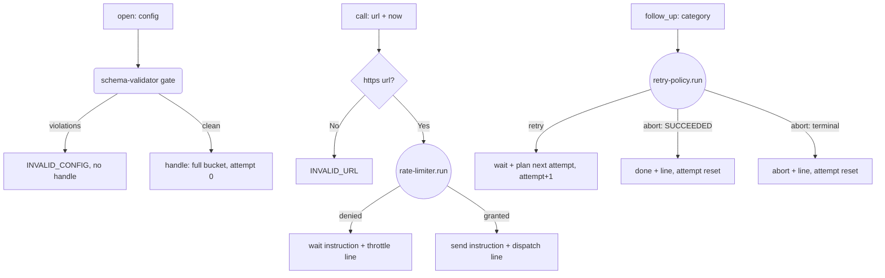

---
# MAM Metadata
id: http-runtime
name: HTTP Runtime Boundary
version: 1.0.0
type: component

author: TCP Ecosystems
description: >
  The rate-limited, retrying, escalating-out-log-line boundary for an HTTP
  dependency. Composes rate-limiter (admission), retry-policy (attempt
  schedule) and structured-logging (telemetry), and validates its runtime
  configuration at construction with schema-validator. Emits execution
  instructions — it owns no sockets, so any host executes the plan.

license: MIT

runtime:
  language: python
  version: ">=3.12"

tags:
  - http
  - boundary
  - pacing
  - reliability
  - telemetry

dependencies:
  - name: schema-validator
    version: ">=1.0.0"
  - name: rate-limiter
    version: ">=1.0.0"
  - name: retry-policy
    version: ">=1.0.0"
  - name: structured-logging
    version: ">=1.0.0"
  - name: mam-runtime
    version: ">=1.0.0"

capabilities:
  - plan
  - reconcile
  - observe

permissions:
  filesystem: none
  network: none
---

# HTTP Runtime Boundary

## Purpose

Every process that talks to an HTTP dependency needs the same four things
before the first byte goes out: an admission decision (local pacing), an
attempt schedule (remote-failure policy), telemetry (what actually happened),
and a validated configuration. This component is that boundary as a decision
layer: it returns **instructions** (`send`, `wait`, `done`, `abort`) that a
host executor performs. The socket belongs to the host; the *decisions* about
the socket belong here, where they are testable without I/O.

## Memory

State that outlives a call, per constructed instance (the returned `handle` is
the persistence handle; the component is stateless between calls, like real
memory-managed infrastructure):

```text
handle = {
  "config": <the validated runtime config>,          # immutable after open()
  "bucket": { "tokens": float, "last_refill_ms": n },# rate-limiter bucket state
  "attempt": n                                       # sends planned so far for the current logical call
}
```

- **Who persists it:** the caller — the handle crosses every call boundary.
- **On a missing or corrupt handle:** every exported operation saves itself
  against it with a typed `INVALID_HANDLE` envelope every time; it does not act.

## Exports

| Export | Inputs | Returns | Contract |
|--------|--------|---------|----------|
| `open(config)` | runtime config | `{valid, handle, code, errors, lines, duration_ms}` | Config validated by schema-validator once; invalid config never produces a handle |
| `call(handle, url, method, correlation_id, now_ms)` | one logical request | `{action, code, attempt, wait_ms, lines, detail, duration_ms}` | Admission via rate-limiter; `send` instructions carry the attempt number; throttles return `wait` with the exact millisecond promise |
| `follow_up(handle, category, correlation_id, now_ms, elapsed_ms?)` | outcome of the last send | `{action, code, wait_ms, attempt, lines, detail, duration_ms}` | Attempt schedule via retry-policy; remote `RATE_LIMITED` gets backoff, terminal categories end the call; the boundary resets after an abort so the next logical call starts clean |

## Inputs

### `open` — runtime config schema (validated by schema-validator at construction)

```text
{ "bucket": { "capacity": 1..4096, "refill_per_second": >=0.001 },
  "retry":  { "max_attempts": 1..32, base_delay_ms, max_delay_ms, multiplier,
              jitter_window_ms, jitter_seed, deadline_ms? },
  "timeout_ms": 1..300000 }
```

Config is immutable after `open` — a running boundary does not re-read knobs.

### `call` — arguments

| Name | Type | Required | Description |
|------|------|----------|-------------|
| handle | object | Yes | A handle from `open` |
| url | string | Yes | `https://host/path…` — the whole transaction is refused for non-https URLs (`INVALID_URL`) |
| method | string | Yes | Any uppercase HTTP verb, used for the instruction only |
| correlation_id | string | No | Carried into every emitted log line |
| now_ms | number | Yes | Caller's clock (ms); drives the bucket refill |

### `follow_up` — arguments

| Name | Type | Required | Description |
|------|------|----------|-------------|
| handle | object | Yes | Same handle as the originating `call` |
| category | string | Yes | A retry-policy failure category (`SUCCESS`, `TIMEOUT`, `RATE_LIMITED`, …) |
| correlation_id | string | No | Correlation carried to telemetry |
| now_ms | number | Yes | Caller's clock |
| elapsed_ms | number | No | Time since the logical call started; feeds the deadline check |

## Outputs

Every export returns the envelope discipline on top of its specific fields:
`code` (`""`, or `DEPENDENCY_UNRESOLVED`, `INVALID_CONFIG`, `INVALID_URL`,
`INVALID_HANDLE`, `THROTTLED`, `ATTEMPTS_EXHAUSTED`, `SUCCEEDED`,
`NON_RETRYABLE`, `WAIT_AND_RETRY`, `RATE_LIMITED`, `DEADLINE_EXCEEDED`),
`duration_ms`, and `lines` — the JSON log lines this step produced.

## Capabilities

### plan

Turn admission + schedule state into a `send`/`wait` instruction for the host executor.

### reconcile

Absorb the outcome of each send via retry-policy: schedule the next attempt or end the call.

### observe

Emit a structured, redacted log line for every decision the boundary makes — nothing leaves unlogged.

## Rules

- The component opens no sockets and performs no I/O; hosts execute instructions.
- Config is validated exactly once, at `open`, by schema-validator; violations are mirrored with validator paths and `INVALID_CONFIG`.
- Admission is never skipped: every `send` is preceded by a rate-limiter verdict on the same clock.
- A throttled `call` does not consume an attempt — the retry budget belongs to failures, not to local pacing.
- Non-https URLs are refused before any instruction is planned (`INVALID_URL`).
- Every emitted line passes through structured-logging (redaction before serialization); URLs are logged without their query string.
- After an abort (`SUCCEEDED`, `NON_RETRYABLE`, `ATTEMPTS_EXHAUSTED`, `DEADLINE_EXCEEDED`) `attempt` resets to 0 — the next logical call starts clean.
- Failures in the handle itself are coded envelopes (`INVALID_HANDLE`), never exceptions.

## Workflow



## Python

```python
import time
from typing import Any, Dict, Optional, Tuple

try:
    from schema_validator import run as validate_value
    from rate_limiter import run as admit
    from retry_policy import run as retry_for
    from structured_logging import run as log_event
except ImportError:
    validate_value = admit = retry_for = log_event = None

RUNTIME_CONFIG_SCHEMA: Dict[str, Any] = {
    "type": "object",
    "required": ["bucket", "retry"],
    "additional": False,
    "properties": {
        "bucket": {
            "type": "object",
            "required": ["capacity", "refill_per_second"],
            "properties": {
                "capacity": {"type": "integer", "minimum": 1, "maximum": 4096},
                "refill_per_second": {"type": "number", "minimum": 0.001},
            },
        },
        "retry": {
            "type": "object",
            "required": ["max_attempts"],
            "properties": {
                "max_attempts": {"type": "integer", "minimum": 1, "maximum": 32},
                "base_delay_ms": {"type": "integer", "minimum": 0, "maximum": 60000},
                "max_delay_ms": {"type": "integer", "minimum": 0, "maximum": 120000},
                "multiplier": {"type": "number", "minimum": 1.0},
                "jitter_window_ms": {"type": "integer", "minimum": 0, "maximum": 2000},
                "jitter_seed": {"type": "integer", "minimum": 0},
                "deadline_ms": {"type": "integer", "minimum": 0},
            },
        },
        "timeout_ms": {"type": "integer", "minimum": 1, "maximum": 300000},
    },
}

URL_SCHEMA = {"type": "string", "pattern": r"https://[a-z0-9.\-]+(?:/[^\s]*)?"}
ABORT_CODES = ("SUCCEEDED", "NON_RETRYABLE", "ATTEMPTS_EXHAUSTED",
               "DEADLINE_EXCEEDED", "INVALID_INPUT")


def _lines(event: str, level: str, fields: Dict[str, Any],
           correlation_id: Optional[str], now_ms: Any) -> Tuple[str, Optional[str]]:
    """One telemetry line through structured-logging; returns (line, code)."""
    verdict = log_event(event, level, fields=fields, correlation_id=correlation_id, now=now_ms)
    return verdict["line"], verdict["code"]


def _finite(handle: Any) -> Tuple[bool, str]:
    if not isinstance(handle, dict):
        return False, "handle"
    for key in ("config", "bucket", "attempt"):
        if key not in handle:
            return False, f"handle.{key}"
    return True, ""


def open(config: Any) -> Dict[str, Any]:
    started = time.perf_counter()

    def envelope(valid: bool, handle: Optional[Dict[str, Any]], code: str = "",
                 errors: Optional[Any] = None) -> Dict[str, Any]:
        return {"valid": valid, "handle": handle, "code": code, "errors": errors or [],
                "lines": [], "duration_ms": round((time.perf_counter() - started) * 1000, 3)}

    if admit is None or validate_value is None or retry_for is None or log_event is None:
        return envelope(False, None, code="DEPENDENCY_UNRESOLVED")
    verdict = validate_value(config, RUNTIME_CONFIG_SCHEMA)
    if not verdict["valid"]:
        return envelope(False, None, "INVALID_CONFIG", verdict["errors"])
    handle = {
        "config": config,
        "bucket": {"tokens": float(config["bucket"]["capacity"]), "last_refill_ms": 0},
        "attempt": 0,
    }
    line, log_code = _lines(
        "http.boundary.open", "info",
        {"capacity": config["bucket"]["capacity"],
         "max_attempts": config["retry"]["max_attempts"]}, None, 0)
    out = envelope(True, handle)
    if log_code:
        out["code"] = log_code
        out["valid"] = False
        out["handle"] = None
    out["lines"].append(line)
    return out


def call(handle: Any, url: Any, method: Any, correlation_id: Optional[str],
         now_ms: Any, requested: Any = 1) -> Dict[str, Any]:
    started = time.perf_counter()

    def envelope(action: str, code: str, **extra: Any) -> Dict[str, Any]:
        base = {"action": action, "code": code, "attempt": handle.get("attempt") if isinstance(handle, dict) else None,
                "wait_ms": 0, "lines": [], "detail": "",
                "duration_ms": round((time.perf_counter() - started) * 1000, 3)}
        base.update(extra)
        return base

    finite, where = _finite(handle)
    if not finite or handle["attempt"] < 0:
        return envelope("abort", "INVALID_HANDLE", detail=f"handle is not usable: {where}")

    if validate_value is None or retry_for is None or log_event is None:
        return envelope("abort", "DEPENDENCY_UNRESOLVED", detail="runtime dependencies unresolved")

    url_verdict = validate_value(url, URL_SCHEMA)   # any https URL; non-https is refused here
    if not url_verdict["valid"]:
        return envelope("abort", "INVALID_URL", detail="url must be an absolute https url")

    verdict = admit(handle["bucket"], handle["config"]["bucket"], now_ms, requested)
    handle["bucket"] = verdict["state"]
    mapped_code = "THROTTLED" if verdict["code"] == "THROTTLED" else (
        "INVALID_CONFIG" if verdict["code"] in ("INVALID_CONFIG", "INVALID_STATE", "INVALID_INPUT") else verdict["code"])
    if not verdict["allowed"]:
        detail = f"local pacing refuses {method} {url.split('?')[0]}: {verdict['detail']}"
        line, _ = _lines("http.boundary.throttled", "warn",
                         {"url": url.split("?")[0], "wait_ms": verdict["wait_ms"]},
                         correlation_id, now_ms)
        out = envelope("wait", mapped_code, wait_ms=verdict["wait_ms"], detail=detail)
        out["lines"].append(line)
        return out

    handle["attempt"] = handle["attempt"] + 1
    line, _ = _lines("http.boundary.dispatch", "info",
                     {"url": url.split("?")[0], "method": method, "attempt": handle["attempt"]},
                     correlation_id, now_ms)
    out = envelope("send", "ADMITTED", detail=f"plan {method} {url.split('?')[0]} as attempt {handle['attempt']}")
    out["lines"].append(line)
    return out


def follow_up(handle: Any, category: Any, correlation_id: Optional[str],
              now_ms: Any, elapsed_ms: Any = 0) -> Dict[str, Any]:
    started = time.perf_counter()

    def envelope(action: str, code: str, **extra: Any) -> Dict[str, Any]:
        base = {"action": action, "code": code, "attempt": handle.get("attempt") if isinstance(handle, dict) else None,
                "wait_ms": 0, "lines": [], "detail": "",
                "duration_ms": round((time.perf_counter() - started) * 1000, 3)}
        base.update(extra)
        return base

    finite, where = _finite(handle)
    if not finite:
        return envelope("abort", "INVALID_HANDLE", detail=f"handle is not usable: {where}")
    if retry_for is None or log_event is None:
        return envelope("abort", "DEPENDENCY_UNRESOLVED", detail="runtime dependencies unresolved")

    decision = retry_for(handle["attempt"], category, handle["config"]["retry"], elapsed_ms)
    if decision["code"] == "SUCCEEDED":
        handle["attempt"] = 0
        line, _ = _lines("http.boundary.settled", "info",
                         {"outcome": "succeeded", "attempts": decision["attempt"]},
                         correlation_id, now_ms)
        out = envelope("done", "SUCCEEDED", detail="logical call complete; schedule reset")
        out["lines"].append(line)
        return out
    if decision["code"] in ABORT_CODES:
        handle["attempt"] = 0
        line, _ = _lines("http.boundary.aborted", "error",
                         {"outcome": "aborted", "decision": decision["code"],
                          "attempts": decision["attempt"]},
                         correlation_id, now_ms)
        out = envelope("abort", decision["code"], detail=decision["detail"])
        out["lines"].append(line)
        return out

    handle["attempt"] = handle["attempt"] + 1
    line, _ = _lines("http.boundary.backoff", "warn",
                     {"outcome": "retrying", "decision": decision["code"],
                      "delay_ms": decision["delay_ms"], "next_attempt": handle["attempt"]},
                     correlation_id, now_ms)
    out = envelope("wait", decision["code"], wait_ms=decision["delay_ms"],
                   detail=decision["detail"])
    out["lines"].append(line)
    return out
```

## Tests

### Input

```yaml
config:
  bucket: { capacity: 5, refill_per_second: 1 }
  retry: { max_attempts: 3, base_delay_ms: 100, multiplier: 2.0, jitter_window_ms: 0 }
url: https://api.example.com/v1/orders
method: POST
```

### Expected

```yaml
action: send
code: ADMITTED
attempt: 1
```

```python
import json

BASE = {"bucket": {"capacity": 5, "refill_per_second": 1},
        "retry": {"max_attempts": 3, "base_delay_ms": 100, "multiplier": 2.0,
                   "jitter_window_ms": 0}}


def test_open_validates_config_and_produces_a_full_bucket():
    out = open(BASE)
    assert out["valid"] is True and out["code"] == ""
    assert out["handle"]["bucket"]["tokens"] == 5.0
    assert out["handle"]["attempt"] == 0
    assert json.loads(out["lines"][0])["event"] == "http.boundary.open"


def test_open_rejects_invalid_config_with_validator_paths():
    bad = {"bucket": {"capacity": 0, "refill_per_second": 1},
           "retry": {"max_attempts": 3}}
    out = open(bad)
    assert out["valid"] is False and out["handle"] is None
    assert out["code"] == "INVALID_CONFIG"
    assert any(e["path"] == "bucket.capacity" for e in out["errors"])


def test_deps_unresolved_is_a_clean_gate():
    names = ("validate_value", "admit", "retry_for", "log_event")
    saved = {k: globals()[k] for k in names}
    try:
        for k in names:
            globals()[k] = None
        assert open(BASE)["code"] == "DEPENDENCY_UNRESOLVED"
    finally:
        globals().update(saved)


def test_call_plans_a_send_and_debits_the_bucket():
    out = open(BASE)
    call_out = call(out["handle"], "https://api.example.com/v1/orders", "POST", "c-1", 0)
    assert call_out["action"] == "send" and call_out["code"] == "ADMITTED"
    assert call_out["attempt"] == 1
    assert abs(out["handle"]["bucket"]["tokens"] - 4.0) < 1e-9


def test_throttled_call_waits_instead_of_spending_attempts():
    out = open(BASE)
    for _ in range(5):
        call(out["handle"], "https://api.example.com/v1/ping", "GET", "c-1", 0)
    throttled = call(out["handle"], "https://api.example.com/v1/ping", "GET", "c-1", 0)
    assert throttled["action"] == "wait" and throttled["code"] == "THROTTLED"
    assert throttled["wait_ms"] == 1000 and throttled["attempt"] is not None


def test_non_https_urls_are_refused_before_any_instruction():
    out = open(BASE)
    refused = call(out["handle"], "http://api.example.com/v1/orders", "POST", "c-1", 0)
    assert refused["action"] == "abort" and refused["code"] == "INVALID_URL"
    assert abs(out["handle"]["bucket"]["tokens"] - 5.0) < 1e-9   # no token spent


def test_urls_are_logged_without_their_query_string():
    out = open(BASE)
    res = call(out["handle"], "https://api.example.com/v1/order?api_key=SK-demo", "GET", "c-2", 0)
    logged = json.loads(res["lines"][0])
    assert logged["fields"]["url"] == "https://api.example.com/v1/order"
    assert "api_key" not in logged["fields"]


def test_transient_failure_schedules_the_next_attempt():
    out = open(BASE)
    call(out["handle"], "https://api.example.com/v1/orders", "POST", "c-1", 0)
    step = follow_up(out["handle"], "TIMEOUT", "c-1", 0)
    assert step["action"] == "wait" and step["code"] == "WAIT_AND_RETRY"
    assert step["wait_ms"] >= 100 and out["handle"]["attempt"] == 2


def test_rate_limit_from_the_far_end_backs_off():
    out = open(BASE)
    call(out["handle"], "https://api.example.com/v1/orders", "POST", "c-1", 0)
    step = follow_up(out["handle"], "RATE_LIMITED", "c-1", 0)
    assert step["action"] == "wait" and step["code"] == "RATE_LIMITED"


def test_permanent_error_aborts_and_resets_the_schedule():
    out = open(BASE)
    call(out["handle"], "https://api.example.com/v1/orders", "POST", "c-1", 0)
    step = follow_up(out["handle"], "PROTOCOL_ERROR", "c-1", 0)
    assert step["action"] == "abort" and step["code"] == "NON_RETRYABLE"
    assert out["handle"]["attempt"] == 0


def test_success_completes_the_logical_call():
    out = open(BASE)
    call(out["handle"], "https://api.example.com/v1/orders", "POST", "c-1", 0)
    step = follow_up(out["handle"], "SUCCESS", "c-1", 0)
    assert step["action"] == "done" and step["code"] == "SUCCEEDED"
    assert out["handle"]["attempt"] == 0


def test_attempt_budget_exhaustion_aborts_cleanly():
    out = open(BASE)
    call(out["handle"], "https://api.example.com/v1/orders", "POST", "c-1", 0)
    follow_up(out["handle"], "TIMEOUT", "c-1", 0)
    follow_up(out["handle"], "TIMEOUT", "c-1", 0)
    step = follow_up(out["handle"], "TIMEOUT", "c-1", 0)
    assert step["action"] == "abort" and step["code"] == "ATTEMPTS_EXHAUSTED"


def test_corrupt_handle_never_acts():
    out = open(BASE)
    handle = out["handle"]
    handle.pop("bucket")
    assert call(handle, "https://a.example.com/x", "GET", "c", 0)["code"] == "INVALID_HANDLE"
    assert follow_up(handle, "TIMEOUT", "c", 0)["code"] == "INVALID_HANDLE"
```

## Examples

```python
boundary = open({"bucket": {"capacity": 10, "refill_per_second": 5},
                 "retry": {"max_attempts": 4, "base_delay_ms": 200}})["handle"]

step = call(boundary, "https://gateway.internal/ordersync", "POST", "c-3", 0)
if step["action"] == "wait":
    time.sleep(step["wait_ms"] / 1000)
    step = call(boundary, "https://gateway.internal/ordersync", "POST", "c-3", 0)

outcome = host.execute(step)           # the socket lives in the host
result = follow_up(boundary, outcome.category, "c-3", 0)   # schedule or settle
```

### Expected Flow

```text
schema gate -> admission -> send/wait -> outcome category -> retry schedule -> settle
```

## References

- Composes: [`rate-limiter`](../01-modules/rate-limiter.mam.md), [`retry-policy`](../01-modules/retry-policy.mam.md), [`structured-logging`](../01-modules/structured-logging.mam.md), [`schema-validator`](../01-modules/schema-validator.mam.md)
- Consumed by the workflows in [Level 3](../03-workflows/README.md) and the services in [Level 4](../04-services/README.md)
- [MAM source format, full component set](https://github.com/tcp-ecosystems/MAM/blob/main/plan-doc/full-mam.md)
