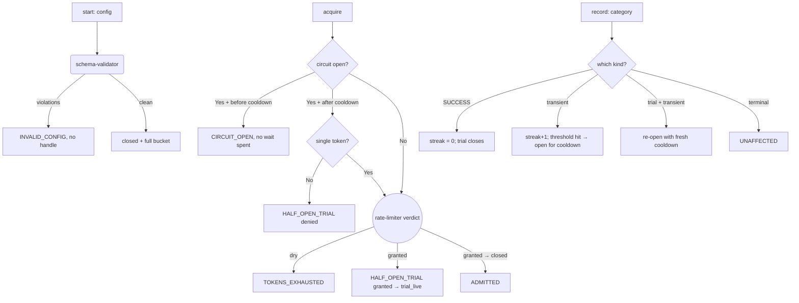

---
# MAM Metadata
id: pacing-circuit
name: Pacing Circuit
version: 1.0.0
type: component

author: TCP Ecosystems
description: >
  Admission control that fuses a token bucket (grade) with a circuit breaker
  (reflex): when transient failures arrive faster than the threshold, the
  circuit opens for a cooldown instead of stampeding a dependency that is
  already down. Composes rate-limiter for the bucket, retry-policy's
  failure taxonomy for what counts as a transient storm, and
  schema-validator for construction-time config.

license: MIT

runtime:
  language: python
  version: ">=3.12"

tags:
  - circuit-breaker
  - pacing
  - resilience
  - admission
  - state-machine

dependencies:
  - name: schema-validator
    version: ">=1.0.0"
  - name: rate-limiter
    version: ">=1.0.0"
  - name: retry-policy
    version: ">=1.0.0"
  - name: mam-runtime
    version: ">=1.0.0"

capabilities:
  - guard
  - reconcile
  - report

permissions:
  filesystem: none
  network: none
---

# Pacing Circuit

## Purpose

Stops the two dumbest failure modes of a busy caller: drowning a dependency
with retries it cannot answer, and stampeding it again the instant the network
stops being congested. The bucket grants capacity by earned refill alone; the
breaker reacts only to what the retry taxonomy declares transient, so a caller
error can storm down the circuit.

## Memory

Per-instance state, persisted by the caller through the `handle`:

```text
handle = {
  "config":  { bucket: {...}, breaker: {...} },                  # immutable after open()
  "bucket":  { "tokens": float, "last_refill_ms": n },           # rate-limiter state
  "breaker": { "streak": n, "open_until_ms": n, "trials": n }    # 0 = never opened
}
```

- **Persistence:** caller-owned, like every handle here.
- **On a missing or corrupt handle:** `goto absent state is actionable, gate` applies — every export returns a coded `INVALID_HANDLE` envelope and does not act.

## Exports

| Export | Inputs | Returns | Contract |
|--------|--------|---------|----------|
| `start(config)` | `{"bucket": {...}, "breaker": {...}}`, see `## Inputs` | `{valid, handle, code, errors, duration_ms}` | Full schema validation once at construction; an invalid config never becomes a handle |
| `acquire(handle, now_ms, requested?)` | clock + tokens asked | `{allowed, code, wait_ms, state-after, duration_ms}` | The graded gate: `CIRCUIT_OPEN` refuses without touching the bucket; open-and-cooled grants exactly one `HALF_OPEN_TRIAL`; closed traffic flows through the bucket |
| `record(handle, category, now_ms)` | outcome of the granted slot | `{circuit, code, streak, wait? , duration_ms}` | Breaker reconciliation: `SUCCESS` closes (trial or open-loop reset), declared-transient categories drive the streak; terminal categories are **reported as `UNAFFECTED`** and change nothing |
| `observe(handle)` | — | snapshot `{circuit, streak, tokens, open_until_ms}` | The machine's current picture, read-only |

## Inputs

### `start` — config schema (validated at construction)

```text
{ "bucket":  { "capacity": 1..4096, "refill_per_second": >=0.001 },
  "breaker": { "failure_threshold": 1..64, "cooldown_ms": 100..3600000 } }
```

### `acquire` — arguments

| Name | Type | Required | Description |
|------|------|----------|-------------|
| handle | object | Yes | From `start`; carries bucket + breaker state |
| now_ms | number | Yes | Caller's clock (ms), monotonic per instance |
| requested | number | No | Tokens requested. Defaults to `1` |

### `record` — arguments

| Name | Type | Required | Description |
|------|------|----------|-------------|
| handle | object | Yes | Same handle the slot was granted from |
| category | string | Yes | A retry-policy failure category: `SUCCESS`, transient storms (`TIMEOUT`, `CONNECTION`, `SERVER_5XX`, `RATE_LIMITED`, `CONFLICT`, `RESOURCE_STATE`), or terminal (`PROTOCOL_ERROR`, `UNKNOWN`) |
| now_ms | number | Yes | The clock at which the outcome arrived |

## Outputs

Decision codes: `ADMITTED`, `HALF_OPEN_TRIAL`, `CIRCUIT_OPEN`,
`BREAKER_OPENED`, `TRIAL_SUCCEEDED`, `TRIAL_FAILED_REOPENED`,
`STREAK_RESET` (success while closed), `STREAK_INCREMENT`, `TOKENS_EXHAUSTED`,
`UNAFFECTED`, `INVALID_CONFIG`, `INVALID_HANDLE`, `DEPENDENCY_UNRESOLVED`.

## Capabilities

### guard

Grant, refuse, or trial-gate every request the caller wants to fire.

### reconcile

Absorb outcomes into the state machine: streaks, cooldowns, trials.

### report

Snapshot the state machine for health endpoints and dashboards.

## Rules

- The breaker trips **only** on categories the retry taxonomy declares transient — a hostile caller error should not break the circuit.
- While open, the bucket is untouched; deferred flows cannot steal capacity from flows that come after cooldown ends.
- Exactly one trial crosses an opened gate after cooldown, and only for a single token; multi-token calls are refused with the wait reassessed.
- Trial success closes the circuit and resets the streak; trial failure re-opens for a fresh cooldown, streak unchanged since the trial consumed it.
- `SUCCESS` resets the streak whether the circuit is closed or the trial came from open.
- Actions only after `start` — all exports give `INVALID_HANDLE` when the handle is not a dict, not complete, or carries a negative bucket.
- The state machine never mutates `config`.

## Workflow



## Python

```python
import time
from typing import Any, Dict, Optional, Tuple

try:
    from schema_validator import run as validate_value
    from rate_limiter import run as admit
    from retry_policy import URGENT as TRANSIENT_OK, RATE_LIMITED as RATE_TAG
except ImportError:
    validate_value = admit = None
    TRANSIENT_OK = ()
    RATE_TAG = ""

BREAKER_SCHEMA: Dict[str, Any] = {
    "type": "object",
    "required": ["bucket", "breaker"],
    "additional": False,
    "properties": {
        "bucket": {
            "type": "object",
            "required": ["capacity", "refill_per_second"],
            "properties": {
                "capacity": {"type": "integer", "minimum": 1, "maximum": 4096},
                "refill_per_second": {"type": "number", "minimum": 0.001},
            },
        },
        "breaker": {
            "type": "object",
            "required": ["failure_threshold", "cooldown_ms"],
            "properties": {
                "failure_threshold": {"type": "integer", "minimum": 1, "maximum": 64},
                "cooldown_ms": {"type": "integer", "minimum": 100, "maximum": 3_600_000},
            },
        },
    },
}


def _usable(handle: Any) -> Tuple[bool, str]:
    if not isinstance(handle, dict):
        return False, "handle"
    for key in ("config", "bucket", "breaker"):
        if key not in handle:
            return False, f"handle.{key}"
    breaker = handle["breaker"]
    if not isinstance(breaker, dict) or "streak" not in breaker or "open_until_ms" not in breaker:
        return False, "handle.breaker"
    if not isinstance(handle["bucket"], dict) or "tokens" not in handle["bucket"]:
        return False, "handle.bucket"
    return True, ""


def start(config: Any) -> Dict[str, Any]:
    started = time.perf_counter()
    if validate_value is None or admit is None or not TRANSIENT_OK:
        return {"valid": False, "handle": None, "code": "DEPENDENCY_UNRESOLVED",
                "errors": [], "duration_ms": round((time.perf_counter() - started) * 1000, 3)}
    verdict = validate_value(config, BREAKER_SCHEMA)
    if not verdict["valid"]:
        return {"valid": False, "handle": None, "code": "INVALID_CONFIG",
                "errors": verdict["errors"],
                "duration_ms": round((time.perf_counter() - started) * 1000, 3)}
    handle = {
        "config": config,
        "bucket": {"tokens": float(config["bucket"]["capacity"]), "last_refill_ms": 0},
        "breaker": {"streak": 0, "open_until_ms": 0, "trials": 0},
    }
    return {"valid": True, "handle": handle, "code": "", "errors": [],
            "duration_ms": round((time.perf_counter() - started) * 1000, 3)}


def acquire(handle: Any, now_ms: Any, requested: Any = 1) -> Dict[str, Any]:
    started = time.perf_counter()

    def verdict(allowed: bool, code: str, wait_ms: int = 0,
                state: Any = None) -> Dict[str, Any]:
        return {"allowed": allowed, "code": code, "wait_ms": wait_ms, "state": state,
                "duration_ms": round((time.perf_counter() - started) * 1000, 3)}

    ok, where = _usable(handle)
    if not ok or handle["breaker"]["open_until_ms"] < 0 or handle["bucket"]["tokens"] < 0:
        return verdict(False, "INVALID_HANDLE")

    breaker = handle["breaker"]
    is_open = now_ms < breaker["open_until_ms"]
    cooling = breaker["open_until_ms"] > 0 and not is_open

    if is_open:
        return verdict(False, "CIRCUIT_OPEN",
                       wait_ms=int(breaker["open_until_ms"] - now_ms), state=None)

    if cooling:
        # half-open window: exactly one probe, one token
        if requested != 1:
            return verdict(False, "CIRCUIT_OPEN",
                           wait_ms=int(max(1, breaker["open_until_ms"] - now_ms)))
        slot = admit(handle["bucket"], handle["config"]["bucket"], now_ms, 1)
        if not slot["allowed"]:
            return verdict(False, "TOKENS_EXHAUSTED", wait_ms=slot["wait_ms"], state=None)
        handle["bucket"] = slot["state"]
        breaker["trials"] = breaker["trials"] + 1
        return verdict(True, "HALF_OPEN_TRIAL", state=slot["state"])

    slot = admit(handle["bucket"], handle["config"]["bucket"], now_ms, requested)
    if not slot["allowed"]:
        code = "TOKENS_EXHAUSTED" if slot["code"] == "THROTTLED" else (
            "INVALID_CONFIG" if slot["code"].startswith("INVALID") else slot["code"])
        return verdict(False, code, wait_ms=slot["wait_ms"], state=None)
    handle["bucket"] = slot["state"]
    return verdict(True, "ADMITTED", state=slot["state"])


def record(handle: Any, category: Any, now_ms: Any) -> Dict[str, Any]:
    started = time.perf_counter()

    def envelope(circuit: str, code: str) -> Dict[str, Any]:
        breaker = handle["breaker"] if isinstance(handle, dict) else {}
        return {"circuit": circuit, "code": code,
                "streak": breaker.get("streak") if isinstance(breaker, dict) else None,
                "open_until_ms": breaker.get("open_until_ms") if isinstance(breaker, dict) else None,
                "duration_ms": round((time.perf_counter() - started) * 1000, 3)}

    ok, _ = _usable(handle)
    if not ok or not isinstance(category, str):
        return envelope("unknown", "INVALID_HANDLE")

    breaker = handle["breaker"]
    threshold = handle["config"]["breaker"]["failure_threshold"]
    cooldown = handle["config"]["breaker"]["cooldown_ms"]
    trial_live = breaker["trials"] > 0

    if category == "SUCCESS":
        breaker["streak"] = 0
        breaker["trials"] = 0
        breaker["open_until_ms"] = 0
        return envelope("closed", "TRIAL_SUCCEEDED" if trial_live else "STREAK_RESET")
    if not (category in TRANSIENT_OK or category == RATE_TAG):
        return envelope("open" if now_ms < breaker["open_until_ms"] else "closed", "UNAFFECTED")

    breaker["streak"] = breaker["streak"] + 1
    if trial_live:
        breaker["trials"] = 0
        breaker["open_until_ms"] = now_ms + cooldown
        return envelope("open", "TRIAL_FAILED_REOPENED")
    if breaker["streak"] >= threshold:
        breaker["open_until_ms"] = now_ms + cooldown
        return envelope("open", "BREAKER_OPENED")
    return envelope("closed", "STREAK_INCREMENT")


def observe(handle: Any) -> Dict[str, Any]:
    started = time.perf_counter()
    ok, _ = _usable(handle)
    if not ok:
        return {"circuit": "unknown", "streak": None, "tokens": None,
                "open_until_ms": None,
                "duration_ms": round((time.perf_counter() - started) * 1000, 3)}
    breaker = handle["breaker"]
    now = {"circuit": "unknown", "streak": breaker["streak"],
           "tokens": handle["bucket"]["tokens"], "open_until_ms": breaker["open_until_ms"],
           "duration_ms": round((time.perf_counter() - started) * 1000, 3)}
    if breaker["open_until_ms"] == 0:
        now["circuit"] = "closed"
    return now
```

## Tests

### Input

```yaml
config:
  bucket: { capacity: 3, refill_per_second: 1 }
  breaker: { failure_threshold: 2, cooldown_ms: 500 }
```

### Expected

```yaml
circuit: closed
code: ADMITTED
```

```python
BASE = {"bucket": {"capacity": 3, "refill_per_second": 1},
        "breaker": {"failure_threshold": 2, "cooldown_ms": 500}}


def fresh():
    return start(BASE)["handle"]


def test_start_validates_and_returns_a_clean_handle():
    out = start(BASE)
    assert out["valid"] is True and out["code"] == ""
    assert out["handle"]["breaker"] == {"streak": 0, "open_until_ms": 0, "trials": 0}


def test_start_rejects_invalid_config_with_validator_paths():
    bad = {"bucket": {"capacity": 0, "refill_per_second": 1},
           "breaker": {"failure_threshold": 2, "cooldown_ms": 500}}
    out = start(bad)
    assert out["valid"] is False and out["code"] == "INVALID_CONFIG"
    assert any(e["path"] == "bucket.capacity" for e in out["errors"])


def test_deps_unresolved_gate():
    names = ("admit", "validate_value", "TRANSIENT_OK")
    saved = {k: globals()[k] for k in names}
    try:
        for k in names:
            globals()[k] = None
        assert start(BASE)["code"] == "DEPENDENCY_UNRESOLVED"
    finally:
        globals().update(saved)


def test_closed_circuit_grants_and_debits():
    handle = fresh()
    out = acquire(handle, 0)
    assert out["allowed"] is True and out["code"] == "ADMITTED"
    assert abs(handle["bucket"]["tokens"] - 2.0) < 1e-9


def test_storm_of_transient_failures_opens_the_breaker():
    handle = fresh()
    record(handle, "TIMEOUT", 0)
    out = record(handle, "CONNECTION", 0)
    assert out["circuit"] == "open" and out["code"] == "BREAKER_OPENED"
    assert out["open_until_ms"] == 500


def test_open_circuit_refuses_without_touching_the_bucket():
    handle = fresh()
    record(handle, "TIMEOUT", 0)
    record(handle, "TIMEOUT", 1)      # opens at now=1, until 501
    refused = acquire(handle, 100)    # deep inside the window
    assert refused["allowed"] is False and refused["code"] == "CIRCUIT_OPEN"
    assert abs(handle["bucket"]["tokens"] - 3.0) < 1e-9
    assert refused["wait_ms"] == 401  # refuses exact, does not fudge


def test_cooldown_expires_into_a_single_half_open_trial():
    handle = fresh()
    record(handle, "TIMEOUT", 0)
    record(handle, "TIMEOUT", 1)      # open until 501
    trial = acquire(handle, 501)
    assert trial["allowed"] is True and trial["code"] == "HALF_OPEN_TRIAL"


def test_multi_token_calls_are_refused_inside_the_half_open_window():
    handle = fresh()
    record(handle, "TIMEOUT", 0)
    record(handle, "TIMEOUT", 1)
    denied = acquire(handle, 501, requested=2)
    assert denied["allowed"] is False
    assert denied["code"] == "CIRCUIT_OPEN"
    assert denied["wait_ms"] == 1


def test_trial_success_closes_and_resumes_normal_traffic():
    handle = fresh()
    record(handle, "TIMEOUT", 0)
    record(handle, "TIMEOUT", 1)
    acquire(handle, 501)              # trial slot
    done = record(handle, "SUCCESS", 502)
    assert done["code"] == "TRIAL_SUCCEEDED" and done["streak"] == 0
    again = acquire(handle, 502)
    assert again["allowed"] is True and again["code"] == "ADMITTED"


def test_trial_failure_re_opens_for_a_fresh_cooldown():
    handle = fresh()
    record(handle, "TIMEOUT", 0)
    record(handle, "TIMEOUT", 1)
    acquire(handle, 501)              # trial
    reopened = record(handle, "SERVER_5XX", 502)
    assert reopened["code"] == "TRIAL_FAILED_REOPENED" and reopened["circuit"] == "open"
    still = acquire(handle, 600)
    assert still["allowed"] is False and still["code"] == "CIRCUIT_OPEN"


def test_terminal_categories_never_trip_the_breaker():
    handle = fresh()
    for now_ms in range(0, 10):
        acquire(handle, now_ms, requested=0.5)  # burn tokens on purpose
    verdict = record(handle, "PROTOCOL_ERROR", 5)
    assert verdict["code"] == "UNAFFECTED"
    assert observe(handle)["circuit"] == "closed"


def test_success_between_failures_resets_the_streak():
    handle = fresh()
    record(handle, "TIMEOUT", 0)
    record(handle, "SUCCESS", 1)
    out = record(handle, "TIMEOUT", 2)
    assert out["streak"] == 1 and out["circuit"] == "closed"


def test_dry_bucket_reports_exhaustion_not_throttle():
    handle = fresh()
    for i in range(3):
        acquire(handle, 0)            # capacity 3, dry at the same instant
    out = acquire(handle, 0)
    assert out["allowed"] is False and out["code"] == "TOKENS_EXHAUSTED"


def test_corrupt_handles_are_coded_never_raised():
    broken = {"config": {}, "bucket": {}, "breaker": {"streak": 0}}
    assert acquire(broken, 0)["code"] == "INVALID_HANDLE"
    assert record(broken, "SUCCESS", 0)["code"] == "INVALID_HANDLE"
    assert observe(broken)["circuit"] == "unknown"
```

## Examples

```python
circuit = start({"bucket": {"capacity": 20, "refill_per_second": 4},
                 "breaker": {"failure_threshold": 5, "cooldown_ms": 2_000}})["handle"]

slot = acquire(circuit, now_ms=1_000)
if slot["allowed"]:
    result = host.execute(slot)               # host owns the socket
    record(circuit, result.category, now_ms=1_100)
else:
    # CIRCUIT_OPEN / TOKENS_EXHAUSTED — park the work until wait_ms
    scheduler.at(slot["wait_ms"])
```

### Expected Flow

```text
schema gate -> circuit state -> (single trial if cooling) -> bucket verdict -> reconcile
```

## References

- Composes: [`rate-limiter`](../01-modules/rate-limiter.mam.md), [`retry-policy`](../01-modules/retry-policy.mam.md) (failure taxonomy), [`schema-validator`](../01-modules/schema-validator.mam.md)
- See also: [`http-runtime`](http-runtime.mam.md) — the network boundary that pairs with this circuit
- [MAM source format, full component set](https://github.com/tcp-ecosystems/MAM/blob/main/plan-doc/full-mam.md)
