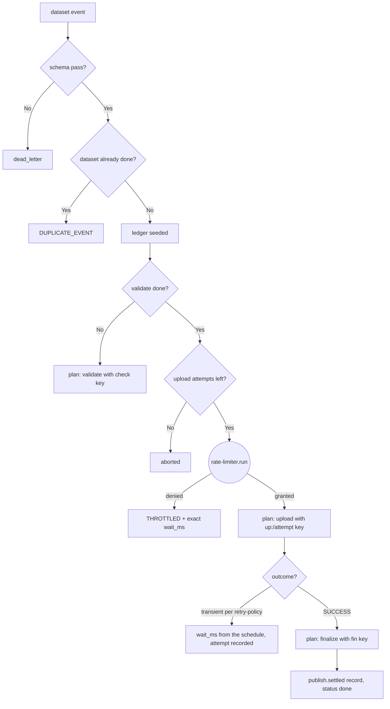

---
# MAM Metadata
id: dataset-publish
name: Dataset Publish Workflow
version: 1.0.0
type: workflow

author: TCP Ecosystems
description: >
  Publishes a checksummed dataset to a registry bucket: schema gate, paced
  upload (one token per attempt, from a Level 1 token bucket), retry policy
  per transient outcome, and a structured-logging completion record. Works
  directly with Level 1 modules — the no-component orchestration pattern.

license: MIT

runtime:
  language: python
  version: ">=3.12"

tags:
  - datasets
  - publishing
  - workflow
  - pacing
  - retry

dependencies:
  - name: schema-validator
    version: ">=1.0.0"
  - name: rate-limiter
    version: ">=1.0.0"
  - name: retry-policy
    version: ">=1.0.0"
  - name: structured-logging
    version: ">=1.0.0"
  - name: mam-runtime
    version: ">=1.0.0"

capabilities:
  - plan
  - reconcile
  - settle

permissions:
  filesystem: none
  network: none
---

# Dataset Publish Workflow

## Purpose

Puts a dataset's payload behind the two disciplines that actually survive a
registry: **egress pacing** (the upload cannot burn the bucket that other
consumers depend on) and a **retry budget that decays** (500 ms doubling to
4 s, four attempts, per failure category). Each planned upload attempts an
idempotency key (`up:<dataset_id>/<attempt>`) and every completion emits one
structured record. Compensation is a declared nothing: dataset publication is
idempotent by checksum — a re-run never publishes anything twice, it dedupes.

## Step table

| Step | Effect | Transient? | Retry decision | Failure after budget | Compensation |
|------|--------|------------|----------------|----------------------|--------------|
| `validate` | none (pure) | never | none | `dead_letter` | none — no side effect happened |
| `upload` | bytes to the registry bucket, open keyed | yes (`TIMEOUT`, `CONNECTION`, `SERVER_5XX`, `RATE_LIMITED`) | retry-policy with a per-attempt acquired token | `aborted` | nothing to un-attach, the publish is idempotent by checksum |
| `finalize` | pure record keeping | never | none | unreachable — pure state mutation succeeds | none |

```text
Retry:  retry-policy decides per attempt with the workflow-level policy —
        {max_attempts 4, base 500 ms, ceiling 4 s, jitter 0}. Deterministic.
Replay: an upload retry re-plans the same dataset attempt with a fresh key —
        a checksum dedupe makes replays safe registrieside.
Stop:   4th transient → abort; a validate fault → dead letter. There is no
        consistent-state risk to repair, so the workflow declares that
        explicitly instead of inventing a compensation.
```

### Idempotency keys (declared; the executor dedupes on them)

```text
check:<dataset_id>          → validate
up:<dataset_id>/<attempt>   → upload (one token consumes per attempt)
fin:<dataset_id>            → finalize
```

`advance(state, id, step, outcome, now_ms, attempt_no=…)` — the executor
echoes the attempt number of the key it acted on (the number in `up:…/N`);
a stale echo is `ALREADY_SETTLED`, never a reprocessed effect.

## Inputs

### The event object (validated with schema-validator)

```text
{ "dataset_id": string, pattern r"ds_[a-z0-9]{8,24}",
  "rows":       integer, 1..10_000_000,
  "checksum":   string, pattern r"[a-f0-9]{64}"      # sha256 hex digest
}
```

### Workflow state (caller-held, per `run`/`advance` round trip)

```text
state = {
  "ledger": { <dataset_id>: { "event": {..}, "steps": {..}, "attempts": {..},
                              "status": "in_progress"|"done"|"aborted"|"dead_letter" } },
  "bucket": { "tokens": float, "last_refill_ms": n },   # the pace tokens
  "config": { "capacity": 1..1024, "refill_per_second": >=0.001 }
}
```

## Outputs

| Name | Type | Description |
|------|------|-------------|
| status | string | `next_step`, `waiting`, `in_progress`, `done`, `aborted`, `dead_letter`, `invalid_state` |
| step | string | The next step, when status is `next_step` |
| step_id | string | Idempotency key of the planned step |
| wait_ms | number | Exact backoff or pacing ms before the next plan |
| record | object | The emitted structured-logging record for the finalize step |
| ledger | object | The per-dataset ledger snapshot (resumable) |

### Codes

`NEXT_STEP`, `THROTTLED`, `STEP_DONE`, `STEP_RETRYABLE`, `DONE`,
`ALREADY_SETTLED`, `ABORTED_ATTEMPTS`, `DEAD_LETTER`, `DUPLICATE_EVENT`,
`WAIT`, `INVALID_STATE`, `DEPENDENCY_UNRESOLVED`.

## Capabilities

### plan

Advance the workflow's pure state machine.

### reconcile

Absorb an upload outcome: success (with the rate token to hold and then the
succeeding retry), transient (with a paced backoff), permanent (abort).

### settle

End the workflow with a structured completion record that carries exactly what
happened, never a secret.

## Rules

- The pacing token is acquired **per planned upload attempt** — retries start out strictly bucket-bounded.
- A retry budget comes from retry-policy, not from the workflow's own arithmetic.
- Publishes are idempotent by checksum, therefore the workflow has explicit `null` compensation funded nowhere except the ledger itself; a rewrite would only lock in a lie saying 'there is compensation' when there isn't.
- `finalize` always runs last and only once (the `fin:` key sets that in stone).
- The module does not write to the filesystem; dataset validation is schema-level only, since the executor owns the storage.
- Every state-mutation transitively survives a replay: `advance` writes `planned` before the executor realizes, so a duplicated outcome is `ALREADY_SETTLED`, not a second publish.
- Integrity codes (`checksums`) never travel into structured-logging fields.

## Workflow



## Python

```python
import time
from typing import Any, Dict, Optional

try:
    from schema_validator import run as validate_value
    from rate_limiter import run as admit
    from retry_policy import run as retry_for
    from structured_logging import run as log_event
except ImportError:
    validate_value = admit = retry_for = log_event = None

DATASET_SCHEMA: Dict[str, Any] = {
    "type": "object",
    "required": ["dataset_id", "rows", "checksum"],
    "additional": False,
    "properties": {
        "dataset_id": {"type": "string", "pattern": r"ds_[a-z0-9]{8,24}"},
        "rows": {"type": "integer", "minimum": 1, "maximum": 10_000_000},
        "checksum": {"type": "string", "pattern": r"[a-f0-9]{64}"},
    },
}

RETRY_POLICY_CFG = {"max_attempts": 4, "base_delay_ms": 500, "max_delay_ms": 4000,
                    "multiplier": 2.0, "jitter_window_ms": 0}

BUCKET_CONFIG_SCHEMA = {"type": "object", "required": ["capacity", "refill_per_second"],
                        "properties": {
                            "capacity": {"type": "integer", "minimum": 1, "maximum": 1024},
                            "refill_per_second": {"type": "number", "minimum": 0.001}}}

CHECKSUM_KEYS = frozenset({"checksum", "signature", "digest"})


def run(state: Any, event: Any, now_ms: Any) -> Dict[str, Any]:
    started = time.perf_counter()

    def envelope(status: str, code: str, **extra: Any) -> Dict[str, Any]:
        out = {"status": status, "code": code, "step": None, "step_id": None,
               "wait_ms": 0, "record": None, "ledger": None,
               "duration_ms": round((time.perf_counter() - started) * 1000, 3)}
        out.update(extra)
        return out

    if validate_value is None or admit is None or retry_for is None or log_event is None:
        return envelope("invalid_state", "DEPENDENCY_UNRESOLVED")
    if not isinstance(state, dict) or not all(k in state for k in ("ledger", "bucket", "config")):
        return envelope("invalid_state", "INVALID_STATE")
    if not isinstance(state["ledger"], dict):
        return envelope("invalid_state", "INVALID_STATE")
    if not validate_value(state["config"], BUCKET_CONFIG_SCHEMA)["valid"]:
        return envelope("invalid_state", "INVALID_STATE")

    verdict = validate_value(event, DATASET_SCHEMA)
    if not verdict["valid"]:
        return envelope("dead_letter", "DEAD_LETTER")

    dataset_id = event["dataset_id"]
    ledger = state["ledger"]
    entry = ledger.get(dataset_id)
    if entry is not None and entry["status"] == "done":
        return envelope("done", "DUPLICATE_EVENT")
    if entry is None:
        entry = {"event": event, "steps": {}, "attempts": {}, "status": "in_progress"}
        ledger[dataset_id] = entry

    if entry["steps"].get("validate") != "done":
        return envelope("next_step", "NEXT_STEP", step="validate",
                        step_id=f"check:{dataset_id}", ledger=entry)

    if entry["steps"].get("upload") != "done":
        attempts = entry["attempts"].get("upload", 0)
        if attempts >= RETRY_POLICY_CFG["max_attempts"]:
            return envelope("aborted", "ABORTED_ATTEMPTS")
        pace = admit(state["bucket"], state["config"], now_ms, 1)
        if not pace["allowed"]:
            return envelope("waiting", pace["code"], wait_ms=pace["wait_ms"])
        state["bucket"] = pace["state"]                     # one token per planned attempt
        return envelope("next_step", "NEXT_STEP", step="upload",
                        step_id=f"up:{dataset_id}/{attempts + 1}", ledger=entry)

    if entry["steps"].get("finalize") != "done":
        entry["steps"]["finalize"] = "done"                 # pure step: plans and acts in one place
        entry["status"] = "done"
        settled = log_event(
            "publish.settled", "info",
            fields={k: ("(checksum)" if k.lower() in CHECKSUM_KEYS else v)
                    for k, v in entry["event"].items()} | {"attempts": entry["attempts"].get("upload", 0) + 1},
            correlation_id=f"fin:{dataset_id}", now=now_ms)
        return envelope("done", "DONE", record=settled["record"], ledger=entry)

    return envelope("done", "DONE", ledger=entry)


def advance(state: Any, dataset_id: Any, step: Any, outcome: Any, now_ms: Any,
            elapsed_ms: Any = 0, attempt_no: Any = None) -> Dict[str, Any]:
    started = time.perf_counter()

    def envelope(status: str, code: str, **extra: Any) -> Dict[str, Any]:
        out = {"status": status, "code": code, "step": step, "wait_ms": 0,
               "ledger": None, "duration_ms": round((time.perf_counter() - started) * 1000, 3)}
        out.update(extra)
        return out

    if retry_for is None or admit is None:
        return envelope("invalid_state", "DEPENDENCY_UNRESOLVED")
    if not isinstance(state, dict) or not isinstance(state.get("ledger"), dict):
        return envelope("invalid_state", "INVALID_STATE")
    entry = state["ledger"].get(dataset_id)
    if entry is None or step not in ("validate", "upload", "finalize") or not isinstance(outcome, str):
        return envelope("invalid_state", "INVALID_STATE")
    if entry["steps"].get(step) == "done":
        return envelope(entry["status"], "ALREADY_SETTLED")

    # idempotency by echoed attempt number — the ledger mirror of the executor's
    # step_id (up:<dataset_id>/<attempt>): a stale echo is settled, never reprocessed
    expected = entry["attempts"].get(step, 0) + 1
    if attempt_no is not None and attempt_no != expected:
        return envelope(entry["status"], "ALREADY_SETTLED")

    if outcome == "SUCCESS":
        entry["steps"][step] = "done"
        return envelope("in_progress", "STEP_DONE", ledger=entry)

    if step == "validate":
        entry["steps"][step] = "failed"
        entry["status"] = "dead_letter"
        return envelope("dead_letter", "DEAD_LETTER", ledger=entry)

    decision = retry_for(expected, outcome, RETRY_POLICY_CFG, elapsed_ms)
    entry["attempts"][step] = expected
    entry["steps"][step] = "failed"
    if decision["action"] == "retry":
        entry["status"] = "in_progress"                    # parked, re-planned later
        return envelope("waiting", "STEP_RETRYABLE", wait_ms=decision["delay_ms"], ledger=entry)
    entry["status"] = "aborted"
    return envelope("aborted", "ABORTED_ATTEMPTS", ledger=entry)
```

## Tests

### Input

```yaml
dataset:
  dataset_id: ds_882311ab
  rows: 12_400
  checksum: 3f79bb7b435b05321651daefd374cdc681dc06faa65e374e38337b88ca6d485e
```

### Expected

```yaml
status: next_step
step: validate
```

```python
import json
DS = {"dataset_id": "ds_882311ab", "rows": 12400,
      "checksum": "3f79bb7b435b05321651daefd374cdc681dc06faa65e374e38337b88ca6d485e"}
CFG = {"capacity": 2, "refill_per_second": 1}


def fresh():
    return {"ledger": {}, "bucket": {"tokens": 2.0, "last_refill_ms": 0}, "config": CFG}


def test_first_plan_is_validate_with_the_check_key():
    out = run(fresh(), DS, 0)
    assert out["status"] == "next_step" and out["step"] == "validate"
    assert out["step_id"] == "check:ds_882311ab"


def test_invalid_dataset_dead_letters_without_side_effects():
    out = run(fresh(), {"dataset_id": "ds_badid", "rows": 0, "checksum": "zz"}, 0)
    assert out["status"] == "dead_letter"
    assert out["ledger"] is None


def test_done_dataset_replay_is_duplicate():
    state = fresh()
    run(state, DS, 0)
    advance(state, "ds_882311ab", "validate", "SUCCESS", 1)
    advance(state, "ds_882311ab", "upload", "SUCCESS", 2)
    out = run(state, DS, 3)        # finalize happens here
    assert out["status"] == "done" and out["code"] == "DONE"
    again = run(state, DS, 4)
    assert again["code"] == "DUPLICATE_EVENT"


def test_finalize_record_never_leaks_the_checksum_or_count():
    state = fresh()
    run(state, DS, 0)
    advance(state, "ds_882311ab", "validate", "SUCCESS", 1)
    advance(state, "ds_882311ab", "upload", "SUCCESS", 2)
    out = run(state, DS, 3)
    rec = out["record"]
    assert rec["fields"]["dataset_id"] == "ds_882311ab"
    assert rec["fields"]["checksum"] == "(checksum)"
    assert rec["event"] == "publish.settled" and rec["level"] == "info"


def test_empty_bucket_throttles_with_exact_wait_and_spends_nothing():
    state = fresh()
    state["bucket"] = {"tokens": 0.0, "last_refill_ms": 0}
    run(state, DS, 0)                     # plans validate: no token needed
    advance(state, "ds_882311ab", "validate", "SUCCESS", 0)
    out = run(state, DS, 0)
    assert out["status"] == "waiting" and out["code"] == "THROTTLED"
    assert out["wait_ms"] == 1000 and state["ledger"]["ds_882311ab"]["steps"]["validate"] == "done"


def test_each_upload_attempt_consumes_exactly_one_token():
    state = fresh()
    run(state, DS, 0)
    advance(state, "ds_882311ab", "validate", "SUCCESS", 0)
    out = run(state, DS, 0)
    assert out["step"] == "upload" and out["step_id"] == "up:ds_882311ab/1"
    assert abs(state["bucket"]["tokens"] - 1.0) < 1e-9
    advance(state, "ds_882311ab", "upload", "TIMEOUT", 0)
    out = run(state, DS, 0)          # retry plan: consumes the second token
    assert out["step_id"] == "up:ds_882311ab/2" and abs(state["bucket"]["tokens"]) < 1e-9


def test_transient_upload_retries_doubling_per_the_policy():
    state = fresh()
    run(state, DS, 0)
    advance(state, "ds_882311ab", "validate", "SUCCESS", 0)
    run(state, DS, 0)
    wait = advance(state, "ds_882311ab", "upload", "TIMEOUT", 0)
    assert wait["code"] == "STEP_RETRYABLE" and wait["wait_ms"] == 500
    run(state, DS, 0)
    wait = advance(state, "ds_882311ab", "upload", "CONNECTION", 0)
    assert wait["wait_ms"] == 1000        # 500 * 2^1, jitter 0 → deterministic


def test_four_transient_failures_abort():
    state = fresh()
    run(state, DS, 0)
    advance(state, "ds_882311ab", "validate", "SUCCESS", 0)
    for i in range(4):
        run(state, DS, i * 4000)          # refill covers each attempt's token
        advance(state, "ds_882311ab", "upload", "TIMEOUT", i * 4000)
    out = run(state, DS, 16000)
    assert out["status"] == "aborted" and out["code"] == "ABORTED_ATTEMPTS"


def test_stale_attempt_echos_are_settled_never_reprocessed():
    state = fresh()
    run(state, DS, 0)
    advance(state, "ds_882311ab", "validate", "SUCCESS", 0, attempt_no=1)
    run(state, DS, 0)                     # plans attempt 1 of upload
    first = advance(state, "ds_882311ab", "upload", "TIMEOUT", 0, attempt_no=1)
    assert first["code"] == "STEP_RETRYABLE" and first["wait_ms"] == 500
    replay = advance(state, "ds_882311ab", "upload", "TIMEOUT", 0, attempt_no=1)
    assert replay["code"] == "ALREADY_SETTLED"    # the ledger mirrors the up:…/1 key
    assert state["ledger"]["ds_882311ab"]["attempts"]["upload"] == 1


def test_invalid_state_is_coded_never_raised():
    assert run({}, DS, 0)["code"] == "INVALID_STATE"
    state = fresh()
    run(state, DS, 0)
    advance(state, "ds_882311ab", "validate", "SUCCESS", 0)
    state["bucket"] = {"tokens": "many", "last_refill_ms": 0}
    out = run(state, DS, 0)               # the L1 limiter codes the corrupt bucket
    assert out["status"] == "waiting" and out["code"] == "INVALID_STATE"


def test_deps_unresolved_gate():
    names = ("validate_value", "admit", "retry_for", "log_event")
    saved = {k: globals()[k] for k in names}
    try:
        for k in names:
            globals()[k] = None
        assert run(fresh(), DS, 0)["code"] == "DEPENDENCY_UNRESOLVED"
        assert advance(fresh(), "ds_882311ab", "upload", "SUCCESS", 0)["code"] == "DEPENDENCY_UNRESOLVED"
    finally:
        globals().update(saved)
```

## Examples

```python
state = {"ledger": {}, "bucket": {"tokens": 4.0, "last_refill_ms": 0}, "config": CFG}

plan = workflow.run(state, dataset_event, now_ms=0)
if plan["status"] == "next_step" and plan["step"] == "upload":
    receipt = executor.upload(plan["step_id"], file_pointer,
                              pace=config, deadline=RETRY_POLICY_CFG["max_delay_ms"])
    workflow.advance(state, dataset_event["dataset_id"], "upload", receipt.category, now_ms)
elif plan["status"] == "waiting":
    scheduler.after(plan["wait_ms"])
```

### Expected Flow

```text
schema gate → token per attempt → transient schedule → abort/settle → structured record
```

## References

- Composes (Level 1, direct): [`schema-validator`](../01-modules/schema-validator.mam.md), [`rate-limiter`](../01-modules/rate-limiter.mam.md), [`retry-policy`](../01-modules/retry-policy.mam.md), [`structured-logging`](../01-modules/structured-logging.mam.md)
- Its sibling [`order-fulfillment`](order-fulfillment.mam.md) shows the same machine composed *through* a Level 2 component
- [MAM source format, full component set](https://github.com/tcp-ecosystems/MAM/blob/main/plan-doc/full-mam.md)
