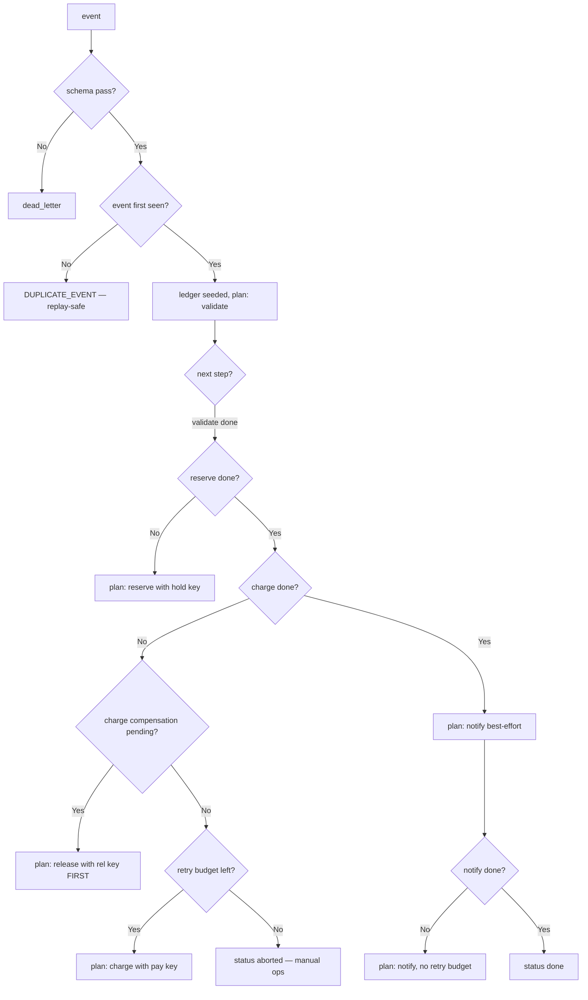

---
# MAM Metadata
id: order-fulfillment
name: Order Fulfillment Workflow
version: 1.0.0
type: workflow

author: TCP Ecosystems
description: >
  Resumable order pipeline: schema gate, inventory reserve, payment charge,
  confirmation — with idempotency on every step, declared failure semantics
  (retry categories per step, compensation when a later step fails), and a
  run ledger that makes replay safe. Composes pacing-circuit (Level 2) and
  schema-validator (Level 1); the ledger is a pure state machine the caller
  re-drives until done.

license: MIT

runtime:
  language: python
  version: ">=3.12"

tags:
  - orders
  - payments
  - workflow
  - idempotency
  - saga

dependencies:
  - name: schema-validator
    version: ">=1.0.0"
  - name: pacing-circuit
    version: ">=1.0.0"
  - name: mam-runtime
    version: ">=1.0.0"

capabilities:
  - plan
  - reconcile
  - settle

permissions:
  filesystem: none
  network: none
---

# Order Fulfillment Workflow

## Purpose

Turns one inbound order event into a series of side effects — without ever
performing one twice. The workflow owns decisions, coordinates the shared
pacing-circuit handle for the payment gateway, and keeps a per-order ledger;
executors perform the actual effects and report back with a failure category.
Everything runs to a terminal state (`done`, `aborted`, `dead_letter`) with
compensation executed **before** any retry is planned, so funds and stock can
never disagree.

## Step table

| Step | Effect | Transient? (retry-category model) | Retry decision | If it fails after attempts | Compensation relies on |
|------|--------|-----------------------------------|----------------|---------------------------|------------------------|
| `validate` | none (pure) | never — a bad order is a caller error | none | `dead_letter` | none needed |
| `reserve` | hold inventory, reversible | yes (`TIMEOUT`, `CONNECTION`, `SERVER_5XX`, `RATE_LIMITED`) | pacing-circuit grants slot + attempt budget | open the reserve hold → release | `release` |
| `charge` | money, irreversible | yes, same categories | pacing-circuit + idempotency key `pay:<order>/<attempt>` | charge aborted → only after ledger agrees on release | `release` |
| `release` | inverse of reserve | yes, same categories | pacing-circuit | kept in `compensation_pending` and re-planned; workflow never exits while a release is missing | none (last resort: manual ops, surfaced in the envelope) |
| `notify` | update order status | best-effort | none | `done` with `notify_failed: true` recorded | none |

```text
Wait:        transient categories park the order with wait_ms — the retry
             budget, not the wall clock, decides when it re-plans.
Compensate:  a spent charge fails → release runs FIRST, before any retry of
             charge gets planned (Order below).
Idempotency: advance() marks steps "planned" BEFORE the executor acts, so a
             replayed outcome is ALREADY_SETTLED — and every plan hands the
             executor its step_id (check/hold/pay/rel/ack keys).
Stop:        after the release settles and the charge budget is exhausted →
             `aborted`; the order is finished manually, never both-charged-
             and-held.
```

### Idempotency keys (declared; executors dedupe on them)

```text
hold:<order_id>          → reserve
pay:<order_id>/<attempt> → charge
rel:<order_id>           → release (reverse key; needs order id replay marker)
ack:<order_id>/<attempt> → notification, best-effort
```

`advance` writes the attempt id into the ledger BEFORE the executor performs
the effect, so replays hit `ALREADY_DONE` or `ALREADY_SETTLED`, not the
gateway.

## Inputs

### The event object (validated with schema-validator)

```text
{ "order_id":  string, pattern r"ord_[a-z0-9]{8,24}",
  "event_id":  string, pattern r"evt_[a-z0-9]{10,40}",          # idempotency domain
  "lines":     array of { "sku": string, "qty": 1..1000 },
  "total_cents": integer 1..100_000_000 }
```

### Ledger and circuit state (caller-held)

```text
state = {
  "ledger":  { <order_id>: { "order": {..}, "steps": {<step>: "planned"|"done"|"failed"},
                             "attempts": {<step>: n}, "status": <see below>,
                             "compensations": [...],
                             "attempts_pay": n } },
  "circuit": <a pacing-circuit handle from start()>,
}
```

Terminal statuses: `done`, `aborted`, `dead_letter`. Transient ones:
`in_progress`, `waiting`, `compensating`.

## Outputs

| Name | Type | Description |
|------|------|-------------|
| status | string | `next_step`, `waiting`, `compensate_first`, `in_progress`, `done`, `aborted`, `dead_letter`, `invalid_state` |
| step | string | The next step to execute, when status is `next_step` |
| step_id | string | Idempotency key for that step (`check/hold/pay/rel/ack:`…), fed straight to the executor |
| wait_ms | number | Backoff after a throttled or retrying outcome |
| ledger snapshot | object | The complete step/attempt picture the caller uses to resume exactly |

### Codes

`NEXT_STEP`, `WAIT`, `COMPENSATE`, `DONE`, `STEP_DONE`, `STEP_RETRYABLE`,
`ALREADY_SETTLED`, `ABORTED_ATTEMPTS`, `ABORTED_PERMANENT`, `DEAD_LETTER`,
`DUPLICATE_EVENT`, `INVALID_STATE`, `DEPENDENCY_UNRESOLVED`.

## Capabilities

### plan

Answer "what should this order do next" — the purest function of ledger state.

### reconcile

Absorb a step's outcome: success advances, transient failure records the attempt
count, permanent failure classifies into its real bucket and locks compensation planning.

### settle

Reach a terminal state only when the ledger agrees side effects are consistent.

## Rules

- Every side-effecting step plans an **idempotency key derived from the** ids **before** writing anything to the ledger's budget.
- The workflow never plans two steps on the same order in one round-trip — one step per `run` call, decided solely by the ledger.
- A failed `charge` sets the *next* plan to `release` — compensation before retry, in that order, always.
- Transient category decisions come from the retry budget the module records, never from wall-clock in the workflow itself.
- Replaying the same `event_id` on a finished order returns `DUPLICATE_EVENT` — the caller asked for the same effect twice.
- An invalid event is a pure validation failure — it is dead-lettered immediately, no compensation exists to reverse nothing.

## Workflow



## Python

```python
import time
from typing import Any, Dict, Optional, Tuple

try:
    from schema_validator import run as validate_value
    from pacing_circuit import start as open_circuit, acquire as grab_slot, record as mark_outcome
except ImportError:
    validate_value = open_circuit = grab_slot = mark_outcome = None

ORDER_SCHEMA: Dict[str, Any] = {
    "type": "object",
    "required": ["order_id", "event_id", "lines", "total_cents"],
    "additional": False,
    "properties": {
        "order_id": {"type": "string", "pattern": r"ord_[a-z0-9]{8,24}"},
        "event_id": {"type": "string", "pattern": r"evt_[a-z0-9]{10,40}"},
        "total_cents": {"type": "integer", "minimum": 1, "maximum": 100_000_000},
        "lines": {
            "type": "array",
            "min_items": 1,
            "max_items": 200,
            "items": {
                "type": "object",
                "required": ["sku", "qty"],
                "properties": {
                    "sku": {"type": "string", "pattern": r"[A-Z0-9\-]{4,24}"},
                    "qty": {"type": "integer", "minimum": 1, "maximum": 1000},
                },
            },
        },
    },
}

TRANSIENT = ("TIMEOUT", "CONNECTION", "SERVER_5XX", "RATE_LIMITED")
STEP_ORDER = ("validate", "reserve", "charge", "release", "notify")
IDEMPOTENCY_KEYS = {
    "validate": "check:<order_id>",
    "reserve":  "hold:<order_id>",
    "charge":   "PAY:<order_id>/<attempt>",
    "release":  "rel:<order_id>",
    "notify":   "ack:<order_id>/<attempt>",
}

def _key(step: str, order_id: str, attempt: int) -> str:
    return IDEMPOTENCY_KEYS[step].replace("<order_id>", order_id).replace("<attempt>", str(attempt))


def run(state: Any, event: Any, now_ms: Any) -> Dict[str, Any]:
    started = time.perf_counter()

    def envelope(status: str, code: str, **extra: Any) -> Dict[str, Any]:
        out = {"status": status, "code": code, "step": None, "step_id": None,
               "wait_ms": 0, "ledger": None, "lines": [],
               "duration_ms": round((time.perf_counter() - started) * 1000, 3)}
        out.update(extra)
        return out

    if validate_value is None or open_circuit is None:
        return envelope("invalid_state", "DEPENDENCY_UNRESOLVED")
    if not isinstance(state, dict) or "ledger" not in state or "circuit" not in state:
        return envelope("invalid_state", "INVALID_STATE")

    verdict = validate_value(event, ORDER_SCHEMA)
    if not verdict["valid"]:
        return envelope("dead_letter", "DEAD_LETTER", wait_ms=0)

    order_id = event["order_id"]
    ledger = state["ledger"]
    record = ledger.get(order_id)

    if record is not None and record["status"] == "done":
        return envelope("done", "DUPLICATE_EVENT")

    # Replays of a live order re-plan exactly the weakest step again
    if record is None:
        ledger[order_id] = {"order": event, "steps": {}, "attempts": {},
                            "compensations": [], "status": "in_progress"}
        record = ledger[order_id]

    if record["steps"].get("validate") != "done":
        return envelope("next_step", "NEXT_STEP", step="validate", step_id=_key("validate", order_id, 0), ledger=record)

    # the circuit is the executor's shared gate: peek, never re-mark, while planning
    open_until = state["circuit"].get("breaker", {}).get("open_until_ms", 0)
    if now_ms < open_until:
        return envelope("waiting", "WAIT", wait_ms=int(open_until - now_ms))

    if record["steps"].get("reserve") != "done":
        return envelope("next_step", "NEXT_STEP", step="reserve", step_id=_key("reserve", order_id, 0), ledger=record)

    if record["steps"].get("release") != "done" and "release" in record["compensations"]:
        return envelope("compensate_first", "COMPENSATE", step="release", step_id=_key("release", order_id, 0), ledger=record)

    if record["steps"].get("charge") != "done":
        attempt = record["attempts"].get("charge", 0)
        if attempt >= 4:
            return envelope("aborted", "ABORTED_ATTEMPTS")
        return envelope("next_step", "NEXT_STEP", step="charge", step_id=_key("charge", order_id, attempt + 1), ledger=record)

    if record["steps"].get("notify") != "done":
        return envelope("next_step", "NEXT_STEP", step="notify", step_id=_key("notify", order_id, 0), ledger=record)

    record["status"] = "done"
    return envelope("done", "DONE", ledger=record)


def advance(state: Any, order_id: Any, step: Any, outcome: Any, now_ms: Any,
            elapsed_ms: Any = 0) -> Dict[str, Any]:
    started = time.perf_counter()

    def envelope(status: str, code: str, **extra: Any) -> Dict[str, Any]:
        out = {"status": status, "code": code, "step": step, "wait_ms": 0, "ledger": None,
               "duration_ms": round((time.perf_counter() - started) * 1000, 3)}
        out.update(extra)
        return out

    if mark_outcome is None:
        return envelope("invalid_state", "DEPENDENCY_UNRESOLVED")
    if not isinstance(state, dict) or "ledger" not in state:
        return envelope("invalid_state", "INVALID_STATE")
    record = state["ledger"].get(order_id)
    if record is None or not isinstance(step, str) or step not in STEP_ORDER:
        return envelope("invalid_state", "INVALID_STATE")
    if not isinstance(outcome, str):
        return envelope("invalid_state", "INVALID_STATE")

    already = record["steps"].get(step)
    if already in ("done", "planned"):
        return envelope(record["status"], "ALREADY_SETTLED")

    record["steps"][step] = "planned"          # idempotency: mark before the act
    if outcome == "SUCCESS":
        record["steps"][step] = "done"
        if step in ("reserve", "charge"):       # keep the gateway's breaker honest
            mark_outcome(state["circuit"], "SUCCESS", now_ms)
        if step == "notify":
            record["status"] = "done"
        return envelope(record["status"], "STEP_DONE", ledger=record)

    if step in ("validate",):
        record["steps"][step] = "failed"
        record["status"] = "dead_letter"
        return envelope("dead_letter", "DEAD_LETTER", ledger=record)

    # circuit first: the breakable dependency viewpoint
    mark_outcome(state["circuit"], outcome, now_ms)

    attempt = record["attempts"].get(step, 0) + 1
    record["attempts"][step] = attempt
    record["steps"][step] = "failed"

    if outcome == "PROTOCOL_ERROR":
        if step == "charge" and record["steps"].get("reserve") == "done":
            record["compensations"].append("release")
        record["status"] = "aborted"
        return envelope("aborted", "ABORTED_PERMANENT", ledger=record)

    if attempt >= 4:
        if step == "charge" and record["steps"].get("reserve") == "done":
            record["compensations"].append("release")
        return envelope("aborted", "ABORTED_ATTEMPTS", ledger=record)

    if outcome in TRANSIENT:
        record["status"] = "waiting"
        return envelope("waiting", "WAIT", wait_ms=min(1000 * 2 ** attempt, 8000), ledger=record)

    record["status"] = "in_progress"
    return envelope("in_progress", "STEP_RETRYABLE", ledger=record)
```

## Tests

### Input

```yaml
event:
  order_id: ord_88423ab12
  event_id: evt_20261023ab8842
  total_cents: 12900
  lines: [{ sku: TSHIRT-RED-L, qty: 1 }]
```

### Expected

```yaml
status: next_step
step: validate
code: NEXT_STEP
```

```python
EVENT = {"order_id": "ord_88423ab12", "event_id": "evt_20261023ab8842",
         "total_cents": 12900, "lines": [{"sku": "TSHIRT-RED-L", "qty": 1}]}


def fresh():
    circuit = open_circuit({"bucket": {"capacity": 10, "refill_per_second": 5},
                            "breaker": {"failure_threshold": 5, "cooldown_ms": 250}})["handle"]
    return {"ledger": {}, "circuit": circuit}


def test_first_event_plans_validate_with_an_idempotency_key():
    out = run(fresh(), EVENT, 0)
    assert out["status"] == "next_step" and out["step"] == "validate"
    assert out["step_id"] == "check:ord_88423ab12"
    assert out["code"] == "NEXT_STEP"


def test_malformed_event_is_dead_lettered_without_compensation():
    out = run(fresh(), {"order_id": "ord_broken", "event_id": "evt_no_id",
                        "lines": [], "total_cents": 0}, 0)
    assert out["status"] == "dead_letter" and out["ledger"] is None


def test_replay_of_a_done_order_is_a_duplicate_not_a_second_run():
    state = fresh()
    run(state, EVENT, 0)
    advance(state, "ord_88423ab12", "validate", "SUCCESS", 1)
    advance(state, "ord_88423ab12", "reserve", "SUCCESS", 2)
    advance(state, "ord_88423ab12", "charge", "SUCCESS", 3)
    advance(state, "ord_88423ab12", "notify", "SUCCESS", 4)
    replay = run(state, EVENT, 5)
    assert replay["code"] == "DUPLICATE_EVENT" and replay["status"] == "done"


def test_advance_marks_before_the_act_making_replays_noops():
    state = fresh()
    run(state, EVENT, 0)
    advance(state, "ord_88423ab12", "validate", "SUCCESS", 1)
    again = advance(state, "ord_88423ab12", "validate", "SUCCESS", 2)
    assert again["code"] == "ALREADY_SETTLED"
    assert state["ledger"]["ord_88423ab12"]["steps"]["validate"] == "done"


def test_transient_charge_failure_waits_not_aborts():
    state = fresh()
    run(state, EVENT, 0)
    advance(state, "ord_88423ab12", "validate", "SUCCESS", 0)
    advance(state, "ord_88423ab12", "reserve", "SUCCESS", 0)
    out = advance(state, "ord_88423ab12", "charge", "TIMEOUT", 5)
    assert out["status"] == "waiting" and out["code"] == "WAIT"
    assert out["wait_ms"] >= 1000 and state["ledger"]["ord_88423ab12"]["status"] == "waiting"


def test_charge_exhaustion_plans_release_compensation_before_replan():
    state = fresh()
    run(state, EVENT, 0)
    advance(state, "ord_88423ab12", "validate", "SUCCESS", 0)
    advance(state, "ord_88423ab12", "reserve", "SUCCESS", 0)
    for attempt in range(4):
        out = advance(state, "ord_88423ab12", "charge", "TIMEOUT", attempt * 100, 0)
    assert out["status"] == "aborted" and out["code"] == "ABORTED_ATTEMPTS"
    assert "release" in state["ledger"]["ord_88423ab12"]["compensations"]
    comp = run(state, EVENT, 20000)
    assert comp["status"] == "compensate_first" and comp["step"] == "release"


def test_permanent_gateway_error_compensates_and_aborts():
    state = fresh()
    run(state, EVENT, 0)
    advance(state, "ord_88423ab12", "validate", "SUCCESS", 0)
    advance(state, "ord_88423ab12", "reserve", "SUCCESS", 0)
    hard = advance(state, "ord_88423ab12", "charge", "PROTOCOL_ERROR", 0)
    assert hard["status"] == "aborted" and "release" in state["ledger"]["ord_88423ab12"]["compensations"]


def test_breaker_returns_wait_when_the_gateway_is_open():
    state = fresh()
    for i in range(5):
        grab_slot(state["circuit"], i)
        mark_outcome(state["circuit"], "TIMEOUT", i)
    run(state, EVENT, 0)
    advance(state, "ord_88423ab12", "validate", "SUCCESS", 5)
    out = run(state, EVENT, 6)
    assert out["status"] == "waiting" and out["code"] == "WAIT"


def test_notify_failure_still_settles_the_order_done():
    state = fresh()
    run(state, EVENT, 0)
    advance(state, "ord_88423ab12", "validate", "SUCCESS", 0)
    advance(state, "ord_88423ab12", "reserve", "SUCCESS", 0)
    advance(state, "ord_88423ab12", "charge", "SUCCESS", 0)
    advance(state, "ord_88423ab12", "notify", "TIMEOUT", 0)
    out = run(state, EVENT, 1)
    assert out["status"] == "next_step" and out["step"] == "notify"    # notify retries, cheap
    advance(state, "ord_88423ab12", "notify", "SUCCESS", 2)
    assert run(state, EVENT, 3)["status"] == "done"


def test_corrupt_and_missing_state_never_acts():
    assert run({}, EVENT, 0)["code"] == "INVALID_STATE"
    assert run(None, EVENT, 0)["code"] == "INVALID_STATE"
    assert advance({"ledger": {}}, "ghost", "validate", "SUCCESS", 0)["code"] == "INVALID_STATE"


def test_deps_unresolved_gate():
    names = ("validate_value", "open_circuit", "grab_slot", "mark_outcome")
    saved = {k: globals()[k] for k in names}
    try:
        for k in names:
            globals()[k] = None
        broken_state = {"ledger": {"ord_x": {}}, "circuit": {}}
        assert run(broken_state, EVENT, 0)["code"] == "DEPENDENCY_UNRESOLVED"
        assert advance(broken_state, "ord_x", "charge", "SUCCESS", 0)["code"] == "DEPENDENCY_UNRESOLVED"
    finally:
        globals().update(saved)
```

## Examples

```python
state = {"ledger": {}, "circuit": pacing.start(BREAKER_CONFIG)["handle"]}

plan = workflow.run(state, event, now_ms=0)
if plan["status"] == "next_step":
    receipt = executors[plan["step"]](event, f"idem:{plan['step_id']}")   # socket-side effect
    settled = workflow.advance(state, event["order_id"], plan["step"], receipt.category, now_ms=0)
elif plan["status"] == "waiting":
    scheduler.after(plan["wait_ms"])
```

### Expected Flow

```text
schema gate → ledger plan → idempotency key → side effect → category reconcile → settle/compensate
```

## References

- Composes: [`pacing-circuit`](../02-components/pacing-circuit.mam.md), [`schema-validator`](../01-modules/schema-validator.mam.md)
- The four failure answers live in the [Level 3 contract](README.md)
- [MAM source format, full component set](https://github.com/tcp-ecosystems/MAM/blob/main/plan-doc/full-mam.md)
