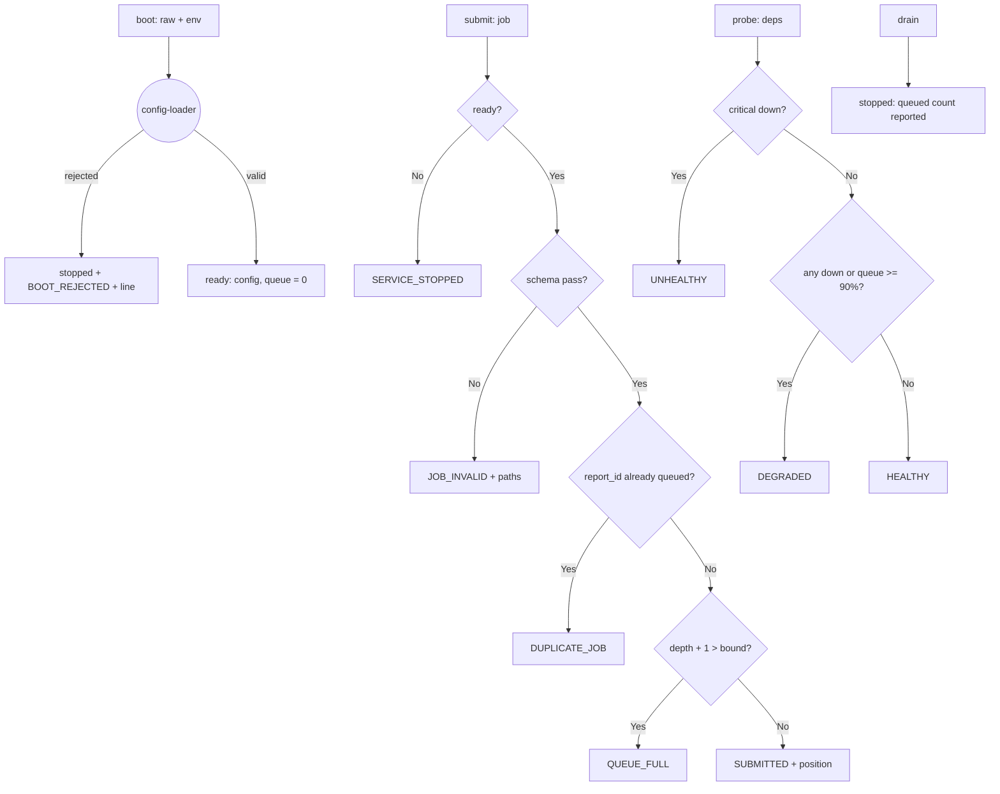

---
# MAM Metadata
id: report-worker
name: Report Worker Service
version: 1.0.0
type: service

author: TCP Ecosystems
description: >
  A resident background service that generates reports from a queue: boots
  from layered configuration through config-loader, answers structured
  health probes with critical-dependency logic, admits jobs through a
  schema gate under explicit backpressure, and drains on command without
  losing sight of what was parked. The service owns zero infrastructure —
  a host runtime binds it to timers and workers.

license: MIT

runtime:
  language: python
  version: ">=3.12"

tags:
  - service
  - lifecycle
  - health
  - backpressure
  - worker

dependencies:
  - name: config-loader
    version: ">=1.0.0"
  - name: schema-validator
    version: ">=1.0.0"
  - name: structured-logging
    version: ">=1.0.0"
  - name: mam-runtime
    version: ">=1.0.0"

capabilities:
  - boot
  - probe
  - submit
  - drain

permissions:
  filesystem: none
  network: none
---

# Report Worker Service

## Purpose

A service is a long-lived resident process, so its definition must answer
four questions a function never faces: **how do I start** (and what happens
when configuration is bad), **am I healthy right now** (per dependency, with
criticality), **do I accept this work** (under a bounded queue), and **how do
I stop** (without lying about in-flight work). This worker answers all four
as pure decisions; the host runtime owns timers, threads and the real
report-rendering executor.

## Memory

State that outlives a call, persisted by the caller:

```text
state = {
  "status":     "ready" | "stopped",
  "config":     { queue_depth, poll_interval_ms, critical: [ids] },
  "queue":      [ report jobs in admission order ],
  "started_at": ms of the boot that produced this state
}
```

- **Persistence:** caller-owned; the service is stateless between calls.
- **Corrupt state** (wrong shape, missing keys, foreign `status`): every
  export returns a coded `INVALID_STATE` envelope and acts on nothing.

## Exports

| Export | Inputs | Returns | Contract |
|--------|--------|---------|----------|
| `boot(raw, env?, now_ms?)` | config file layer + env layer | `{valid, status, code, config, lines, ...}` | config-loader gate with fixed defaults; a rejected layer never produces a `ready` state |
| `probe(state, dependencies)` | snapshot of dependencies | `{status, code, detail, ...}` | Health rollup: `healthy` if all dependencies healthy; `degraded` when only non-critical ones are down **or** the queue is ≥ 90% full; `unhealthy` when any critical dependency is down or the service is stopped |
| `submit(state, job, now_ms?)` | report job | `{code, position, lines, ...}` | schema gate + duplicate check + queue-depth backpressure |
| `drain(state, now_ms?)` | — | `{status, code, queued, ...}` | Closed for new work, queue preserved and reported; irreversible for this state object |

## Inputs

### `boot` — service configuration (config-loader grammar)

```text
raw / env keys:  queue_depth        int 1..10_000
                 poll_interval_ms   int 10..600_000
                 critical           array of dependency ids (1..16)
env override:    CFG_QUEUE_DEPTH, CFG_POLL_INTERVAL_MS, CFG_CRITICAL_I
```

`critical` lists the dependency ids whose being down makes the service
`unhealthy` rather than `degraded` — an operations decision, not a code one.

### `submit` — job schema

```text
{ "report_id": string, pattern r"rep_[a-z0-9]{8,24}",
  "dataset_id": string, pattern r"ds_[a-z0-9]{1,24}",
  "window": { "from_ms": >=0, "to_ms": >=0 }   # to_ms > from_ms
}
```

### `probe` — dependencies snapshot

```text
{ "<dependency_id>": { "state": "healthy" | "down", "latency_ms": >=0 }, ... }
```

## Outputs

| Name | Type | Description |
|------|------|-------------|
| status | string | `ready` / `stopped` for lifecycle; `healthy` / `degraded` / `unhealthy` for probes |
| code | string | `""`, `BOOT_REJECTED`, `SUBMITTED`, `DUPLICATE_JOB`, `QUEUE_FULL`, `JOB_INVALID`, `SERVICE_STOPPED`, `DRAINED`, `HEALTHY`, `DEGRADED`, `UNHEALTHY`, `INVALID_STATE`, `DEPENDENCY_UNRESOLVED` |
| position | integer | 1-based queue position after a successful submit |
| queued | integer | Jobs parked when a drain completed |
| config | object | The merged configuration a successful boot produced |

## Capabilities

### boot

Turn layered configuration into a `ready` state — or a log-line'd rejection that names the violating paths.

### probe

Roll dependency health plus local pressure into one honest status word.

### submit

Admit work only when the schema passes and the queue has room.

### drain

Stop admitting and report exactly what was left parked.

## Rules

- `boot` validates through config-loader — the service configures nothing itself and never merges ad hoc.
- A job is admitted only between `ready` and `drain`: `submit` after a drain is `SERVICE_STOPPED`, permanently for that state object.
- The queue depth is a hard bound: the job that would exceed it is refused with `QUEUE_FULL` and the queue it saw unchanged.
- Duplicate `report_id` within the same queue is `DUPLICATE_JOB` — once is work, twice is a caller bug.
- Criticality is data, not code: config names the critical dependencies; the probe logic only reads the list.
- Health probes never mutate state; drains never re-open.
- Every rejected admission (bad job, full queue, duplicate) is a coded envelope — the service never throws across its boundary.
- No timestamps invented: `now_ms` is a caller argument anywhere time matters.

## Workflow



## Python

```python
import time
from typing import Any, Dict, Optional, Tuple

try:
    from config_loader import run as load_layers
    from schema_validator import run as validate_value
    from structured_logging import run as log_event
except ImportError:
    load_layers = validate_value = log_event = None

SERVICE_SCHEMA: Dict[str, Any] = {
    "type": "object",
    "required": ["queue_depth", "poll_interval_ms", "critical"],
    "additional": False,
    "properties": {
        "queue_depth": {"type": "integer", "minimum": 1, "maximum": 10_000},
        "poll_interval_ms": {"type": "integer", "minimum": 10, "maximum": 600_000},
        "critical": {"type": "array", "min_items": 1, "max_items": 16,
                     "items": {"type": "string", "pattern": r"[a-z][a-z0-9\-]{1,31}"}},
    },
}
SERVICE_DEFAULTS: Dict[str, Any] = {"queue_depth": 64, "poll_interval_ms": 2_000,
                                    "critical": ["registry"]}

JOB_SCHEMA: Dict[str, Any] = {
    "type": "object",
    "required": ["report_id", "dataset_id", "window"],
    "additional": False,
    "properties": {
        "report_id": {"type": "string", "pattern": r"rep_[a-z0-9]{8,24}"},
        "dataset_id": {"type": "string", "pattern": r"ds_[a-z0-9]{1,24}"},
        "window": {
            "type": "object",
            "required": ["from_ms", "to_ms"],
            "properties": {
                "from_ms": {"type": "integer", "minimum": 0},
                "to_ms": {"type": "integer", "minimum": 0},
            },
        },
    },
}

def _usable(state: Any) -> bool:
    if not isinstance(state, dict) or "status" not in state:
        return False
    if state["status"] not in ("ready", "stopped"):
        return False
    if not isinstance(state.get("config"), dict):
        return False
    if not isinstance(state.get("queue"), list):
        return False
    return True


def boot(raw: Any, env: Optional[Dict[str, Any]] = None,
         now_ms: Any = 0) -> Dict[str, Any]:
    started = time.perf_counter()

    def envelope(valid: bool, status: str, code: str, **extra: Any) -> Dict[str, Any]:
        out = {"valid": valid, "status": status, "code": code, "config": None,
               "lines": [], "duration_ms": round((time.perf_counter() - started) * 1000, 3)}
        out.update(extra)
        return out

    if load_layers is None or validate_value is None or log_event is None:
        return envelope(False, "stopped", "DEPENDENCY_UNRESOLVED")

    verdict = load_layers(raw, SERVICE_SCHEMA, defaults=SERVICE_DEFAULTS, env=env)
    if not verdict["valid"]:
        line = log_event("service.boot.rejected", "error",
                         fields={"violations": len(verdict["errors"]),
                                 "drift": [u["path"] for u in verdict["unknown"]]},
                         correlation_id=None, now=now_ms)
        return envelope(False, "stopped", "BOOT_REJECTED",
                        lines=[line["line"]], errors=verdict["errors"])

    state = {"status": "ready", "config": verdict["config"], "queue": [],
             "started_at": now_ms}
    line = log_event("service.boot.ready", "info",
                     fields={"queue_depth": verdict["config"]["queue_depth"],
                             "poll_interval_ms": verdict["config"]["poll_interval_ms"]},
                     correlation_id=None, now=now_ms)
    out = envelope(True, "ready", "", config=verdict["config"], lines=[line["line"]])
    out["state"] = state
    return out


def probe(state: Any, dependencies: Any) -> Dict[str, Any]:
    started = time.perf_counter()

    def envelope(status: str, code: str, **extra: Any) -> Dict[str, Any]:
        out = {"status": status, "code": code, "detail": "",
               "duration_ms": round((time.perf_counter() - started) * 1000, 3)}
        out.update(extra)
        return out

    if not _usable(state) or not isinstance(dependencies, dict):
        return envelope("unhealthy", "INVALID_STATE", detail="state or dependency snapshot unusable")

    if state["status"] != "ready":
        return envelope("unhealthy", "UNHEALTHY", detail="service is not ready")

    critical = set(state["config"]["critical"])
    down = []
    for dep_id, dep in dependencies.items():
        if not isinstance(dep, dict) or dep.get("state") not in ("healthy", "down"):
            return envelope("unhealthy", "INVALID_STATE", detail=f"dependency {dep_id} malformed")
        if dep["state"] == "down":
            down.append(dep_id)

    depth = len(state["queue"])
    bound = state["config"]["queue_depth"]
    pressured = bound > 0 and depth >= 0.9 * bound
    critical_down = [d for d in down if d in critical]

    if critical_down:
        return envelope("unhealthy", "UNHEALTHY",
                        detail=f"critical dependencies down: {sorted(critical_down)}",
                        down=down)
    if down or pressured:
        return envelope("degraded", "DEGRADED",
                        detail=f"non-critical down: {sorted(down)}" if down
                        else f"queue at {depth}/{bound}")
    return envelope("healthy", "HEALTHY", detail=f"queue at {depth}/{bound}")


def submit(state: Any, job: Any, now_ms: Any = 0) -> Dict[str, Any]:
    started = time.perf_counter()

    def envelope(code: str, **extra: Any) -> Dict[str, Any]:
        out = {"code": code, "position": None, "lines": [],
               "duration_ms": round((time.perf_counter() - started) * 1000, 3)}
        out.update(extra)
        return out

    if validate_value is None or log_event is None:
        return envelope("DEPENDENCY_UNRESOLVED")
    if not _usable(state):
        return envelope("INVALID_STATE")

    if state["status"] != "ready":
        return envelope("SERVICE_STOPPED")

    verdict = validate_value(job, JOB_SCHEMA)
    if not verdict["valid"]:
        return envelope("JOB_INVALID", errors=verdict["errors"])

    if any(queued.get("report_id") == job["report_id"] for queued in state["queue"]):
        return envelope("DUPLICATE_JOB")

    if len(state["queue"]) + 1 > state["config"]["queue_depth"]:
        line = log_event("service.queue.full", "warn",
                         fields={"depth": len(state["queue"]),
                                 "bound": state["config"]["queue_depth"]},
                         correlation_id=None, now=now_ms)
        return envelope("QUEUE_FULL", lines=[line["line"]])

    state["queue"].append(dict(job))
    line = log_event("service.job.queued", "info",
                     fields={"report_id": job["report_id"], "position": len(state["queue"])},
                     correlation_id=None, now=now_ms)
    out = envelope("SUBMITTED", position=len(state["queue"]), lines=[line["line"]])
    return out


def drain(state: Any, now_ms: Any = 0) -> Dict[str, Any]:
    started = time.perf_counter()

    def envelope(code: str, **extra: Any) -> Dict[str, Any]:
        out = {"code": code, "queued": None, "lines": [],
               "duration_ms": round((time.perf_counter() - started) * 1000, 3)}
        out.update(extra)
        return out

    if validate_value is None or log_event is None:
        return envelope("DEPENDENCY_UNRESOLVED")
    if not _usable(state):
        return envelope("INVALID_STATE")

    if state["status"] != "ready":
        return envelope("SERVICE_STOPPED")

    queued = len(state["queue"])
    state["status"] = "stopped"
    line = log_event("service.drain.done", "info",
                     fields={"queued": queued}, correlation_id=None, now=now_ms)
    out = envelope("DRAINED", queued=queued, lines=[line["line"]])
    out["status"] = "stopped"
    return out
```

## Tests

### Input

```yaml
raw: { queue_depth: 2, poll_interval_ms: 500, critical: [registry] }
job: { report_id: rep_88423ab129, dataset_id: ds_882311, window: { from_ms: 0, to_ms: 100 } }
```

### Expected

```yaml
status: ready
code: ""
probe: healthy
```

```python
import json

RAW = {"queue_depth": 2, "poll_interval_ms": 500, "critical": ["registry"]}
JOB = {"report_id": "rep_88423ab129", "dataset_id": "ds_882311",
       "window": {"from_ms": 0, "to_ms": 100}}


def ready():
    out = boot(RAW, now_ms=0)
    assert out["valid"] is True, out
    return out["state"]


def test_boot_merges_and_reports_ready():
    out = boot(RAW, now_ms=7)
    assert out["status"] == "ready" and out["code"] == ""
    assert out["config"]["poll_interval_ms"] == 500
    assert out["state"]["started_at"] == 7
    assert json.loads(out["lines"][0])["event"] == "service.boot.ready"


def test_boot_rejects_bad_layers_with_paths_kept():
    out = boot({"queue_depth": 0}, now_ms=0)
    assert out["status"] == "stopped" and out["code"] == "BOOT_REJECTED"
    assert any(e["path"] == "queue_depth" for e in out["errors"])
    assert json.loads(out["lines"][0])["event"] == "service.boot.rejected"


def test_env_layer_overrides_the_file_layer():
    out = boot(RAW, env={"CFG_POLL_INTERVAL_MS": "900"})
    assert out["config"]["poll_interval_ms"] == 900


def test_submit_admits_and_reports_position():
    state = ready()
    out = submit(state, JOB, now_ms=1)
    assert out["code"] == "SUBMITTED" and out["position"] == 1
    assert json.loads(out["lines"][0])["fields"]["report_id"] == "rep_88423ab129"


def test_submit_enforces_the_schema_gate():
    state = ready()
    bad = {"report_id": "rep_XX", "dataset_id": "ds_1", "window": {"from_ms": 9, "to_ms": 0}}
    out = submit(state, bad)
    assert out["code"] == "JOB_INVALID"
    assert any(e["path"] == "report_id" for e in out["errors"])
    assert state["queue"] == []


def test_duplicate_report_ids_are_refused():
    state = ready()
    submit(state, JOB)
    again = submit(state, dict(JOB))
    assert again["code"] == "DUPLICATE_JOB"
    assert len(state["queue"]) == 1


def test_queue_depth_is_a_hard_bound():
    state = ready()                       # queue_depth = 2
    submit(state, JOB)
    submit(state, {"report_id": "rep_00000aaaa", "dataset_id": "ds_x1",
                   "window": {"from_ms": 0, "to_ms": 1}})
    full = submit(state, {"report_id": "rep_99999zzzz", "dataset_id": "ds_x2",
                          "window": {"from_ms": 0, "to_ms": 1}})
    assert full["code"] == "QUEUE_FULL"
    assert len(state["queue"]) == 2       # the refused job never entered


def test_probe_rolls_health_with_criticality():
    state = ready()
    healthy = probe(state, {"registry": {"state": "healthy", "latency_ms": 3}})
    assert healthy["code"] == "HEALTHY"
    degraded = probe(state, {"cache": {"state": "down", "latency_ms": 0}})
    assert degraded["code"] == "DEGRADED"
    broken = probe(state, {"registry": {"state": "down", "latency_ms": 0}})
    assert broken["code"] == "UNHEALTHY"
    assert "registry" in broken["detail"]


def test_probe_flags_a_pressured_queue():
    state = ready()
    submit(state, JOB)                                     # 1/2 → 50%
    assert probe(state, {})["code"] == "HEALTHY"
    submit(state, {"report_id": "rep_00000aaaa", "dataset_id": "ds_x1",
                   "window": {"from_ms": 0, "to_ms": 1}})  # 2/2 → 100%
    assert probe(state, {})["code"] == "DEGRADED"


def test_probe_rejects_malformed_dependencies():
    state = ready()
    out = probe(state, {"registry": {"state": "vibes"}})
    assert out["code"] == "INVALID_STATE"


def test_drain_stops_admission_and_reports_parked_work():
    state = ready()
    submit(state, JOB)
    done = drain(state, now_ms=9)
    assert done["status"] == "stopped" and done["code"] == "DRAINED"
    assert done["queued"] == 1
    after = submit(state, dict(JOB))
    assert after["code"] == "SERVICE_STOPPED"
    again = drain(state)
    assert again["code"] == "SERVICE_STOPPED"      # drains never re-open


def test_drained_service_probes_unhealthy():
    state = ready()
    drain(state)
    assert probe(state, {})["code"] == "UNHEALTHY"


def test_corrupt_state_is_coded_never_raised():
    assert probe({"status": "half"}, {})["code"] == "INVALID_STATE"
    assert submit({"status": "ready"}, JOB)["code"] == "INVALID_STATE"
    assert drain("no")["code"] == "INVALID_STATE"


def test_deps_unresolved_gate():
    names = ("load_layers", "validate_value", "log_event")
    saved = {k: globals()[k] for k in names}
    try:
        for k in names:
            globals()[k] = None
        assert boot(RAW)["code"] == "DEPENDENCY_UNRESOLVED"
        assert submit({"status": "ready", "config": SERVICE_DEFAULTS, "queue": []}, JOB)["code"] == "DEPENDENCY_UNRESOLVED"
        assert drain({"status": "ready"})["code"] == "DEPENDENCY_UNRESOLVED"
    finally:
        globals().update(saved)
```

## Examples

```python
state = boot(config_layers, env=ENV, now_ms=now_ms())["state"]
host.register_timer(state["config"]["poll_interval_ms"], render_next, state)

health = probe(state, host.dependency_snapshot())
if health["code"] in ("UNHEALTHY", "DEGRADED"):
    alarms.raise(health["detail"])

admission = submit(state, job, now_ms=now_ms())
if admission["code"] == "QUEUE_FULL":
    caller.retry_after(state["config"]["poll_interval_ms"])
elif admission["code"] == "SUBMITTED":
    metrics.gauge("queue.position", admission["position"])

# SIGTERM: stop taking work; the host finishes the queue it already has
drain(state, now_ms=now_ms())
```

### Expected Flow

```text
config gate → ready → admit-under-bound → health rollup → drain-and-report
```

## References

- Composes: [`config-loader`](../01-modules/config-loader.mam.md), [`schema-validator`](../01-modules/schema-validator.mam.md), [`structured-logging`](../01-modules/structured-logging.mam.md)
- Sibling in this level: [`webhook-receiver`](webhook-receiver.mam.md)
- [MAM source format, full component set](https://github.com/tcp-ecosystems/MAM/blob/main/plan-doc/full-mam.md)
