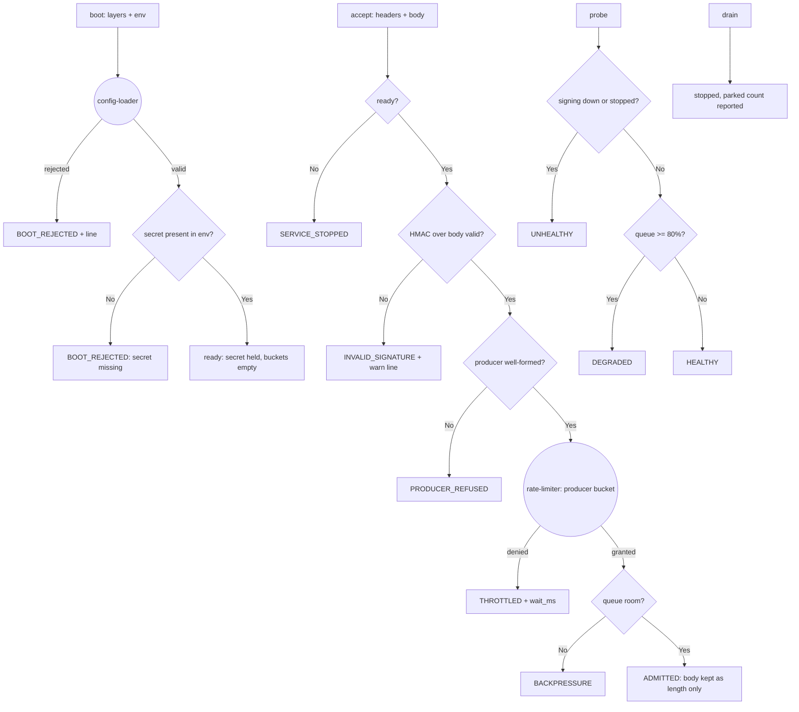

---
# MAM Metadata
id: webhook-receiver
name: Webhook Receiver Service
version: 1.0.0
type: service

author: TCP Ecosystems
description: >
  An inbound HTTP-facing service that admits producer webhooks only after a
  constant-time HMAC signature check, paces every producer with its own
  Level 1 token bucket, and bodies the payload straight into a bounded queue.
  Boots its secret reference from layered config through config-loader,
  never logs body content or the secret, and drains on command.

license: MIT

runtime:
  language: python
  version: ">=3.12"

tags:
  - service
  - webhooks
  - hmac
  - admission
  - pacing

dependencies:
  - name: config-loader
    version: ">=1.0.0"
  - name: rate-limiter
    version: ">=1.0.0"
  - name: structured-logging
    version: ">=1.0.0"
  - name: schema-validator
    version: ">=1.0.0"
  - name: mam-runtime
    version: ">=1.0.0"

capabilities:
  - boot
  - accept
  - probe
  - drain

permissions:
  filesystem: none
  network: none
  environment: read
  secrets: reference-only
---

# Webhook Receiver Service

## Purpose

The receiving side of an integration is where trust gets decided, so this
service makes three decisions on every request and refuses everything it
cannot decide: **is the caller authentic** (HMAC-SHA256 over the exact body,
compared in constant time), **is the caller's traffic within pace** (one
token bucket *per producer*, so one bad neighbor cannot starve the others),
and **is there room** (a bounded queue — overload is refused loudly, not
silently buffered forever). The service holds no sockets: a host runtime
binds it to the HTTP layer; this is the trust logic as reviewable code.

## Memory

```text
state = {
  "status":   "ready" | "stopped",
  "secret":   <the signing secret resolved from the environment>,   # never logged, never in envelopes
  "config":   { queue_cap, bucket: { capacity, refill_per_second } },
  "buckets":  { <producer_id>: { tokens, last_refill_ms } },        # per-producer pace state
  "queue":    [ accepted-envelopes, body replaced by its length ],
  "created":  n    # growth guard: max producer buckets
}
```

- **Persistence:** caller-owned, as everywhere in this library.
- **Corrupt state:** coded `INVALID_STATE`, never an exception — including a
  missing secret, which is a boot failure, not a runtime surprise.

## Exports

| Export | Inputs | Returns | Contract |
|--------|--------|---------|----------|
| `boot(raw, env, now_ms?)` | config layers + process environment | `{valid, status, code, state, lines, ...}` | config-loader gate; the config names the env var holding the secret, the service reads it once at boot; a missing secret refuses the boot (`BOOT_REJECTED`) |
| `accept(state, headers, body, now_ms)` | HTTP headers + raw body | `{code, position, lines, ...}` | Gate order is fixed: authenticity → producer shape → pace → queue room |
| `probe(state, dependencies)` | dependency snapshot | `{status, code, detail, ...}` | `healthy` with everything fine; `degraded` when the queue is ≥ 80% full or a non-critical dependency is down; `unhealthy` when the `signing` dependency is down or the service is stopped |
| `drain(state, now_ms?)` | — | `{status, code, queued, ...}` | Stop admitting; report parked count; irreversible for the state object |

## Inputs

### `boot` — service configuration

```text
keys:             queue_cap    int 1..10_000
                  bucket       { capacity int 1..1024, refill_per_second >=0.001 }
                  secret_ref   string, env var name pattern r"[A-Z][A-Z0-9_]{2,63}"
env:              CFG_QUEUE_CAP, CFG_BUCKET_CAPACITY_I, CFG_REFILL_I
                  + the env var named by secret_ref must hold the secret
```

### `accept` — headers and body

| Name | Type | Required | Description |
|------|------|----------|-------------|
| headers | object | Yes | At minimum `x-mam-producer` (id, `pr_[a-z0-9_]{4,24}`) and `x-mam-signature` (64 lowercase hex, HMAC-SHA256 of the body) |
| body | string | Yes | The raw payload; the signature is computed over exactly these bytes |
| now_ms | number | Yes | Caller's clock |

### `probe` — dependencies

```text
{ "<dep_id>": { "state": "healthy" | "down" }, ... }
```

## Outputs

| Name | Type | Description |
|------|------|-------------|
| code | string | `""`, `BOOT_REJECTED`, `ADMITTED`, `INVALID_SIGNATURE`, `PRODUCER_REFUSED`, `THROTTLED`, `BACKPRESSURE`, `SERVICE_STOPPED`, `DRAINED`, `HEALTHY`, `DEGRADED`, `UNHEALTHY`, `INVALID_STATE`, `DEPENDENCY_UNRESOLVED` |
| position | integer | 1-based queue position after an admission |
| queued | integer | Parked envelopes after a drain |
| state | object | The ready service state a successful boot produced |

## Capabilities

### boot

Gate the configuration through config-loader, resolve the secret exactly once, refuse loudly when it is absent.

### accept

Authenticate, shape-check, pace per producer, and queue — each stage a typed refusal when it fails.

### probe

Roll queue pressure and dependency health into one status word.

### drain

Close admission without lying about what is parked.

## Rules

- Signature comparison is constant time (`hmac.compare_digest`) — timing is not a side channel the service offers.
- The secret enters memory once at boot and never leaves it: it appears in no log line, no envelope field, and no queue element. Bodies are logged by length only.
- One token bucket per producer id; buckets are created on first admission and capped at 64 producers — beyond that, unbounded caller spaces are refused (`PRODUCER_REFUSED`) instead of growing state without bound.
- A throttled producer waits `wait_ms` exactly as the Level 1 limiter computed it; its request is not queued and no token is spent.
- `signing` is a load-bearing dependency name: if the config declares it and the probe sees it down, the service is `unhealthy` — auth-zombies do not keep admitting.
- Gate order is fixed and observable: authenticity before shape before pace before queue — an unauthenticated request learns nothing about its pace or the queue.
- Every refusal is a coded envelope; the service never raises across its boundary.
- Accept after drain is `SERVICE_STOPPED`; drains never re-open.

## Workflow



## Python

```python
import hashlib
import hmac
import time
from typing import Any, Dict, Optional

try:
    from config_loader import run as load_layers
    from rate_limiter import run as admit
    from structured_logging import run as log_event
    from schema_validator import run as validate_value
except ImportError:
    load_layers = admit = log_event = validate_value = None

RECEIVER_SCHEMA: Dict[str, Any] = {
    "type": "object",
    "required": ["queue_cap", "bucket", "secret_ref"],
    "additional": False,
    "properties": {
        "queue_cap": {"type": "integer", "minimum": 1, "maximum": 10_000},
        "secret_ref": {"type": "string", "pattern": r"[A-Z][A-Z0-9_]{2,63}"},
        "bucket": {
            "type": "object",
            "required": ["capacity", "refill_per_second"],
            "properties": {
                "capacity": {"type": "integer", "minimum": 1, "maximum": 1024},
                "refill_per_second": {"type": "number", "minimum": 0.001},
            },
        },
    },
}
RECEIVER_DEFAULTS: Dict[str, Any] = {
    "queue_cap": 128,
    "secret_ref": "WEBHOOK_SECRET",
    "bucket": {"capacity": 8, "refill_per_second": 2},
}

PRODUCER_SCHEMA: Dict[str, Any] = {"type": "string", "pattern": r"pr_[a-z0-9_]{4,24}"}
SIGNATURE_SCHEMA: Dict[str, Any] = {"type": "string", "pattern": r"[a-f0-9]{64}"}
MAX_PRODUCER_BUCKETS = 64
PRESSURE_RATIO = 0.8


def _usable(state: Any) -> bool:
    if not isinstance(state, dict) or state.get("status") not in ("ready", "stopped"):
        return False
    if not isinstance(state.get("config"), dict) or not isinstance(state.get("queue"), list):
        return False
    if not isinstance(state.get("buckets"), dict):
        return False
    return True


def _signature_keys(secret: str, body: str) -> str:
    return hmac.new(secret.encode("utf-8"), body.encode("utf-8"), hashlib.sha256).hexdigest()


def boot(raw: Any, env: Any, now_ms: Any = 0) -> Dict[str, Any]:
    started = time.perf_counter()

    def envelope(valid: bool, status: str, code: str, **extra: Any) -> Dict[str, Any]:
        out = {"valid": valid, "status": status, "code": code, "state": None,
               "lines": [], "duration_ms": round((time.perf_counter() - started) * 1000, 3)}
        out.update(extra)
        return out

    if load_layers is None or log_event is None:
        return envelope(False, "stopped", "DEPENDENCY_UNRESOLVED")
    if not isinstance(env, dict):
        return envelope(False, "stopped", "BOOT_REJECTED", errors=[{"path": "env", "code": "TYPE_MISMATCH"}])

    verdict = load_layers(raw, RECEIVER_SCHEMA, defaults=RECEIVER_DEFAULTS)
    if not verdict["valid"]:
        line = log_event("webhook.boot.rejected", "error",
                         fields={"violations": len(verdict["errors"])}, correlation_id=None, now=now_ms)
        return envelope(False, "stopped", "BOOT_REJECTED", errors=verdict["errors"], lines=[line["line"]])

    secret = env.get(verdict["config"]["secret_ref"])
    if not isinstance(secret, str) or len(secret) < 16:
        line = log_event("webhook.boot.rejected", "error",
                         fields={"stage": "secret"}, correlation_id=None, now=now_ms)
        return envelope(False, "stopped", "BOOT_REJECTED",
                        errors=[{"path": "secret", "code": "SECRET_MISSING"}], lines=[line["line"]])

    state = {"status": "ready", "secret": secret, "config": verdict["config"],
             "buckets": {}, "queue": []}
    line = log_event("webhook.boot.ready", "info",
                     fields={"queue_cap": verdict["config"]["queue_cap"],
                             "bucket_capacity": verdict["config"]["bucket"]["capacity"]},
                     correlation_id=None, now=now_ms)
    return envelope(True, "ready", "", state=state, lines=[line["line"]])


def accept(state: Any, headers: Any, body: Any, now_ms: Any) -> Dict[str, Any]:
    started = time.perf_counter()

    def envelope(code: str, **extra: Any) -> Dict[str, Any]:
        out = {"code": code, "position": None, "lines": [],
               "duration_ms": round((time.perf_counter() - started) * 1000, 3)}
        out.update(extra)
        return out

    if admit is None or log_event is None or validate_value is None:
        return envelope("DEPENDENCY_UNRESOLVED")
    if not _usable(state):
        return envelope("INVALID_STATE")
    if state["status"] != "ready":
        return envelope("SERVICE_STOPPED")
    if not isinstance(headers, dict) or not isinstance(body, str):
        return envelope("INVALID_STATE")

    signature = headers.get("x-mam-signature")
    expected = _signature_keys(state["secret"], body)
    if not isinstance(signature, str) or not hmac.compare_digest(signature, expected):
        line = log_event("webhook.accept.refused", "warn",
                         fields={"stage": "signature"}, correlation_id=None, now=now_ms)
        return envelope("INVALID_SIGNATURE", lines=[line["line"]])

    producer_id = headers.get("x-mam-producer")
    if not validate_value(producer_id, PRODUCER_SCHEMA)["valid"]:
        return envelope("PRODUCER_REFUSED", detail="producer id malformed or missing")

    if producer_id not in state["buckets"]:
        if len(state["buckets"]) >= MAX_PRODUCER_BUCKETS:
            return envelope("PRODUCER_REFUSED", detail="producer bucket space exhausted")
        state["buckets"][producer_id] = {"tokens": float(state["config"]["bucket"]["capacity"]),
                                         "last_refill_ms": 0}
    pace = admit(state["buckets"][producer_id], state["config"]["bucket"], now_ms, 1)
    if not pace["allowed"]:
        return envelope(pace["code"], wait_ms=pace["wait_ms"])
    state["buckets"][producer_id] = pace["state"]

    if len(state["queue"]) + 1 > state["config"]["queue_cap"]:
        line = log_event("webhook.queue.full", "warn",
                         fields={"depth": len(state["queue"])}, correlation_id=None, now=now_ms)
        return envelope("BACKPRESSURE", lines=[line["line"]])

    state["queue"].append({"producer": producer_id, "body_len": len(body),
                           "received_at": now_ms})
    line = log_event("webhook.accepted", "info",
                     fields={"producer": producer_id, "body_len": len(body),
                             "position": len(state["queue"])},
                     correlation_id=None, now=now_ms)
    out = envelope("ADMITTED", position=len(state["queue"]), lines=[line["line"]])
    return out


def probe(state: Any, dependencies: Any) -> Dict[str, Any]:
    started = time.perf_counter()

    def envelope(status: str, code: str, **extra: Any) -> Dict[str, Any]:
        out = {"status": status, "code": code, "detail": "",
               "duration_ms": round((time.perf_counter() - started) * 1000, 3)}
        out.update(extra)
        return out

    if not _usable(state) or not isinstance(dependencies, dict):
        return envelope("unhealthy", "INVALID_STATE", detail="state or dependency snapshot unusable")

    if state["status"] != "ready":
        return envelope("unhealthy", "UNHEALTHY", detail="service is not ready")

    for dep_id, dep in dependencies.items():
        if not isinstance(dep, dict) or dep.get("state") not in ("healthy", "down"):
            return envelope("unhealthy", "INVALID_STATE", detail=f"dependency {dep_id} malformed")
        if dep.get("state") == "down" and dep_id == "signing":
            return envelope("unhealthy", "UNHEALTHY", detail="signing dependency down")

    depth = len(state["queue"])
    if depth >= PRESSURE_RATIO * state["config"]["queue_cap"]:
        return envelope("degraded", "DEGRADED", detail=f"queue at {depth}/{state['config']['queue_cap']}")
    return envelope("healthy", "HEALTHY", detail=f"queue at {depth}/{state['config']['queue_cap']}")


def drain(state: Any, now_ms: Any = 0) -> Dict[str, Any]:
    started = time.perf_counter()

    def envelope(code: str, **extra: Any) -> Dict[str, Any]:
        out = {"code": code, "queued": None, "lines": [],
               "duration_ms": round((time.perf_counter() - started) * 1000, 3)}
        out.update(extra)
        return out

    if log_event is None:
        return envelope("DEPENDENCY_UNRESOLVED")
    if not _usable(state):
        return envelope("INVALID_STATE")
    if state["status"] != "ready":
        return envelope("SERVICE_STOPPED")

    queued = len(state["queue"])
    state["status"] = "stopped"
    line = log_event("webhook.drain.done", "info",
                     fields={"queued": queued}, correlation_id=None, now=now_ms)
    out = envelope("DRAINED", queued=queued, lines=[line["line"]])
    out["status"] = "stopped"
    return out
```

## Tests

### Input

```yaml
raw: { queue_cap: 4, bucket: { capacity: 2, refill_per_second: 1 } }
env: { WEBHOOK_SECRET: unit-test-signing-secret-0f3a }
```

### Expected

```yaml
status: ready
code: ""
```

```python
import hashlib
import hmac as hmac_std
import json

SECRET = "unit-test-signing-secret-0f3a"
ENV = {"WEBHOOK_SECRET": SECRET}
RAW = {"queue_cap": 4, "bucket": {"capacity": 2, "refill_per_second": 1}}
BODY = '{"event":"ping"}'


def signed():
    return hmac_std.new(SECRET.encode(), BODY.encode(), hashlib.sha256).hexdigest()


def headers(sig=None, producer="pr_gateway01"):
    return {"x-mam-signature": signed() if sig is None else sig,
            "x-mam-producer": producer}


def ready():
    out = boot(RAW, ENV, now_ms=0)
    assert out["valid"] is True, out
    return out["state"]


def fresh_bodies(text):
    return hmac_std.new(SECRET.encode(), text.encode(), hashlib.sha256).hexdigest()


def test_boot_resolves_the_secret_once_and_merges_config():
    out = boot(RAW, ENV, now_ms=5)
    assert out["status"] == "ready" and out["code"] == ""
    assert out["state"]["secret"] == SECRET
    assert out["state"]["config"]["bucket"]["capacity"] == 2
    assert json.loads(out["lines"][0])["event"] == "webhook.boot.ready"


def test_boot_names_a_missing_or_short_secret_is_rejected():
    assert boot(RAW, {}, now_ms=0)["code"] == "BOOT_REJECTED"
    assert boot(RAW, {"WEBHOOK_SECRET": "short"}, now_ms=0)["code"] == "BOOT_REJECTED"


def test_boot_config_is_gated_by_the_loader():
    out = boot({"queue_cap": 0}, ENV, now_ms=0)
    assert out["code"] == "BOOT_REJECTED"
    assert any(e["path"] == "queue_cap" for e in out["errors"])


def test_valid_signature_is_admitted_with_position_and_no_body():
    state = ready()
    out = accept(state, headers(), BODY, now_ms=0)
    assert out["code"] == "ADMITTED" and out["position"] == 1
    queued = state["queue"][0]
    assert queued["body_len"] == len(BODY) and "body" not in queued
    assert json.loads(out["lines"][0])["fields"]["body_len"] == len(BODY)


def test_wrong_signature_refuses_and_learns_nothing_else():
    state = ready()
    out = accept(state, headers(sig="0" * 64), BODY, now_ms=0)
    assert out["code"] == "INVALID_SIGNATURE"
    assert state["queue"] == [] and state["buckets"] == {}   # gate order: auth first


def test_signature_is_constant_time_exactly_over_the_body():
    state = ready()
    other = BODY + " "                # one byte different → different digest
    out = accept(state, headers(sig=signed()), other, now_ms=0)
    assert out["code"] == "INVALID_SIGNATURE"


def test_malformed_producer_ids_are_refused_after_auth():
    state = ready()
    out = accept(state, headers(producer="PR-BIG"), BODY, now_ms=0)
    assert out["code"] == "PRODUCER_REFUSED"
    assert state["queue"] == []


def test_each_producer_has_its_own_pace():
    state = ready()                   # bucket capacity 2 per producer
    a1 = accept(state, headers(producer="pr_producer_a"), BODY, now_ms=0)
    a2 = accept(state, headers(producer="pr_producer_a"), BODY, now_ms=0)
    b1 = accept(state, headers(producer="pr_producer_b"), BODY, now_ms=0)
    assert (a1["code"], a2["code"], b1["code"]) == ("ADMITTED", "ADMITTED", "ADMITTED")
    a3 = accept(state, headers(producer="pr_producer_a"), BODY, now_ms=0)
    assert a3["code"] == "THROTTLED" and a3["wait_ms"] == 1000
    assert "pr_producer_b" in state["buckets"] and "pr_producer_a" in state["buckets"]


def test_producer_bucket_space_is_bounded():
    wide = boot({"queue_cap": 200, "bucket": {"capacity": 2, "refill_per_second": 1}},
                ENV, now_ms=0)["state"]
    for i in range(64):
        out = accept(wide, headers(producer=f"pr_flood{i:05d}"), BODY, now_ms=0)
        assert out["code"] == "ADMITTED", out
    beyond = accept(wide, headers(producer="pr_overflow01"), BODY, now_ms=0)
    assert beyond["code"] == "PRODUCER_REFUSED"
    assert len(wide["buckets"]) == 64


def test_backpressure_bodies_the_queue():
    state = ready()                   # queue_cap 4; producer capacity 2 refills 1/s
    for i in range(4):
        out = accept(state, headers(producer=f"pr_flood{i:05d}"), BODY, now_ms=0)
        assert out["code"] == "ADMITTED", out
    late = accept(state, headers(producer="pr_flood00"), BODY, now_ms=4000)
    assert late["code"] == "BACKPRESSURE"     # refilled token, but no room
    assert json.loads(late["lines"][0])["event"] == "webhook.queue.full"


def test_probe_flags_pressure_and_signing():
    state = ready()
    assert probe(state, {"signing": {"state": "healthy"}})["code"] == "HEALTHY"
    assert probe(state, {"signing": {"state": "down"}})["code"] == "UNHEALTHY"
    for i in range(4):
        accept(state, headers(producer=f"pr_flood{i:05d}"), BODY, now_ms=0)
    assert probe(state, {})["code"] == "DEGRADED"          # 4/4 ≥ 80% of cap


def test_probe_rejects_malformed_dependency_snapshots():
    state = ready()
    assert probe(state, {"signing": "down"})["code"] == "INVALID_STATE"


def test_drain_closes_admission_and_reports_parked():
    state = ready()
    accept(state, headers(), BODY, now_ms=0)
    done = drain(state, now_ms=9)
    assert done["status"] == "stopped" and done["queued"] == 1
    assert accept(state, headers(), BODY, now_ms=10)["code"] == "SERVICE_STOPPED"
    assert drain(state)["code"] == "SERVICE_STOPPED"


def test_corrupt_state_and_inputs_are_coded():
    assert accept({"status": "ready"}, headers(), BODY, 0)["code"] == "INVALID_STATE"
    state = ready()
    assert accept(state, {}, BODY, 0)["code"] == "INVALID_SIGNATURE"   # no header at all
    assert accept(state, headers(), 17, 0)["code"] == "INVALID_STATE"
    assert probe("no", {})["code"] == "INVALID_STATE"
    assert drain("no")["code"] == "INVALID_STATE"


def test_the_secret_never_reaches_a_log_line():
    state = ready()
    out = accept(state, headers(), BODY, now_ms=0)
    lines = json.dumps(out["lines"])
    assert SECRET not in lines                    # held in memory, never serialized
    assert all("body" not in json.dumps(entry) or entry.get("body_len")
               for entry in state["queue"])


def test_deps_unresolved_gate():
    names = ("load_layers", "admit", "log_event", "validate_value")
    saved = {k: globals()[k] for k in names}
    try:
        for k in names:
            globals()[k] = None
        assert boot(RAW, ENV)["code"] == "DEPENDENCY_UNRESOLVED"
        assert drain({"status": "ready"})["code"] == "DEPENDENCY_UNRESOLVED"
    finally:
        globals().update(saved)
```

## Examples

```python
state = boot(config_layers, env=os.environ, now_ms=now_ms())["state"]

# The host's HTTP handler, thin as it should be:
def http_handler(request):
    verdict = accept(state, dict(request.headers), request.text, now_ms())
    if verdict["code"] == "ADMITTED":
        return 202, {"position": verdict["position"]}
    if verdict["code"] == "THROTTLED":
        return 429, {"retry_after_ms": verdict["wait_ms"]}
    if verdict["code"] in ("INVALID_SIGNATURE", "PRODUCER_REFUSED"):
        return 401, {}
    if verdict["code"] == "BACKPRESSURE":
        return 503, {}
```

### Expected Flow

```text
config gate → secret once → authenticate → shape → per-producer pace → queue room
```

## References

- Composes: [`config-loader`](../01-modules/config-loader.mam.md), [`rate-limiter`](../01-modules/rate-limiter.mam.md), [`structured-logging`](../01-modules/structured-logging.mam.md), [`schema-validator`](../01-modules/schema-validator.mam.md)
- Sibling in this level: [`report-worker`](report-worker.mam.md)
- [MAM source format, full component set](https://github.com/tcp-ecosystems/MAM/blob/main/plan-doc/full-mam.md)
