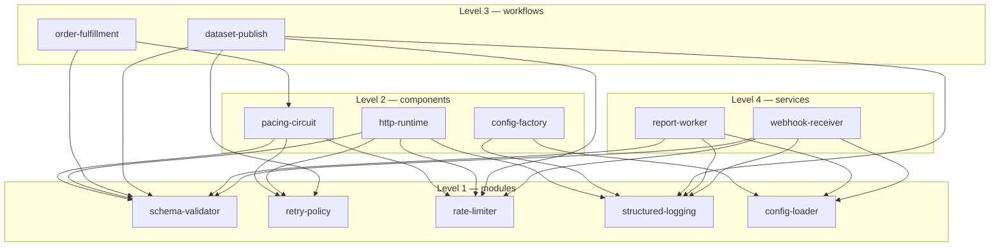

---
# MAM Metadata
id: orders-platform
name: Orders Platform (Reference System)
version: 1.0.0
type: system

author: TCP Ecosystems
description: >
  The complete reference system of this library: five Level 1 modules, three
  Level 2 components, two Level 3 workflows and two Level 4 services wired
  into one composition contract. The root file names every member, declares
  the graph edges between them, and refuses to run when a member is absent,
  invalid, or wired upward across the level ladder.

license: MIT

runtime:
  language: python
  version: ">=3.12"

tags:
  - reference-system
  - composition
  - orders
  - webhooks
  - datasets

dependencies:
  - name: schema-validator
    version: "1.0.0"
  - name: retry-policy
    version: "1.0.0"
  - name: rate-limiter
    version: "1.0.0"
  - name: structured-logging
    version: "1.0.0"
  - name: config-loader
    version: "1.0.0"
  - name: http-runtime
    version: "1.0.0"
  - name: config-factory
    version: "1.0.0"
  - name: pacing-circuit
    version: "1.0.0"
  - name: order-fulfillment
    version: "1.0.0"
  - name: dataset-publish
    version: "1.0.0"
  - name: report-worker
    version: "1.0.0"
  - name: webhook-receiver
    version: "1.0.0"
  - name: mam-runtime
    version: ">=1.0.0"

capabilities:
  - verify
  - describe
  - compose

permissions:
  filesystem: none
  network: none
---

# Orders Platform (Reference System)

## Purpose

This is the repository-as-system: a real composition of the library's four
levels, described the way you would describe a deployed repository to a new
engineer — except the description is executable. Orders arrive at a webhook
receiver, are paced per producer, flow into an order workflow whose gateway
traffic is governed by a shared pacing circuit, produce datasets that publish
through a rate-limited workflow, and surface in a worker whose health rolls
up dependencies and queue pressure. Nothing here invents behavior that the
member files do not carry; the root file's job is **composition and refusal**.

## Members

| Member | Level | Path | Responsibility in this system |
|--------|-------|------|-------------------------------|
| `schema-validator` | 1 | [`01-modules/schema-validator.mam.md`](../01-modules/schema-validator.mam.md) | Every event, job and config gate |
| `retry-policy` | 1 | [`01-modules/retry-policy.mam.md`](../01-modules/retry-policy.mam.md) | Attempt schedules and the failure taxonomy the breaker reads |
| `rate-limiter` | 1 | [`01-modules/rate-limiter.mam.md`](../01-modules/rate-limiter.mam.md) | Token buckets: producer pace and dataset egress |
| `structured-logging` | 1 | [`01-modules/structured-logging.mam.md`](../01-modules/structured-logging.mam.md) | Redaction and the one-line JSON channel |
| `config-loader` | 1 | [`01-modules/config-loader.mam.md`](../01-modules/config-loader.mam.md) | Layered service configuration |
| `http-runtime` | 2 | [`02-components/http-runtime.mam.md`](../02-components/http-runtime.mam.md) | Request-level boundary for host adapters (admission + attempts + telemetry) |
| `config-factory` | 2 | [`02-components/config-factory.mam.md`](../02-components/config-factory.mam.md) | Hot-reload with path-only change audit |
| `pacing-circuit` | 2 | [`02-components/pacing-circuit.mam.md`](../02-components/pacing-circuit.mam.md) | Shared gateway admission with breaker semantics |
| `order-fulfillment` | 3 | [`03-workflows/order-fulfillment.mam.md`](../03-workflows/order-fulfillment.mam.md) | reserve → charge → compensate ledger machine |
| `dataset-publish` | 3 | [`03-workflows/dataset-publish.mam.md`](../03-workflows/dataset-publish.mam.md) | validate → paced upload → settle |
| `report-worker` | 4 | [`04-services/report-worker.mam.md`](../04-services/report-worker.mam.md) | Resident report queue: boot, backpressure, health, drain |
| `webhook-receiver` | 4 | [`04-services/webhook-receiver.mam.md`](../04-services/webhook-receiver.mam.md) | Authenticated, per-producer-paced inbound edge |

The manifest above **is** the membership contract: the verifier's `MANIFEST`
constant must hold exactly these twelve ids, and a member that is not listed
is never composed, however valid it is on its own.

## Inputs

### `verify` — the composition verdict input

```text
present = { "<member_id>": {"valid": true|false} or true|false, ... }
          # one entry per id the build/CI gates observed on disk;
          # the system never reads the disk itself (no filesystem permission)
edges   = optional replacement for the declared graph (used by tests and
          by CI when a branch proposes new wiring)
```

## Outputs

| Name | Type | Description |
|------|------|-------------|
| valid | boolean | True only when every check below passes |
| code | string | `""`, `SYSTEM_INCOMPLETE`, `MEMBER_INVALID`, `EDGE_UNKNOWN`, `LEVEL_ORDER_VIOLATION`, `INVALID_INPUT` |
| missing | array | Manifest members absent from `present` |
| unknown | array | Ids in `present` that the manifest does not admit |
| invalid | array | Present members whose own level gate failed |
| bad_edges | array | Declared edges referencing ids outside the manifest |
| level_violations | array | Edges whose target is not on a strictly lower level |
| members | integer | Size of the manifest (12) |

## Rules

- **Composition order is the level ladder.** Every declared edge points from a
  higher level to a strictly lower one; the verifier treats an upward edge as
  a violation even when both endpoints are valid.
- **Refusal is explicit.** Missing members, unadmitted members, invalid members
  and unknown edges each produce their own list and code — the system never
  degrades into "compose what happens to be there".
- **State ownership is bounded by level.** Modules are stateless; components own
  handles; workflows own ledgers; services own lifecycle state. Nothing writes
  state into another level's domain without an explicit handle argument.
- **One pacing authority per external dependency.** The gateway dependency is
  governed by the single shared `pacing-circuit` handle owned by the caller of
  `order-fulfillment`. `http-runtime` is admitted for host adapters that need
  request-level plans (it is a boundary, not a second authority) and is
  deliberately not double-wired into the same dependency.
- **No silent dead members.** `describe().unconsumed` enumerates every member
  nobody composes: services are deployment roots, workflows are executed by
  hosts, and the two boundary utilities (`http-runtime`, `config-factory`) are
  admitted by the rule above. Anything else appearing on that list is a wiring
  bug to fix or a member to remove.
- **The root file imports nothing.** It is a verifier and a map; behavior lives in the members, so a broken member cannot hide behind root-file reconstruction.
- **Health ownership:** the services own their own probes; the system does not add a second source of truth for liveness.

## Workflow



Every arrow above is an entry in the verifier's `EDGES` constant — the
diagram and the graph cannot drift apart silently, and the verifier refuses
any edge that points upward.

## Python

```python
import time
from typing import Any, Dict, List, Tuple

MANIFEST: Dict[str, Dict[str, Any]] = {
    "schema-validator": {"level": 1, "path": "01-modules/schema-validator.mam.md"},
    "retry-policy":     {"level": 1, "path": "01-modules/retry-policy.mam.md"},
    "rate-limiter":     {"level": 1, "path": "01-modules/rate-limiter.mam.md"},
    "structured-logging": {"level": 1, "path": "01-modules/structured-logging.mam.md"},
    "config-loader":    {"level": 1, "path": "01-modules/config-loader.mam.md"},
    "http-runtime":     {"level": 2, "path": "02-components/http-runtime.mam.md"},
    "config-factory":   {"level": 2, "path": "02-components/config-factory.mam.md"},
    "pacing-circuit":   {"level": 2, "path": "02-components/pacing-circuit.mam.md"},
    "order-fulfillment": {"level": 3, "path": "03-workflows/order-fulfillment.mam.md"},
    "dataset-publish":  {"level": 3, "path": "03-workflows/dataset-publish.mam.md"},
    "report-worker":    {"level": 4, "path": "04-services/report-worker.mam.md"},
    "webhook-receiver": {"level": 4, "path": "04-services/webhook-receiver.mam.md"},
}

# (consumer, provider) — the consumer is always the higher level
EDGES: List[Tuple[str, str]] = [
    ("pacing-circuit", "rate-limiter"),
    ("pacing-circuit", "retry-policy"),
    ("pacing-circuit", "schema-validator"),
    ("http-runtime", "rate-limiter"),
    ("http-runtime", "retry-policy"),
    ("http-runtime", "structured-logging"),
    ("http-runtime", "schema-validator"),
    ("config-factory", "config-loader"),
    ("config-factory", "structured-logging"),
    ("order-fulfillment", "pacing-circuit"),
    ("order-fulfillment", "schema-validator"),
    ("dataset-publish", "schema-validator"),
    ("dataset-publish", "rate-limiter"),
    ("dataset-publish", "retry-policy"),
    ("dataset-publish", "structured-logging"),
    ("report-worker", "config-loader"),
    ("report-worker", "schema-validator"),
    ("report-worker", "structured-logging"),
    ("webhook-receiver", "config-loader"),
    ("webhook-receiver", "rate-limiter"),
    ("webhook-receiver", "structured-logging"),
    ("webhook-receiver", "schema-validator"),
]


def verify(present: Any, edges: Any = None) -> Dict[str, Any]:
    started = time.perf_counter()

    def envelope(valid: bool, code: str, **extra: Any) -> Dict[str, Any]:
        out = {"valid": valid, "code": code, "missing": [], "unknown": [],
               "invalid": [], "bad_edges": [], "level_violations": [],
               "members": len(MANIFEST),
               "duration_ms": round((time.perf_counter() - started) * 1000, 3)}
        out.update(extra)
        return out

    if not isinstance(present, dict):
        return envelope(False, "INVALID_INPUT")

    edge_list = EDGES if edges is None else edges
    if not isinstance(edge_list, (list, tuple)):
        return envelope(False, "INVALID_INPUT")

    missing = sorted(set(MANIFEST) - set(present))
    unknown = sorted(set(present) - set(MANIFEST))

    invalid = []
    for member_id, observed in present.items():
        if member_id not in MANIFEST:
            continue
        ok = observed.get("valid") if isinstance(observed, dict) else observed is True
        if ok is not True:
            invalid.append(member_id)
    invalid.sort()

    bad_edges = []
    level_violations = []
    for edge in edge_list:
        if not isinstance(edge, (list, tuple)) or len(edge) != 2:
            bad_edges.append(edge)
            continue
        consumer, provider = edge
        if consumer not in MANIFEST or provider not in MANIFEST:
            bad_edges.append(edge)
            continue
        if MANIFEST[provider]["level"] >= MANIFEST[consumer]["level"]:
            level_violations.append(edge)

    if missing or unknown:
        return envelope(False, "SYSTEM_INCOMPLETE", missing=missing, unknown=unknown,
                        invalid=invalid, bad_edges=bad_edges,
                        level_violations=level_violations)
    if invalid:
        return envelope(False, "MEMBER_INVALID", invalid=invalid)
    if bad_edges:
        return envelope(False, "EDGE_UNKNOWN", bad_edges=bad_edges)
    if level_violations:
        return envelope(False, "LEVEL_ORDER_VIOLATION",
                        level_violations=level_violations)
    return envelope(True, "")


def describe() -> Dict[str, Any]:
    levels: Dict[str, int] = {}
    for member_id, meta in MANIFEST.items():
        levels[str(meta["level"])] = levels.get(str(meta["level"]), 0) + 1
    providers = {provider for _, provider in EDGES}
    return {
        "id": "orders-platform",
        "members": len(MANIFEST),
        "by_level": dict(sorted(levels.items())),
        "edges": len(EDGES),
        # members nobody composes: deployable roots + host-executed entries
        # + the two boundary utilities admitted by the Rules section
        "unconsumed": sorted(set(MANIFEST) - providers),
    }
```

## Tests

### Input

```yaml
present: one {"valid": true} entry per member id in the manifest
edges: default EDGES
```

### Expected

```yaml
valid: true
code: ""
members: 12
```

```python
ALL_OK = {member: {"valid": True} for member in MANIFEST}


def test_complete_manifest_verifies():
    out = verify(ALL_OK)
    assert out["valid"] is True and out["code"] == ""
    assert out["members"] == 12


def test_a_missing_member_is_named_not_ignored():
    present = dict(ALL_OK)
    del present["pacing-circuit"]
    out = verify(present)
    assert out["valid"] is False and out["code"] == "SYSTEM_INCOMPLETE"
    assert out["missing"] == ["pacing-circuit"]


def test_an_unadmitted_member_is_refused():
    present = dict(ALL_OK)
    present["example-thing"] = {"valid": True}
    out = verify(present)
    assert out["code"] == "SYSTEM_INCOMPLETE" and out["unknown"] == ["example-thing"]


def test_a_member_that_fails_its_own_gate_blocks_the_system():
    present = dict(ALL_OK)
    present["webhook-receiver"] = {"valid": False}
    out = verify(present)
    assert out["valid"] is False and out["code"] == "MEMBER_INVALID"
    assert out["invalid"] == ["webhook-receiver"]


def test_boolean_shorthand_is_read_honestly():
    present = {member: True for member in MANIFEST}
    assert verify(present)["valid"] is True
    present["config-loader"] = False
    assert verify(present)["code"] == "MEMBER_INVALID"


def test_edges_to_unknown_members_are_refused():
    out = verify(ALL_OK, edges=[("report-worker", "ghost-service")])
    assert out["code"] == "EDGE_UNKNOWN"
    assert ("report-worker", "ghost-service") in out["bad_edges"]


def test_upward_edges_break_the_level_ladder():
    out = verify(ALL_OK, edges=[("schema-validator", "order-fulfillment")])
    assert out["code"] == "LEVEL_ORDER_VIOLATION"
    assert ("schema-validator", "order-fulfillment") in out["level_violations"]


def test_same_level_composition_is_also_refused():
    out = verify(ALL_OK, edges=[("report-worker", "webhook-receiver")])
    assert out["code"] == "LEVEL_ORDER_VIOLATION"


def test_default_graph_is_clean_and_every_edge_is_downward():
    for consumer, provider in EDGES:
        assert MANIFEST[provider]["level"] < MANIFEST[consumer]["level"], (consumer, provider)
    assert verify(ALL_OK)["level_violations"] == []


def test_manifest_is_internally_consistent():
    assert len(MANIFEST) == len(set(MANIFEST)) == 12
    for member_id, meta in MANIFEST.items():
        assert meta["level"] in (1, 2, 3, 4)
        assert meta["path"].startswith(f"0{meta['level']}-")
        assert meta["path"].endswith(f"{member_id}.mam.md")


def test_unconsumed_members_are_enumerable_and_justified():
    described = describe()
    assert described["members"] == 12 and described["edges"] == len(EDGES)
    assert set(described["by_level"]) == {"1", "2", "3", "4"}
    # deployment roots (services), host-executed workflows, boundary utilities
    assert described["unconsumed"] == [
        "config-factory", "dataset-publish", "http-runtime",
        "order-fulfillment", "report-worker", "webhook-receiver",
    ]


def test_malformed_inputs_are_coded():
    assert verify(None)["code"] == "INVALID_INPUT"
    assert verify(ALL_OK, edges="nope")["code"] == "INVALID_INPUT"
    assert verify(ALL_OK, edges=[("only-one",)])["code"] == "EDGE_UNKNOWN"
```

## Examples

```python
# CI: one verdict per member comes from `mam validate <member>`, then the
# system root answers the only question that matters: may this compose?
observations = {
    member: {"valid": gates[member].passed}
    for member in manifest_ids        # read from system.mam.md, not globbed
}
verdict = verify(observations)
if not verdict["valid"]:
    raise SystemExit(f"refusing to build {verdict['code']}: {verdict}")

# Tools consume the same graph:
#   mam graph system.mam.md        → must equal EDGES
#   mam build                      → member bundles + lockfiles
#   mam compile --target python    → runnable skeleton, members untouched
```

### Expected Flow

```text
manifest → per-member gates → graph check (downward only) → verdict or refusal
```

## Compile targets

| Target | Meaning in this system |
|--------|------------------------|
| `python` | The member Python blocks assembled into a runnable package: modules → components → workflows → services |
| `openai` | Agent-runtime scaffold where `report-worker` exposes the tools and `webhook-receiver` validates the ingress |
| `langgraph` | Graph wiring: `webhook-receiver` → `order-fulfillment` → `dataset-publish`, with `pacing-circuit` as the gateway gate |

## References

- Manifest contract: [Level 5 README](README.md) · machine manifest: [`mam.toml`](mam.toml)
- Members: [`01-modules`](../01-modules/README.md) · [`02-components`](../02-components/README.md) · [`03-workflows`](../03-workflows/README.md) · [`04-services`](../04-services/README.md)
- [MAM source format, full component set](https://github.com/tcp-ecosystems/MAM/blob/main/plan-doc/full-mam.md)
