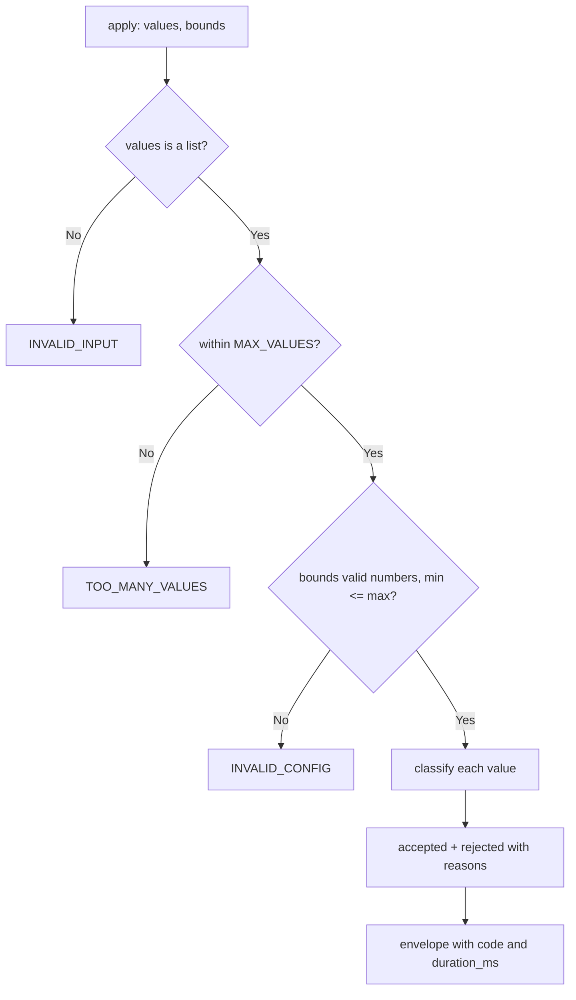

---
# MAM Metadata
id: module-template
name: Module Template
version: 1.0.0
type: module

author: Your Name
description: >
  A correct starting point for a Level 1 module: one pure decision function,
  a typed envelope with stable error codes, injectable clock-free logic, and
  executable tests. Copy both files, rename the id, replace `apply` with
  your decision — keep the envelope and the test bar.

license: MIT

runtime:
  language: python
  version: ">=3.12"

tags:
  - template
  - module
  - starter

dependencies:
  - name: mam-runtime
    version: ">=1.0.0"

capabilities:
  - apply

permissions:
  filesystem: none
  network: none
---

# Module Template

## Purpose

Level 1 is the bottom of the ladder: pure functions, no I/O, no state, no
dependencies. This template gives you the shell every module in this library
uses — a decision function that never raises, an envelope that always answers
the same shape, stable error codes callers can branch on, and tests that are
executed by the repository gate.

Replace the filtering logic below with your decision. Do not remove the
envelope fields: downstream components rely on `code` and `duration_ms`.

## Inputs

### `apply(values, minimum, maximum)` — arguments

| Name | Type | Required | Description |
|------|------|----------|-------------|
| values | array | Yes | Values to classify; numbers inside the bounds are accepted, everything else is rejected with a reason |
| minimum | number | No | Inclusive lower bound. Defaults to `0` |
| maximum | number | No | Inclusive upper bound. Defaults to `100` |

## Outputs

| Name | Type | Description |
|------|------|-------------|
| accepted | array | Values that satisfied the bounds, in input order |
| rejected | array | `{index, reason}` entries for every value that did not |
| accepted_count | integer | Length of `accepted` |
| rejected_count | integer | Length of `rejected` |
| code | string | `""`, `INVALID_INPUT`, `INVALID_CONFIG`, or `TOO_MANY_VALUES` |
| duration_ms | number | Wall-clock cost of this call |

## Capabilities

### apply

Classify one bounded batch; the only exported decision of this module.

## Rules

- Never raise: every malformed input is a coded envelope.
- Booleans are not numbers here (`True` is not a value of `1`) — type checks handle that explicitly.
- Bounds are validated before any value is classified; `minimum > maximum` is a configuration error, not an empty result.
- Batch size is bounded (`MAX_VALUES`) so a hostile caller cannot allocate an unbounded rejection list.
- The module imports nothing outside the standard library.

## Workflow



## Python

```python
import time
from typing import Any, Dict, List

MAX_VALUES = 1000


def _is_number(value: Any) -> bool:
    return isinstance(value, (int, float)) and not isinstance(value, bool)


def apply(values: Any, minimum: Any = 0, maximum: Any = 100) -> Dict[str, Any]:
    started = time.perf_counter()

    def envelope(code: str, accepted: List[Any] | None = None,
                 rejected: List[Dict[str, Any]] | None = None) -> Dict[str, Any]:
        accepted = accepted or []
        rejected = rejected or []
        return {
            "accepted": accepted,
            "rejected": rejected,
            "accepted_count": len(accepted),
            "rejected_count": len(rejected),
            "code": code,
            "duration_ms": round((time.perf_counter() - started) * 1000, 3),
        }

    if not isinstance(values, list):
        return envelope("INVALID_INPUT")
    if len(values) > MAX_VALUES:
        return envelope("TOO_MANY_VALUES")
    if not _is_number(minimum) or not _is_number(maximum) or minimum > maximum:
        return envelope("INVALID_CONFIG")

    accepted = []
    rejected = []
    for index, value in enumerate(values):
        if _is_number(value) and minimum <= value <= maximum:
            accepted.append(value)
        else:
            rejected.append({
                "index": index,
                "reason": "OUT_OF_BOUNDS" if _is_number(value) else "NOT_A_NUMBER",
            })
    return envelope("", accepted, rejected)
```

## Tests

### Input

```yaml
values: [10, 50, 99, 120, "7", true]
minimum: 0
maximum: 100
```

### Expected

```yaml
accepted: [10, 50, 99]
rejected_count: 3
code: ""
```

```python
def test_accepts_values_within_the_bounds():
    out = apply([10, 50, 99], 0, 100)
    assert out["accepted"] == [10, 50, 99] and out["code"] == ""
    assert out["rejected"] == []


def test_rejects_out_of_bounds_and_non_numbers_with_reasons():
    out = apply([10, 120, "7", True], 0, 100)
    assert out["accepted"] == [10]
    assert out["rejected"] == [
        {"index": 1, "reason": "OUT_OF_BOUNDS"},
        {"index": 2, "reason": "NOT_A_NUMBER"},
        {"index": 3, "reason": "NOT_A_NUMBER"},
    ]


def test_bounds_are_inclusive():
    assert apply([0, 100], 0, 100)["accepted"] == [0, 100]


def test_inverted_bounds_are_a_configuration_error():
    out = apply([5], 10, 1)
    assert out["code"] == "INVALID_CONFIG" and out["accepted"] == []


def test_non_list_input_is_coded():
    assert apply("10,20")["code"] == "INVALID_INPUT"
    assert apply(None)["code"] == "INVALID_INPUT"


def test_batch_size_is_bounded():
    assert apply(list(range(MAX_VALUES + 1)))["code"] == "TOO_MANY_VALUES"


def test_results_are_ordered_and_counts_match():
    out = apply([3, 1, 2], 0, 10)
    assert out["accepted"] == [3, 1, 2]
    assert out["accepted_count"] == 3 and out["rejected_count"] == 0
```

## Examples

```python
verdict = apply(event["scores"], minimum=0, maximum=100)
if verdict["code"] == "INVALID_CONFIG":
    raise SystemExit("fix the caller's bounds, not the data")
for dropped in verdict["rejected"]:
    metrics.increment(f"score.rejected.{dropped['reason']}")
accepted = verdict["accepted"]
```

### Expected Flow

```text
bounds check -> batch bound -> classify -> envelope (never raise)
```

## References

- Level contract: [Level 1 — Modules](../../01-modules/README.md)
- Copy of the template: [`templates/module/README.md`](README.md)
- [MAM source format, full component set](https://github.com/tcp-ecosystems/MAM/blob/main/plan-doc/full-mam.md)
