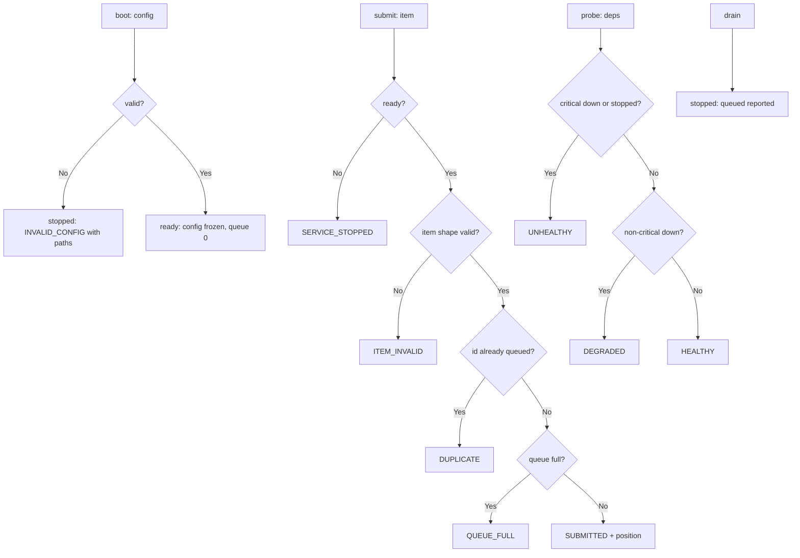

---
# MAM Metadata
id: service-template
name: Service Template
version: 1.0.0
type: service

author: Your Name
description: >
  A correct starting point for a Level 4 service: an explicit lifecycle
  (boot → ready → drain → stopped), configuration validated once at boot,
  a health rollup with critical-dependency logic, and a bounded intake
  queue. Decisions only — the host runtime owns sockets, timers and workers.

license: MIT

runtime:
  language: python
  version: ">=3.12"

tags:
  - template
  - service
  - starter
  - lifecycle

dependencies:
  - name: mam-runtime
    version: ">=1.0.0"

capabilities:
  - boot
  - submit
  - probe
  - drain

permissions:
  filesystem: none
  network: none
---

# Service Template

## Purpose

A service exists continuously, so it must answer four questions a workflow
never faces: how it starts, whether it is healthy right now, whether it may
accept work, and how it stops. This template is the lifecycle skeleton with
a bounded intake queue and a criticality-aware probe. Replace the admission
rules; keep the lifecycle and the refusal codes.

## Memory

```text
state = {
  "status":     "ready" | "stopped",
  "config":     { queue_cap, critical: [dependency ids] },
  "queue":      [ accepted items in arrival order ],
  "started_at": ms of the boot that produced this state
}
```

- **Persistence:** caller-owned; the service is stateless between calls.
- **Corrupt state:** coded `INVALID_STATE`, never an exception.

## Exports

| Export | Inputs | Returns | Contract |
|--------|--------|---------|----------|
| `boot(config, now_ms?)` | `{queue_cap, critical}` | `{valid, status, state, code, errors, duration_ms}` | Validated once; invalid config never produces a `ready` state |
| `submit(state, item, now_ms?)` | one work item `{kind, id}` | `{code, position, duration_ms}` | Schema, duplicate and capacity checks, in that order |
| `probe(state, dependencies)` | `{id: {state: healthy / down}}` | `{status, code, detail, duration_ms}` | `healthy` / `degraded` (non-critical down) / `unhealthy` (critical down or stopped) |
| `drain(state, now_ms?)` | — | `{status, code, queued, duration_ms}` | Closed for new work; parked count reported; irreversible |

## Inputs

### `boot` — configuration

```text
{ "queue_cap": integer 1..10_000,
  "critical":  array of dependency ids 1..16 }   # each matches [a-z][a-z0-9-]{1,31}
```

### `submit` — work item

```text
{ "kind": string pattern [a-z][a-z0-9_-]{1,31},
  "id":   string pattern [a-z0-9_-]{4,40} }
```

### `probe` — dependency snapshot

```text
{ "<dep_id>": { "state": "healthy" | "down" }, ... }
```

## Outputs

| Name | Type | Description |
|------|------|-------------|
| status | string | Lifecycle (`ready`, `stopped`) or health (`healthy`, `degraded`, `unhealthy`) |
| code | string | `""`, `INVALID_CONFIG`, `SUBMITTED`, `DUPLICATE`, `QUEUE_FULL`, `ITEM_INVALID`, `SERVICE_STOPPED`, `HEALTHY`, `DEGRADED`, `UNHEALTHY`, `DRAINED`, `INVALID_STATE` |
| position | integer | 1-based queue position after admission |
| queued | integer | Parked items after a drain |
| state | object | The ready state a successful boot produced |

## Capabilities

### boot

Validate configuration once and produce the state the host persists.

### submit

Admit work between `ready` and `drain`, under a hard capacity bound.

### probe

Roll dependency health and criticality into one status word.

### drain

Stop admitting; report exactly what is parked.

## Rules

- Lifecycle transitions are one-way: `boot` only from stopped (a new state), `drain` only from ready; a drained state never re-opens.
- Intake is bounded by `queue_cap`; the refused item is not queued.
- Duplicate ids are refused while queued (`DUPLICATE`) — a second delivery of the same item is a caller bug.
- The probe treats declared `critical` dependencies strictly: any of them down makes the service `unhealthy`, regardless of other dependencies.
- A stopped service probes `unhealthy` — liveness is not a lie kept for graphs.
- Every refusal is a coded envelope; the module raises nothing across its boundary.
- No timestamps invented: `now_ms` is a caller argument.

## Workflow



## Python

```python
import re
import time
from typing import Any, Dict, List

ITEM_KIND = re.compile(r"^[a-z][a-z0-9_-]{1,31}$")
ITEM_ID = re.compile(r"^[a-z0-9_-]{4,40}$")
DEP_ID = re.compile(r"^[a-z][a-z0-9-]{1,31}$")


def _usable(state: Any) -> bool:
    return isinstance(state, dict) and state.get("status") in ("ready", "stopped") \
        and isinstance(state.get("config"), dict) and isinstance(state.get("queue"), list)


def boot(config: Any, now_ms: Any = 0) -> Dict[str, Any]:
    started = time.perf_counter()

    def envelope(valid: bool, status: str, code: str, **extra: Any) -> Dict[str, Any]:
        out = {"valid": valid, "status": status, "state": None, "code": code,
               "errors": [], "duration_ms": round((time.perf_counter() - started) * 1000, 3)}
        out.update(extra)
        return out

    if not isinstance(config, dict):
        return envelope(False, "stopped", "INVALID_CONFIG",
                        errors=[{"path": "config", "code": "TYPE_MISMATCH"}])

    errors: List[Dict[str, Any]] = []
    queue_cap = config.get("queue_cap")
    if isinstance(queue_cap, bool) or not isinstance(queue_cap, int) \
            or not 1 <= queue_cap <= 10_000:
        errors.append({"path": "queue_cap", "code": "OUT_OF_RANGE"})
    critical = config.get("critical")
    if not isinstance(critical, list) or not 1 <= len(critical) <= 16 \
            or any(not isinstance(dep, str) or not DEP_ID.match(dep) for dep in critical):
        errors.append({"path": "critical", "code": "INVALID_ITEMS"})
    if errors:
        return envelope(False, "stopped", "INVALID_CONFIG", errors=errors)

    state = {"status": "ready", "config": {"queue_cap": queue_cap,
                                           "critical": list(critical)},
             "queue": [], "started_at": now_ms}
    return envelope(True, "ready", "", state=state, config=state["config"])


def submit(state: Any, item: Any, now_ms: Any = 0) -> Dict[str, Any]:
    started = time.perf_counter()

    def envelope(code: str, **extra: Any) -> Dict[str, Any]:
        out = {"code": code, "position": None,
               "duration_ms": round((time.perf_counter() - started) * 1000, 3)}
        out.update(extra)
        return out

    if not _usable(state):
        return envelope("INVALID_STATE")
    if state["status"] != "ready":
        return envelope("SERVICE_STOPPED")
    if not isinstance(item, dict) or not isinstance(item.get("kind"), str) \
            or not isinstance(item.get("id"), str) \
            or not ITEM_KIND.match(item["kind"]) or not ITEM_ID.match(item["id"]):
        return envelope("ITEM_INVALID")

    if any(queued.get("id") == item["id"] for queued in state["queue"]):
        return envelope("DUPLICATE")
    if len(state["queue"]) + 1 > state["config"]["queue_cap"]:
        return envelope("QUEUE_FULL")

    state["queue"].append({"kind": item["kind"], "id": item["id"],
                           "received_at": now_ms})
    return envelope("SUBMITTED", position=len(state["queue"]))


def probe(state: Any, dependencies: Any) -> Dict[str, Any]:
    started = time.perf_counter()

    def envelope(status: str, code: str, detail: str = "") -> Dict[str, Any]:
        return {"status": status, "code": code, "detail": detail,
                "duration_ms": round((time.perf_counter() - started) * 1000, 3)}

    if not _usable(state) or not isinstance(dependencies, dict):
        return envelope("unhealthy", "INVALID_STATE", "state or snapshot unusable")
    if state["status"] != "ready":
        return envelope("unhealthy", "UNHEALTHY", "service is not ready")

    down = []
    for dep_id, dep in dependencies.items():
        if not isinstance(dep, dict) or dep.get("state") not in ("healthy", "down"):
            return envelope("unhealthy", "INVALID_STATE", f"dependency {dep_id} malformed")
        if dep["state"] == "down":
            down.append(dep_id)

    critical_down = sorted(dep for dep in down if dep in state["config"]["critical"])
    if critical_down:
        return envelope("unhealthy", "UNHEALTHY",
                        f"critical dependencies down: {critical_down}")
    if down:
        return envelope("degraded", "DEGRADED", f"non-critical down: {sorted(down)}")
    return envelope("healthy", "HEALTHY", f"queue at {len(state['queue'])}/"
                                          f"{state['config']['queue_cap']}")


def drain(state: Any, now_ms: Any = 0) -> Dict[str, Any]:
    started = time.perf_counter()

    def envelope(code: str, **extra: Any) -> Dict[str, Any]:
        out = {"code": code, "queued": None,
               "duration_ms": round((time.perf_counter() - started) * 1000, 3)}
        out.update(extra)
        return out

    if not _usable(state):
        return envelope("INVALID_STATE")
    if state["status"] != "ready":
        return envelope("SERVICE_STOPPED")

    queued = len(state["queue"])
    state["status"] = "stopped"
    out = envelope("DRAINED", queued=queued)
    out["status"] = "stopped"
    return out
```

## Tests

### Input

```yaml
config: { queue_cap: 2, critical: [registry] }
item: { kind: report, id: rep_882311 }
```

### Expected

```yaml
status: ready
probe: healthy
```

```python
CONFIG = {"queue_cap": 2, "critical": ["registry"]}
ITEM = {"kind": "report", "id": "rep_882311"}


def ready():
    out = boot(CONFIG, now_ms=3)
    assert out["valid"] is True, out
    return out["state"]


def test_boot_validates_and_produces_ready_state():
    out = boot(CONFIG, now_ms=3)
    assert out["status"] == "ready" and out["code"] == ""
    assert out["state"]["started_at"] == 3 and out["state"]["queue"] == []


def test_boot_rejects_bad_config_with_paths():
    out = boot({"queue_cap": 0, "critical": ["UPPER"]})
    assert out["valid"] is False and out["code"] == "INVALID_CONFIG"
    assert [e["path"] for e in out["errors"]] == ["queue_cap", "critical"]


def test_submit_admits_and_reports_position():
    state = ready()
    out = submit(state, ITEM, now_ms=4)
    assert out["code"] == "SUBMITTED" and out["position"] == 1
    assert state["queue"][0]["received_at"] == 4


def test_invalid_items_are_refused_before_capacity():
    state = ready()
    assert submit(state, {"kind": "Report", "id": "x"})["code"] == "ITEM_INVALID"
    assert submit(state, {"kind": "report"})["code"] == "ITEM_INVALID"
    assert state["queue"] == []


def test_duplicates_are_refused_while_queued():
    state = ready()
    submit(state, ITEM)
    assert submit(state, dict(ITEM))["code"] == "DUPLICATE"
    assert len(state["queue"]) == 1


def test_queue_cap_is_a_hard_bound():
    state = ready()                      # cap 2
    submit(state, ITEM)
    submit(state, {"kind": "report", "id": "rep_000001"})
    assert submit(state, {"kind": "report", "id": "rep_000002"})["code"] == "QUEUE_FULL"
    assert len(state["queue"]) == 2


def test_probe_rolls_health_with_criticality():
    state = ready()
    assert probe(state, {"registry": {"state": "healthy"}})["code"] == "HEALTHY"
    assert probe(state, {"cache": {"state": "down"}})["code"] == "DEGRADED"
    assert probe(state, {"registry": {"state": "down"}})["code"] == "UNHEALTHY"
    assert probe(state, {"registry": {"state": "vibes"}})["code"] == "INVALID_STATE"


def test_drain_is_one_way_and_reports_parked_work():
    state = ready()
    submit(state, ITEM)
    done = drain(state, now_ms=9)
    assert done["status"] == "stopped" and done["queued"] == 1
    assert submit(state, {"kind": "report", "id": "rep_000009"})["code"] == "SERVICE_STOPPED"
    assert drain(state)["code"] == "SERVICE_STOPPED"
    assert probe(state, {})["code"] == "UNHEALTHY"


def test_corrupt_state_and_inputs_are_coded():
    assert submit({"status": "ready"}, ITEM)["code"] == "INVALID_STATE"
    assert probe("no", {})["code"] == "INVALID_STATE"
    assert drain(None)["code"] == "INVALID_STATE"
    assert boot("not-a-mapping")["code"] == "INVALID_CONFIG"
```

## Examples

```python
state = boot(config, now_ms=clock())["state"]
host.register_handler(lambda item: submit(state, item, now_ms=clock()))

health = probe(state, host.dependency_snapshot())
if health["code"] != "HEALTHY":
    alerts.raise_alert(health["detail"])

# graceful shutdown: stop intake, then let the host finish state["queue"]
drain(state, now_ms=clock())
```

### Expected Flow

```text
config gate -> ready -> bounded admission -> health rollup -> drain and report
```

## References

- Level contract: [Level 4 — Services](../../04-services/README.md)
- Copy instructions: [`templates/service/README.md`](README.md)
- [MAM source format, full component set](https://github.com/tcp-ecosystems/MAM/blob/main/plan-doc/full-mam.md)
