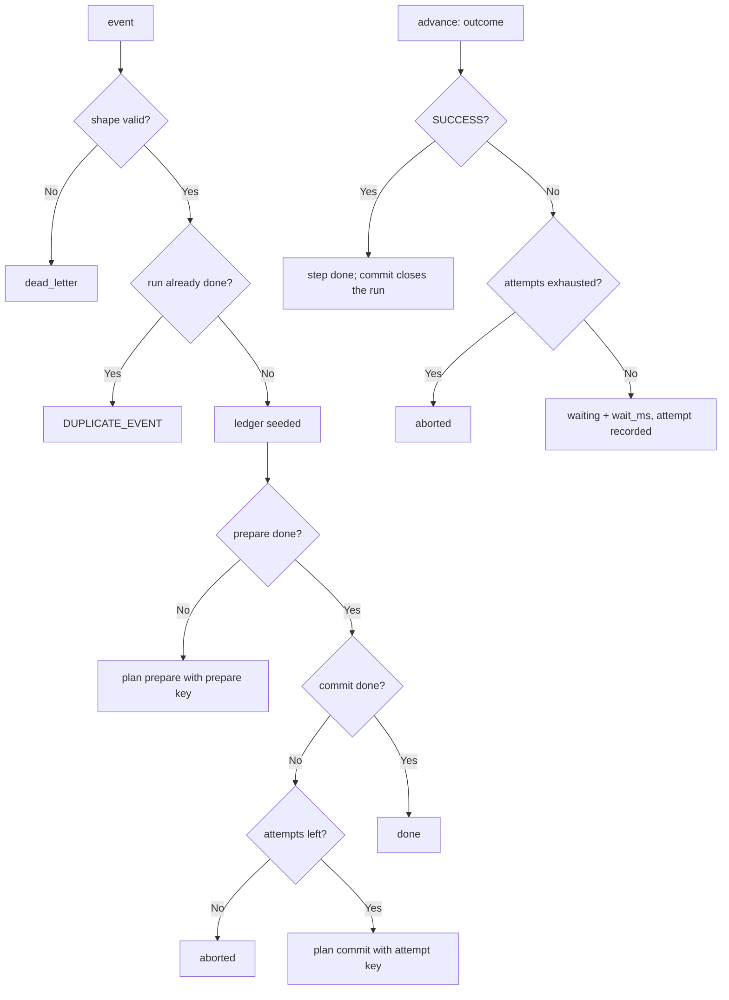

---
# MAM Metadata
id: workflow-template
name: Workflow Template
version: 1.0.0
type: workflow

author: Your Name
description: >
  A correct starting point for a Level 3 workflow: two steps, a caller-held
  run ledger, idempotency by echoed attempt number, and all four failure
  answers declared explicitly (retry, compensate, replay, stop). No I/O —
  the workflow plans, the executor performs, the ledger resumes.

license: MIT

runtime:
  language: python
  version: ">=3.12"

tags:
  - template
  - workflow
  - starter
  - ledger

dependencies:
  - name: mam-runtime
    version: ">=1.0.0"

capabilities:
  - plan
  - advance

permissions:
  filesystem: none
  network: none
---

# Workflow Template

## Purpose

A workflow is a finite process with a resumable ledger. This template gives
you the machine every workflow in this library uses: `run` answers "what is
the next step", `advance` absorbs the outcome of a step and moves the ledger,
replays are settled by attempt number, and the four failure answers are
stated rather than improvised. Replace `prepare` and `commit` with your real
steps; keep the ledger discipline.

## Step table

| Step | Effect | Transient? | Retry decision | If budget is spent | Compensation |
|------|--------|------------|----------------|--------------------|--------------|
| `prepare` | opens an executor-owned resource | yes — the executor reports category | retry with `BACKOFF_MS × attempt` | `aborted` | nothing was side-effected by the workflow |
| `commit` | makes the prepared work visible | yes — same rule | same budget | `aborted`, prepared work released by the executor | executor releases the prepared handle |

### Failure answers (the contract this template demonstrates)

```text
Retry:     transient outcome → waiting + wait_ms; the attempt counter lives
           in the ledger and the executor dedupes on the step key.
Replay:    advance() takes the attempt number echoed from the step key;
           a stale echo is ALREADY_SETTLED, never a second effect.
Compensate: a failed commit after a prepared resource exists must release it
           (executor-owned); the ledger records the compensation demand.
Stop:      attempt budget = 3; after that the run is ABORTED and surfaced,
           not silently retried forever.
```

### Idempotency keys

```text
prepare:<event_id>          → prepare
commit:<event_id>/<attempt> → commit
```

## Inputs

### The event

```text
{ "id": string 1..64,             # idempotency domain of the run
  "payload": object }             # passed through to the executor
```

### Workflow state (caller-held)

```text
state = {
  "ledger": { <event_id>: {
      "event": {..}, "steps": {prepare|commit: done|failed},
      "attempts": int, "status": in_progress|done|aborted
  } },
  "prepared": { <event_id>: handle }   # executor-owned resources, by id
}
```

## Outputs

| Name | Type | Description |
|------|------|-------------|
| status | string | `next_step`, `waiting`, `in_progress`, `done`, `aborted`, `dead_letter`, `invalid_state` |
| step | string | Next step when `next_step` |
| step_id | string | Executor idempotency key for that step |
| wait_ms | number | Backoff before re-planning after a transient outcome |
| ledger | object | Per-run snapshot, resumable |

### Codes

`NEXT_STEP`, `STEP_DONE`, `STEP_RETRYABLE`, `ALREADY_SETTLED`, `DONE`,
`DUPLICATE_EVENT`, `DEAD_LETTER`, `ABORTED_ATTEMPTS`, `INVALID_STATE`,
`DEPENDENCY_UNRESOLVED`.

## Capabilities

### plan

Decide the next step purely from the ledger.

### advance

Absorb a step outcome: success advances, transient waits, exhaustion stops.

## Rules

- The workflow never performs effects; it plans and records.
- One step per plan call: the ledger decides, nothing is guessed.
- `advance` marks a step done before returning; replays find it done (`ALREADY_SETTLED`) or meet the stale-attempt guard.
- Attempts are 1-based and monotonic per run; the executor echoes the number embedded in the step key.
- Invalid events are dead-lettered without side effects and without compensation.
- The budget is finite (`MAX_ATTEMPTS`); "retry forever" is not a policy.
- No clock reads inside the module: `now_ms` is always a caller argument.
- The module imports nothing outside the standard library.

## Workflow



## Python

```python
import time
from typing import Any, Dict

MAX_ATTEMPTS = 3
BACKOFF_MS = 500
STEP_ORDER = ("prepare", "commit")


def _run_id(event: Any) -> str:
    if isinstance(event, dict) and isinstance(event.get("id"), str) and 1 <= len(event["id"]) <= 64:
        return event["id"]
    return ""


def _usable(state: Any) -> bool:
    return isinstance(state, dict) and isinstance(state.get("ledger"), dict)


def _usable_entry(entry: Any) -> bool:
    return isinstance(entry, dict) and isinstance(entry.get("steps"), dict) \
        and isinstance(entry.get("attempts"), int)


def run(state: Any, event: Any, now_ms: Any) -> Dict[str, Any]:
    started = time.perf_counter()

    def envelope(status: str, code: str, **extra: Any) -> Dict[str, Any]:
        out = {"status": status, "code": code, "step": None, "step_id": None,
               "wait_ms": 0, "ledger": None,
               "duration_ms": round((time.perf_counter() - started) * 1000, 3)}
        out.update(extra)
        return out

    if not _usable(state):
        return envelope("invalid_state", "INVALID_STATE")

    event_id = _run_id(event)
    if not event_id:
        return envelope("dead_letter", "DEAD_LETTER")

    ledger = state["ledger"]
    entry = ledger.get(event_id)
    if entry is not None and entry.get("status") == "done":
        return envelope("done", "DUPLICATE_EVENT")
    if entry is None:
        entry = {"event": event, "steps": {}, "attempts": 0, "status": "in_progress"}
        ledger[event_id] = entry
    if not _usable_entry(entry):
        return envelope("invalid_state", "INVALID_STATE")

    if entry["steps"].get("prepare") != "done":
        return envelope("next_step", "NEXT_STEP", step="prepare",
                        step_id=f"prepare:{event_id}", ledger=entry)

    if entry["steps"].get("commit") != "done":
        if entry["attempts"] >= MAX_ATTEMPTS:
            entry["status"] = "aborted"
            return envelope("aborted", "ABORTED_ATTEMPTS", ledger=entry)
        return envelope("next_step", "NEXT_STEP", step="commit",
                        step_id=f"commit:{event_id}/{entry['attempts'] + 1}",
                        ledger=entry)

    entry["status"] = "done"
    return envelope("done", "DONE", ledger=entry)


def advance(state: Any, event_id: Any, step: Any, outcome: Any, now_ms: Any,
            attempt_no: Any = None) -> Dict[str, Any]:
    started = time.perf_counter()

    def envelope(status: str, code: str, **extra: Any) -> Dict[str, Any]:
        out = {"status": status, "code": code, "step": step, "wait_ms": 0,
               "ledger": None, "duration_ms": round((time.perf_counter() - started) * 1000, 3)}
        out.update(extra)
        return out

    if not _usable(state):
        return envelope("invalid_state", "INVALID_STATE")
    entry = state["ledger"].get(event_id)
    if not _usable_entry(entry) or step not in STEP_ORDER or not isinstance(outcome, str):
        return envelope("invalid_state", "INVALID_STATE")
    if entry["steps"].get(step) == "done":
        return envelope(entry["status"], "ALREADY_SETTLED")

    expected = entry["attempts"] + 1
    if attempt_no is not None and attempt_no != expected:
        return envelope(entry["status"], "ALREADY_SETTLED")

    if outcome == "SUCCESS":
        entry["steps"][step] = "done"
        if step == "commit":
            entry["status"] = "done"
        return envelope(entry["status"], "STEP_DONE", ledger=entry)

    entry["attempts"] = expected
    entry["steps"][step] = "failed"
    if entry["attempts"] >= MAX_ATTEMPTS:
        entry["status"] = "aborted"
        return envelope("aborted", "ABORTED_ATTEMPTS", ledger=entry)
    entry["status"] = "in_progress"
    return envelope("waiting", "STEP_RETRYABLE",
                    wait_ms=BACKOFF_MS * entry["attempts"], ledger=entry)
```

## Tests

### Input

```yaml
event: { id: run_0001, payload: { customer: c_77 } }
```

### Expected

```yaml
status: next_step
step: prepare
step_id: prepare:run_0001
```

```python
EVENT = {"id": "run_0001", "payload": {"customer": "c_77"}}


def fresh():
    return {"ledger": {}, "prepared": {}}


def test_first_plan_is_prepare_with_a_stable_key():
    out = run(fresh(), EVENT, 0)
    assert out["status"] == "next_step" and out["step"] == "prepare"
    assert out["step_id"] == "prepare:run_0001"


def test_invalid_events_are_dead_lettered():
    out = run(fresh(), {"id": ""}, 0)
    assert out["status"] == "dead_letter" and out["ledger"] is None


def test_happy_path_reaches_done():
    state = fresh()
    run(state, EVENT, 0)
    advance(state, "run_0001", "prepare", "SUCCESS", 1)
    planned = run(state, EVENT, 2)
    assert planned["step"] == "commit" and planned["step_id"] == "commit:run_0001/1"
    advance(state, "run_0001", "commit", "SUCCESS", 3, attempt_no=1)
    assert run(state, EVENT, 4)["status"] == "done"


def test_replay_of_a_done_run_is_duplicate():
    state = fresh()
    run(state, EVENT, 0)
    advance(state, "run_0001", "prepare", "SUCCESS", 1)
    run(state, EVENT, 2)
    advance(state, "run_0001", "commit", "SUCCESS", 3, attempt_no=1)
    assert run(state, EVENT, 4)["code"] == "DUPLICATE_EVENT"


def test_transient_outcome_waits_with_linear_backoff():
    state = fresh()
    run(state, EVENT, 0)
    advance(state, "run_0001", "prepare", "SUCCESS", 1)
    run(state, EVENT, 2)
    out = advance(state, "run_0001", "commit", "TIMEOUT", 3, attempt_no=1)
    assert out["status"] == "waiting" and out["wait_ms"] == 500
    again = advance(state, "run_0001", "commit", "TIMEOUT", 4, attempt_no=2)
    assert again["wait_ms"] == 1000


def test_attempt_budget_stops_the_run():
    state = fresh()
    run(state, EVENT, 0)
    advance(state, "run_0001", "prepare", "SUCCESS", 1)
    for attempt in (1, 2, 3):
        run(state, EVENT, attempt * 10)
        out = advance(state, "run_0001", "commit", "TIMEOUT", attempt * 10,
                      attempt_no=attempt)
    assert out["status"] == "aborted" and out["code"] == "ABORTED_ATTEMPTS"


def test_stale_attempt_echo_is_settled_not_reprocessed():
    state = fresh()
    run(state, EVENT, 0)
    advance(state, "run_0001", "prepare", "SUCCESS", 1)
    run(state, EVENT, 2)
    advance(state, "run_0001", "commit", "TIMEOUT", 3, attempt_no=1)
    replay = advance(state, "run_0001", "commit", "TIMEOUT", 4, attempt_no=1)
    assert replay["code"] == "ALREADY_SETTLED"


def test_corrupt_state_and_unknown_steps_are_coded():
    assert run({}, EVENT, 0)["code"] == "INVALID_STATE"
    state = fresh()
    run(state, EVENT, 0)
    assert advance(state, "run_0001", "publish", "SUCCESS", 1)["code"] == "INVALID_STATE"
    assert advance(state, "ghost", "commit", "SUCCESS", 1)["code"] == "INVALID_STATE"
```

## Examples

```python
state = {"ledger": {}, "prepared": {}}

plan = workflow.run(state, event, now_ms=clock())
while plan["status"] in ("next_step", "waiting"):
    if plan["status"] == "waiting":
        sleep(plan["wait_ms"])
        plan = workflow.run(state, event, now_ms=clock())
        continue
    receipt = executors[plan["step"]](event, idempotency_key=plan["step_id"])
    plan = workflow.advance(state, event["id"], plan["step"], receipt.category,
                            clock(), attempt_no=receipt.attempt)
```

### Expected Flow

```text
event gate -> ledger plan -> executor with key -> outcome -> advance -> done/aborted
```

## References

- Level contract: [Level 3 — Workflows](../../03-workflows/README.md)
- Copy instructions: [`templates/workflow/README.md`](README.md)
- [MAM source format, full component set](https://github.com/tcp-ecosystems/MAM/blob/main/plan-doc/full-mam.md)
